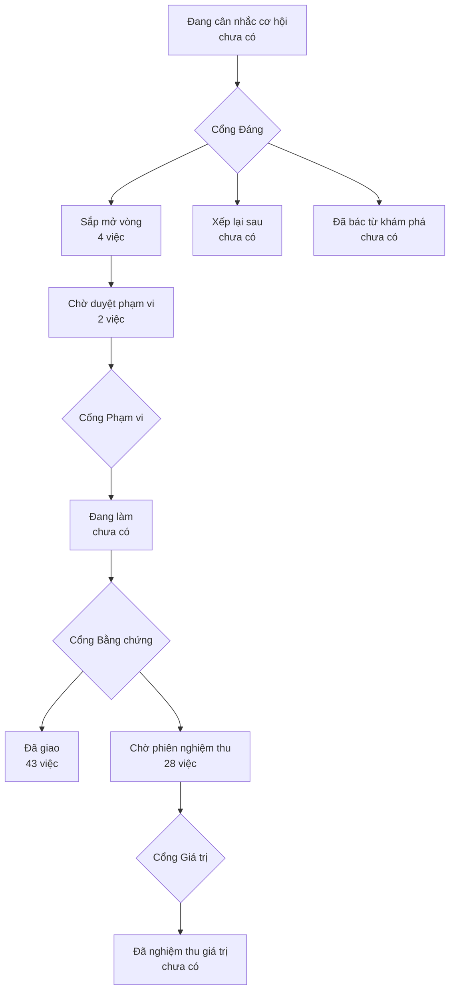

# Bản đồ sản phẩm

> Bản đồ vẽ lại từ hồ sơ của xưởng mỗi lần một người ký một cổng — đừng sửa tay.
> (đọc từ thư mục `_acceptance/` và `.out-of-scope/`)
> Lộ trình: [LO-TRINH.html](LO-TRINH.html)

> **Bốn cổng người** — mỗi cổng là một câu hỏi chỉ người trả lời được:
> **Cổng Đáng** việc này có đáng làm không · **Cổng Phạm vi** bộ tiêu chí
> đã đủ và đúng chưa · **Cổng Bằng chứng** đã làm đúng thứ đã hứa chưa ·
> **Cổng Giá trị** thứ đã giao có ăn thua không.

## Sắp mở vòng

- Khách đăng nhập hoặc đăng ký qua auth-4/auth-5 không còn chuyển động bị cấm, gradient tự chọn hay chữ kích thước tuỳ ý, và lỗi nhóm (auth) hiện error.tsx (`auth-hop-chuan`)
- Nhà đầu tư mở /listing/[id] thấy đầu trang product-detail-5, ảnh tự thu khi có (không có thì ẩn gallery), lịch form-5 không còn điều khiển thô, vùng dữ liệu có Skeleton và Empty (`listing-detail-product-detail-5`)
- Nhà đầu tư duyệt listing lọc bằng filters (màn hẹp filter-sidebar-5) và bản đồ @mapcn/store-locator gom cụm, vẫn lọc theo khung nhìn khi kéo hoặc zoom (`listings-filters-store-locator`)
- Người duyệt mở /ops/review và thấy hàng chờ dạng bảng theo solution-agents-5, lọc theo loại thẻ, bấm một hàng mở sheet chi tiết có dải ảnh tin xem được cả ở màn 390px (`ops-review-khung-hang-cho`)

## Chờ duyệt phạm vi

- Tài liệu và đánh dấu của kho khớp các chốt 23–24/10 (tên nhóm S03 tầng C, luật S08, luật phép đo Zalo, ROADMAP V9) (`chep-chot-2410`)
- CI chạy typecheck và test của app, pipeline, agent, data-api trên mọi PR (`ci-test-module`)

## Đã giao — chờ phiên nghiệm thu

- audit-all không còn PASS giả ở backup và membership S03, và kiểm các trang /ops ở đúng cổng :3456 (`audit-all-noi-that`)
- Bước chụp trang của kho gặp lỗi ở bất kỳ bước nào cũng không in hay đặt tên nguồn thật ra ngoài tiến trình, và không ghi ảnh khi chưa che xong tầng A (`buoc-chup-khong-in-ten-that`)
- Bảng canonical không còn tin sinh từ dữ liệu thử, và transform từ chối post thử nếu lọt vào (`canonical-khong-tin-gia`)
- Job cloud-sync thoát khác 0 khi bất kỳ bước nào hỏng, và push-ops-facts kết nối theo DATABASE_URL (`cloud-sync-bao-loi-that`)
- Nhà đầu tư mở So sánh ở /compare (301 từ /so-sanh) và Đã lưu, cả hai có PageHeader, trạng thái tải/trống/lỗi, Đã lưu trống dùng c-empty-11 (`compare-saved-trang-thai`)
- DB local tự khởi động lại sau khi Docker hoặc máy khởi động lại (`db-tu-khoi-dong`)
- /api/v1/deals chỉ trả dữ liệu cho token ops cho tới khi tin mock được rút khỏi canonical (`deals-api-tam-dong`)
- Người vận hành mở «Căn giá tốt» /ops/deals không thấy căn có diện tích hay số phòng phi lý, danh sách không dồn ở trần giảm giá, và thẻ ghi «đăng 1 lần» thay «mới» (`deals-loai-tin-phi-ly`)
- Người vận hành mở «Kiểm chất lượng» trên /ops/quality thấy bản mới nhất của mỗi kiểm theo từng thực thể, số kiểm đếm đúng, và kết quả độ phủ không ghi «Đạt» xanh khi độ phủ 0% (`dq-moi-nhat-moi-kiem`)
- check-freshness đo S03/S05/S06 theo giờ THU thật của snapshot thay vì giờ NẠP — nguồn ngừng thu mà bị nạp lại bản cũ phải báo quá hạn (`freshness-do-gio-thu-that-s03`)
- check-freshness đo độ tươi theo bảng thật của từng nguồn, có SLO cho S05 và S06, không còn dòng quá hạn giả (`freshness-theo-nguon-that`)
- Gỡ tài khoản Zalo kiểm bản cấu hình sau khi gỡ trước lệnh đăng xuất: cấu hình phạm bất biến bộ canh thì từ chối mà không đăng xuất phiên nào (`go-tai-khoan-kiem-cfg-truoc-logout`)
- Route gỡ tài khoản thu DELETE /api/v1/ops/zalo/accounts từ chối id rỗng hoặc không có trong danh sách tài khoản trước khi gọi openclaw (`go-tai-khoan-kiem-id`)
- Người vận hành mở «Hiệu chuẩn» trên /ops/quality thấy mỗi thị trường một bộ số nhất quán giữa các bảng, định nghĩa «tự thu» ghi rõ ở từng bảng, mẫu mỏng có cờ, và thị trường chưa có số gộp thành một dòng; bước chụp trang của kho chụp được /ops đã đăng nhập (`hieu-chuan-mot-bo-so`)
- Mọi job đêm thoát khác 0 khi không tới được DB, và watchdog cảnh báo khi DB sập (`job-bao-loi-that`)
- Leak gate của sync cloud đỏ khi role anon còn SELECT được bất kỳ bảng hay view nào (`leak-gate-kiem-anon`)
- Trên máy chủ, ô và lưới Khoá an toàn đọc khối lockdown máy thu đẩy lên; không có số thì 8/8 lớp «Chỉ kiểm ở máy thu», không lớp nào xanh; Kev gate và collector API ở Máy móc cùng trạng thái với Khoá an toàn (`lockdown-cloud-theo-facts`)
- Route POST /api/v1/ops/zalo/login từ chối accountId không có trong danh sách tài khoản trước khi spawn openclaw channels login (`login-kiem-id`)
- Bản khai công cụ app/docs/api/mcp-tools.json khớp sổ bề mặt API: công cụ tin rao đòi bearer ops hoặc bị gỡ, không công cụ nào ghi «public» trái sổ (`mcp-tools-theo-so-be-mat`)
- Ô KPI ba trang Ops trên cloud đọc số máy local đẩy lên kèm mốc đo giờ VN; không có số thì «—» và «Chỉ đo ở máy local» một lần; số cũ quá 45′ thì báo, không badge xanh (`o-kpi-chi-do-local`)
- Sau mỗi lượt cloud-sync, máy local đẩy lên cloud năm khối số tổng hợp Ops có mốc đo, qua bộ soát tầng A, và cloud có một hàm đọc chung báo số cũ quá 45′ (`ops-facts-so-tong-hop`)
- Người vận hành đọc /ops/collections và /ops/quality chỉ thấy mã S0x kèm vai trò, không tên nguồn thật — kể cả nhãn job đẩy từ máy thu (`ops-nhan-ma-nguon`)
- Người vận hành thấy cùng một số SLO trên /ops và /ops/collections (`slo-mot-nguon`)
- Mọi route API của app nằm trong một sổ bề mặt và chỉ trả đúng thứ sổ cho phép (`so-be-mat-api`)
- Mọi đường dữ liệu rời máy (sync và ops-facts) qua cùng một bộ soát tầng A chặn khi lỗi (`soat-tang-a-moi-duong-len-cloud`)
- Khách mở trang chủ và /methodology (301 từ /phuong-phap) thấy định nghĩa dạng faq-3, hero và thẻ thị trường không còn màu cứng, lỗi nhóm marketing có error.tsx và lỗi toàn cục có global-error.tsx (`trang-chu-methodology`)
- Thẻ hiệu chuẩn của khu vực gộp nhiều market S02 cho tỉ lệ «Listing» khớp bảng Độ phủ trung thực: tự thu của cả khu vực chia cho tổng listing S02 của mọi market thành phần (`ty-le-listing-khu-vuc-gop`)
- Nhà đầu tư dùng /yield thấy bảng chi phí vận hành và phần «Dòng tiền vốn vay» dựng bằng data-grid-advanced-7, còn link /vn/<market>/dau-tu cũ chuyển 301 về /yield?area=…#financing (`yield-dong-tien-von-vay`)

## Đã giao

- AU3 phần nạp — tác vụ Chợ Tốt và Facebook báo lỗi rõ khi nạp hỏng, không nhảy qua snapshot lỗi (`au3-nap-bao-loi`)
- audit-all.sh và trang Ops ở máy local đọc log job ở checkout chính dù chạy từ worktree, không báo LIMITED hay «Hỏng» giả vì thư mục log rỗng (`audit-all-doc-log-o-checkout`)
- ZC3 — watchdog Zalo không sót log đầu ngày, cảnh báo drop bất thường và DB chết; nạp Zalo đêm phục hồi sau khi DB sập (`audit-p1-resilience`)
- backfill ảnh Zalo xét cả snapshot zalo-agent schemaVersion 3, không chỉ v2 (`backfill-zalo-media-v3`)
- Đồng bộ cloud nguyên tử — prod không trống/thiếu dữ liệu giữa các lượt sync; chốt luật sale_offers lên cloud (`cloud-sync-atomic`)
- Người vận hành mở /ops/collections không thấy số S02 nào ở biểu đồ, bảng hay panel Rotation; số S02 chỉ ở /ops/quality và tiêu đề biểu đồ nói rõ đang đếm gì (`collections-khong-so-s02`)
- Collector API :9210 tắt êm — SIGTERM/SIGINT flush hết buffer rồi mới thoát (`collector-graceful-shutdown`)
- tài khoản ops thử chỉ ở DB local cho máy tự đăng nhập dev (`dev-ops-account`) — đã giao — máy thông, cửa veto còn mở
- Hậu kỳ enrich-qua-de-xuat — đề xuất sống qua nạp lại, hoàn tác có audit, E1 không suy đất từ tên nhóm (`enrich-hau-ky`)
- Enrichment qua đề xuất — giá trị LLM không ghi thẳng sale_offers/properties (`enrich-qua-de-xuat`)
- Người vận hành đọc mọi mốc giờ trên cổng Ops theo giờ Việt Nam có ghi múi, ngày gom theo giờ Việt Nam, và nguồn quá hạn hiện đúng mức trễ thay vì tuổi bằng SLO (`gio-ops-gio-vn`)
- 2410-1 — mốc thu captured_at của stg Zalo và Chợ Tốt luôn là giờ thu snapshot, nạp lại không làm sai, có script khôi phục kèm sao lưu (`giu-captured-at`)
- Ngôn ngữ chuẩn — CONTEXT.md, luật đặt tên, bối cảnh sản phẩm, test slug route (`glossary-context`)
- ZC6 — hook Zalo giữ tin trong hàng đợi cục bộ khi collector chết rồi gửi lại, không làm treo gateway (`hook-zalo-spool`)
- PL1 — importer bỏ qua mọi snapshot thử (zalo-mock, e2e, TEST), không ghi chúng vào stg_* (`importer-bo-qua-du-lieu-thu`)
- Bản đồ đích cổng Invest — block đích cho mọi route Invest trước khi dọn tiếp (`invest-target-map`)
- ZC1 nối tiếp — cứng hoá ingest của collector API (media rác không làm hỏng lô, id tin chữ giữ nguyên, payload nguyên vẹn) (`kev-nhan-cung-hoa`)
- PL4 — hook Zalo đẩy mọi tin tới collector kèm điểm Kev (meta.kev), không bỏ tin theo điểm (`kev-thanh-nhan`)
- Gỡ ảnh và chữ AirDNA khỏi trang chi tiết listing (Invest) (`listing-airdna-photos`)
- Lộ trình máy đọc + quy định «mỗi loại thông tin một chỗ» — bật gói road-map, cắt đợt phan-loai-2310 và cam-mau-2310 (`lo-trinh-2310`)
- Lockdown tính ở máy local không báo «Ổn» cho lớp không kiểm được và «Dòng log cuối» của job là dòng có nghĩa (`lockdown-local-noi-that`)
- Lối vào các script Node chạy được khi gọi qua symlink ~/dev/one-invest (job đêm launchd) (`loi-vao-script-chay-qua-symlink`)
- Người vận hành đọc «Luồng 7 ngày qua» trên /ops/collections thấy mỗi cột đếm đúng thứ nhãn nói — tin rao đúng nguồn, đủ 7 ngày từ số máy thu đẩy lên, cột không có số trên máy chủ ghi «Chỉ ở máy thu» (`luong-7-ngay-dung-so`)
- Dọn luật hỏi quyền rộng — rào push main chuyển sang branch protection GitHub như crm/kit (`narrow-ask-rules`)
- Tick bật nhóm trên /ops/sources luôn ghi requireMention true, và bộ ghi cấu hình OpenClaw từ chối mọi bản cấu hình phạm bất biến bộ canh trước khi ghi (`nhom-moi-requiremention`)
- Siết quyền — cổng Ops đóng mặc định, /api/zalo-media chỉ ảnh staging (`ops-access-hardening`)
- Đổi URL cloud cứng từ project Vercel cũ sang prod mới onehub-invest.vercel.app (`ops-ingest-url-onehub-invest`)
- Người trực mở bảng Ops trên điện thoại 390px thấy cột Trạng thái ngay sau cột tên, không phải cuộn ngang mới thấy Hỏng hay Ổn (`ops-mobile-cot-trang-thai`)
- Người vận hành đọc cổng Ops thấy nhãn theo CONTEXT.md, không chữ tiếng Anh hay mã thô, chi tiết kiểm chất lượng diễn giải tiếng Việt, tên thị trường có dấu đầy đủ (`ops-nhan-theo-context`)
- /ops và /ops/collections trên cloud không còn vỡ khi thiếu source_registry — nói rõ độ tươi chỉ đo ở máy local (`ops-prod-sap-source-registry`)
- /ops/review và /ops/sources trên cloud không còn 500 khi thiếu bảng tầng A — nói rõ chỉ có ở máy local (`ops-review-sources-500-tren-cloud`)
- Vá ranh giới cổng — Căn giá tốt sang Ops, gỡ AirDNA khỏi Mô phỏng đầu tư (`portal-deals-airdna`)
- Ảnh tin trên thẻ hàng duyệt /ops/review (dải ảnh + phóng to, nối loadReviewMedia) (`review-card-photos`)
- Backend ảnh tin cho hàng duyệt /ops/review (route /api/zalo-media + loader ảnh theo thẻ) (`review-media-backend`)
- Đưa view ruler v_ruler_p2_area + v_ruler_p2 vào migration và hướng dẫn bắt kịp schema cloud (`ruler-p2-views-migration`)
- ZC1 — hai tin chỉ có ảnh cùng nhóm cùng thời điểm đều vào raw với sourceId khác nhau (`sourceid-tin-anh`)
- Bảng staging stg_s08_inventory cho danh mục căn S08 (migration 040) (`stg-s08-inventory`)
- Nạp ảnh Zalo N1 (meta.mediaFiles) xuống stg_zalo_posts.media_files (`stg-zalo-media-files`)
- Khoá Data API Supabase prod — thu quyền anon/authenticated, bật RLS mọi bảng public (migration 037) (`supabase-lock-anon-rls`)
- Bộ chuẩn UI/UX ReUI — đợt B1 (dọn cổng Ops tới khi không còn UI tự vẽ tay) (`ui-clean-b1-ops`)
- Chuẩn UI ReUI — đợt B3 thống nhất biểu đồ (bảng màu chuỗi chung, gom code chép trùng, tách file > 200 dòng) (`ui-clean-b3-charts`)
- Bộ chuẩn UI/UX ReUI — Phần A (setup: skill + MCP ReUI, skill onehub-ui, lint chặn tự vẽ tay, cắm vào kit) (`ui-standards-reui`)
- ZC3 nối tiếp — watchdog Zalo quét nốt đuôi log ngày cũ khi xoay ngày (`watchdog-l4b-cuoi-ngay`)
