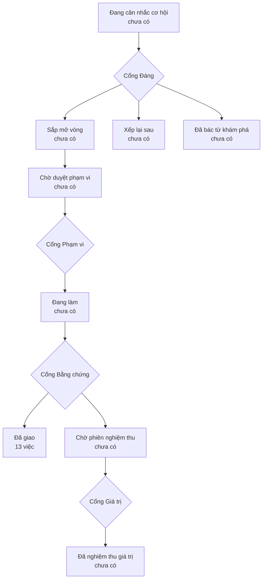

# Bản đồ sản phẩm

> Bản đồ vẽ lại từ hồ sơ của xưởng mỗi lần một người ký một cổng — đừng sửa tay.
> (đọc từ thư mục `_acceptance/` và `.out-of-scope/`)

> **Bốn cổng người** — mỗi cổng là một câu hỏi chỉ người trả lời được:
> **Cổng Đáng** việc này có đáng làm không · **Cổng Phạm vi** bộ tiêu chí
> đã đủ và đúng chưa · **Cổng Bằng chứng** đã làm đúng thứ đã hứa chưa ·
> **Cổng Giá trị** thứ đã giao có ăn thua không.

## Đã giao

- Enrichment qua đề xuất — giá trị LLM không ghi thẳng sale_offers/properties (`enrich-qua-de-xuat`)
- Ngôn ngữ chuẩn — CONTEXT.md, luật đặt tên, bối cảnh sản phẩm, test slug route (`glossary-context`)
- Bản đồ đích cổng Invest — block đích cho mọi route Invest trước khi dọn tiếp (`invest-target-map`)
- Gỡ ảnh và chữ AirDNA khỏi trang chi tiết listing (Invest) (`listing-airdna-photos`)
- Siết quyền — cổng Ops đóng mặc định, /api/zalo-media chỉ ảnh staging (`ops-access-hardening`)
- Đổi URL cloud cứng từ project Vercel cũ sang prod mới onehub-invest.vercel.app (`ops-ingest-url-onehub-invest`)
- Vá ranh giới cổng — Căn giá tốt sang Ops, gỡ AirDNA khỏi Mô phỏng đầu tư (`portal-deals-airdna`)
- Backend ảnh tin cho hàng duyệt /ops/review (route /api/zalo-media + loader ảnh theo thẻ) (`review-media-backend`)
- Đưa view ruler v_ruler_p2_area + v_ruler_p2 vào migration và hướng dẫn bắt kịp schema cloud (`ruler-p2-views-migration`)
- Nạp ảnh Zalo N1 (meta.mediaFiles) xuống stg_zalo_posts.media_files (`stg-zalo-media-files`)
- Bộ chuẩn UI/UX ReUI — đợt B1 (dọn cổng Ops tới khi không còn UI tự vẽ tay) (`ui-clean-b1-ops`)
- Chuẩn UI ReUI — đợt B3 thống nhất biểu đồ (bảng màu chuỗi chung, gom code chép trùng, tách file > 200 dòng) (`ui-clean-b3-charts`)
- Bộ chuẩn UI/UX ReUI — Phần A (setup: skill + MCP ReUI, skill onehub-ui, lint chặn tự vẽ tay, cắm vào kit) (`ui-standards-reui`)
