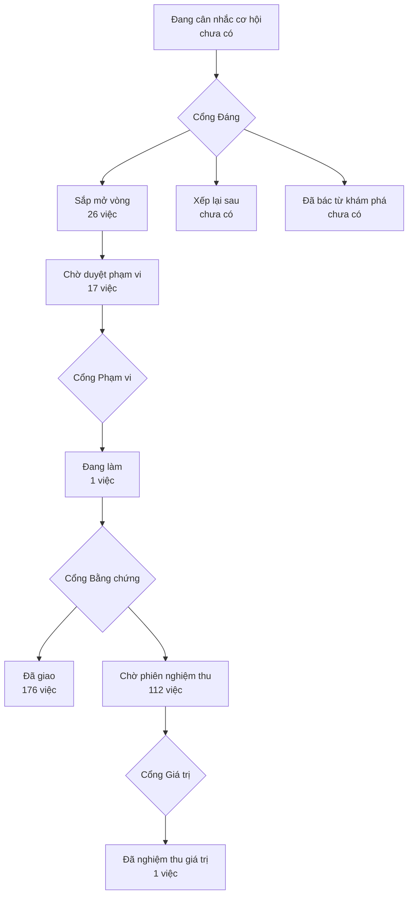

# Bản đồ sản phẩm

> Bản đồ vẽ lại từ hồ sơ của xưởng mỗi lần một người ký một cổng — đừng sửa tay.
> (đọc từ thư mục `_acceptance/` và `.out-of-scope/`)
> Lộ trình: [LO-TRINH.html](LO-TRINH.html)

> **Bốn cổng người** — mỗi cổng là một câu hỏi chỉ người trả lời được:
> **Cổng Đáng** việc này có đáng làm không · **Cổng Phạm vi** bộ tiêu chí
> đã đủ và đúng chưa · **Cổng Bằng chứng** đã làm đúng thứ đã hứa chưa ·
> **Cổng Giá trị** thứ đã giao có ăn thua không.

## Sắp mở vòng

- Ba nút Grand Park mang loại theo luật dự án con hay phân khu, Ocean Park 1, 2, 3 có dự án cha Ocean Park, không còn nút asset_nodes loại building, và lệnh dựng danh bạ vẫn ra cùng toà (`ba-nut-grand-park-q2`)
- Mỗi tin đang rao có giá/m² hợp lệ mang hạng phần trăm trong nhóm sâu nhất đủ căn (hôm nay phường × loại × bán/thuê, thêm số phòng ngủ khi nhóm vẫn đủ), cùng số căn, trung vị, p20, phần trăm dưới trung vị, nhãn và lý do lùi cấp, do pipeline tính sẵn; /ops/deals và /v1/deals đọc bảng này (`bang-hang-gia-m2`)
- Người vận hành mở thẻ nối dự án trên Ops, thấy cặp mã nguồn ↔ dự án máy đề xuất kèm căn cứ, duyệt từng cặp hoặc cả loạt cùng căn cứ, và mỗi cặp đã duyệt thành một bí danh (`bang-noi-ma-du-an`)
- Transform S03 và S05 ghi mỗi Yêu cầu vào bảng inquiry_records (dịch vụ, loại hình, số phòng, diện tích, ngân sách với đầu dưới ở ListPriceLow, khu, bài nguồn, bằng chứng ý định); ý định lấy từ phát biểu lớp cao nhất giữa luật laYeuCau và nhãn model đọc tin, Kev thêm vào khi PL5 giao (`bang-yeu-cau-noi-lai`)
- Số giảm của Căn giá tốt ở /ops/deals và ở API /v1/deals chỉ so tin với thước cùng phường × loại hình × bán/thuê; tin chưa rõ loại hình không có số giảm và ghi lý do (`can-gia-tot-cung-loai`)
- Người vận hành chọn một vị trí bất kỳ trên cây (tỉnh → phường → dự án → phân khu → toà), lọc loại hình, bán hay thuê, số phòng ngủ, diện tích, tầng, đường và thấy danh sách Căn giá tốt xếp theo hạng giá/m², mỗi dòng kèm nhóm so sánh, số căn trong nhóm, lý do lùi cấp và độ tin (`can-gia-tot-loc-xep-hang`)
- Người vận hành mở trang đo hằng ngày và thấy phân bố tin theo sáu mức gắn (căn, trục, toà, phân khu, dự án, phường) theo nguồn × vùng × loại nhà, kèm cảnh báo khi một ô giảm (`chi-so-muc-gan`)
- Bản chiếu Danh bạ lên cloud gồm toà, trục, căn, bảng nối dự án, phát biểu thuộc tính dự án và tin sơ cấp, không mang tên nguồn thật, và trang Danh bạ đọc được trên cloud (`danh-ba-len-cloud`)
- Người vận hành mở trang Danh bạ và thấy độ đủ hồ sơ của từng dự án theo bảy nhóm thông tin — trống, một nguồn, nhiều nguồn khớp, mâu thuẫn — cùng thẻ mâu thuẫn và tỉ lệ dự án đủ năm nhóm đầu mỗi ngày (`do-du-ho-so-du-an`)
- Thuộc tính của dự án và phân khu ghi được thành phát biểu có nguồn: field_assertions nhận resource Subdivision, Complex với các field đã kiểm RESO DD 2.1, bộ phân xử dựng cột cấp dự án, chủ đầu tư kế thừa xuống toà (`kho-thuoc-tinh-du-an`)
- Người vận hành mở một toà thấy lưới trục × tầng với trạng thái từng ô, mở một căn thấy tin đang rao, người đăng, lịch sử giá chào, độ chắc từng trường và bằng chứng (`luoi-toa-ho-so-can`)
- Ảnh tin không tải được (đường dẫn hết hạn, không có tệp) được đánh dấu, và Ops, Invest không vẽ ô ảnh vỡ cho các ảnh đó (`media-het-han`)
- Luật nhận Yêu cầu bắt thêm các bài viết tắt («khách thuê 1pn…», «tìm 2pn…», «cần thuê gấp…») mà không kéo tin rao vào nhánh Yêu cầu; nhánh Yêu cầu trên Sankey DF6 đổi số theo (`mo-rong-luat-yeu-cau`)
- Người vận hành duyệt xong cặp nối cho 282 dự án S06 có từ 10 tin trở lên, mỗi dự án nối vào một nút có xã/phường hoặc bị từ chối có lý do (`noi-du-an-s06`)
- Người vận hành thấy thẻ các dự án, toà mà tin nói tới nhưng danh bạ chưa có, gom theo tần suất kèm tin mẫu, rồi tạo nút ứng viên hoặc trỏ vào nút có sẵn (`nut-ung-vien-tu-tin`)
- Người vận hành mở /ops/inquiries và lọc Yêu cầu theo dịch vụ, dự án, số phòng, ngân sách, người đăng, thời gian, trạng thái; mở một Yêu cầu thấy tiêu chí kèm câu trích và cách đọc, các bài đã đăng, người đăng nối sang /ops/people, và đánh dấu «Không phải Yêu cầu» (`ops-bang-yeu-cau`)
- Kiểm «phường» và «trường lõi» trên đồng chảy và bậc dữ liệu chỉ nhận khu cấp phường; tin chỉ gắn tới tỉnh hay thành phố không còn được tính là có phường (`phuong-that-trong-truong-loi`)
- Tin gắn dự án nằm trọn một xã nhận phường suy ra từ dự án, không đè phường đã có (`phuong-tu-du-an`)
- Dự án của tin S06 (SubdivisionName, project_node) đi tới tin và căn (`s06-du-an-len-tin-can`)
- Người vận hành gộp hai nút danh bạ, tách, đổi cha, đổi loại giữa dự án con và phân khu, hay rút một nút sai trên Ops, và mọi bí danh, liên kết tin, phát biểu kế thừa phía sau đi theo (`sua-cay-danh-ba`)
- Thuộc tính trong danh mục S08 và S09 thành phát biểu ở đúng cấp: dự án (quy mô, loại hình, chủ đầu tư, bàn giao, loại căn và số căn, phí), phân khu, toà (tầng, hầm, thang máy, toạ độ, bàn giao), căn (diện tích kèm cách tính, phòng, hướng, loại căn) (`thuoc-tinh-danh-muc-s08-s09`)
- Quỹ căn chủ đầu tư S08 thành tin sơ cấp gắn đúng căn, mang giá chủ đầu tư và trạng thái quỹ, và không xuất hiện ở danh sách Bán, thước giá hay metrics (`tin-so-cap-s08`)
- Phân khu và toà S09 vào danh bạ không sinh toà trùng, và có ba số quyết định thu S09: phủ trên dự án của S03, phủ trên 282 dự án S06, phân giải mã toà S03 (`toa-s09-vao-danh-ba`)
- Người vận hành mở trang Danh bạ trên Ops và thấy cây dự án → toà với số căn, số đã xác nhận, số có tin, số off-market, biết toà nào còn thiếu (`trang-do-phu-danh-ba`)
- Tin rao mọi nguồn ghi được phát biểu dự án, phân khu và phường: field_assertions nhận project_node_id, subzone_node_id và area_id ở resource Property (`truong-du-an-tren-tin`)
- Từ vựng và mappings theo mục 39: «Dự án», phân khu, mức gắn và ba huy hiệu trạng thái có trong CONTEXT; ADR-0011, 0013, 0016 nói dự án cha và kế thừa từ nút vùng; mappings.yaml khai property_type → PropertySubType, block_raw → BuildingName, S08 project_name → SubdivisionName; CONTEXT có thêm «Tin sơ cấp», «Độ đủ hồ sơ», «Mã định danh nhà nước» (`tu-vung-du-an-muc-39`)

## Chờ duyệt phạm vi

- ADR-0015 «đường lệnh kéo một chiều cloud → máy thu» và bản sửa đổi ADR-0007, kèm thuật ngữ mới và ROADMAP §2.3–2.4 khớp thực tế (`adr-duong-lenh-keo`)
- Báo cáo số liệu hằng ngày theo bảng mục tiêu — lệnh gom số chỉ đọc, so hôm qua và so đích, gợi ý kiến nghị (`bao-cao-so-lieu-ngay`)
- Ca CD-AC-7b chờ request lưu ghi xong rồi mới đọc params, hết chập chờn trên CI (`che-do-thu-test-cho-luu`)
- Tài liệu và đánh dấu của kho khớp các chốt 23–24/10 (tên nhóm S03 tầng C, luật S08, luật phép đo Zalo, ROADMAP V9) (`chep-chot-2410`)
- đầu dò của hồ sơ chuyen-huong-ma-thi-truong gỡ đúng worktree tạm của nó, bỏ lệnh prune trên kho dùng chung (`chm-dau-do-khong-prune`)
- CI bỏ qua ca «DF-AC-3 DB thật» cần tin rao thật ở DB local (chỉ chạy ở máy thu) (`ci-bo-qua-df-ac-3`)
- Diễn giải dòng kiểm «Nhãn số chưa xác minh» trên /ops/quality, kể cả vế S03 qua người đăng (`dq-so-chua-xac-minh-qua-nguoi`)
- giải thích hai nhãn «Chưa xác minh» ngay trên thẻ tin và trên trang Phương pháp (`giai-thich-nhan-chua-xac-minh`)
- Bật nhóm khoá kit 2.34.0 cho làn ghim lại và lưới hoá cũ; gỡ đường cache 2.32.0 khỏi config (`kit-khoa-nhom-1`)
- Lớp chép CI của Acceptance Gate Kit lên 2.34.0 và kế hoạch chuyển bản cho đợt dot0-cam-mau (`nang-kit-2-34-0`)
- Nhận kit 2.35.0 — đổi đường bộ đệm có số sang 2.35.0 và khai vùng giao diện (design-floor bậc M1) (`nhan-kit-2-35-0`)
- Nhận kit 2.36.0 — chép lớp CI theo thẻ, vẽ lại bản đồ, bật GITATTR-TEP-SINH (`nhan-kit-2-36-0`)
- Nhận kit 2.37.0 — chép lớp CI theo bản cài, gỡ chân engine đỏ của đường nền (`nhan-kit-2-37-0`)
- API Thu thập trên cloud không đọc bảng chỉ có ở máy thu — gỡ 500 của /api/v1/ops/collections (`ops-collections-api-cloud`)
- MCP ReUI của kho gửi kèm key giấy phép (đọc từ biến môi trường) và kiểu giao diện của app, để phiên Claude dùng được gói Pro mà không phải đăng nhập (`reui-mcp-key`)
- harness của s06-vung-moi-len-canonical chạy được transform-chotot có import gan-sdt-s06.mjs (`s06-vung-moi-harness-gan-sdt`)
- hai test app chạy trên DB chung thôi đỏ vì mã vùng dài cũ và thôi treo khi có DDL xếp hàng (`test-app-tren-db-chung`)

## Đang làm

- Phần danh mục dự án của S07 thu theo giải pháp ZCode, ưu tiên Hà Nội và HCM, và nạp vào stg_* không nhân dòng (`thu-danh-muc-s07`)

## Đã giao — chờ phiên nghiệm thu

- Người duyệt vai Vận hành ở máy thu thấy ảnh tin chỉ có URL gốc (S06, S05) trên thẻ duyệt — ảnh đi qua máy chủ theo media_key, trình duyệt không nhận URL hay tên miền nguồn (`anh-goc-qua-may-chu`)
- audit-all không còn PASS giả ở backup và membership S03, và kiểm các trang /ops ở đúng cổng :3456 (`audit-all-noi-that`)
- Khách đăng nhập hoặc đăng ký qua auth-4/auth-5 không còn chuyển động bị cấm, gradient tự chọn hay chữ kích thước tuỳ ý, và lỗi nhóm (auth) hiện error.tsx (`auth-hop-chuan`)
- Chặng «Bài nhận → Đọc được» của S03 trên /ops/data-flow tính trên bài cần đọc — ảnh đã ghép vào tin rời mẫu số, bài Yêu cầu là đầu ra ngang tin rao và cùng tính vào «Đọc được» (`bai-nhan-tru-bai-chi-anh`)
- Bộ bóc SĐT của S03/S05 bắt đủ bốn dạng viết tách lạ, bỏ số 11 chữ số, và tin chọn SĐT theo luật rõ trên mọi bài của tin — dạng số ra giữ nguyên (`boc-sdt-du-va-chon-ro`)
- Bước chụp trang của kho gặp lỗi ở bất kỳ bước nào cũng không in hay đặt tên nguồn thật ra ngoài tiến trình, và không ghi ảnh khi chưa che xong tầng A (`buoc-chup-khong-in-ten-that`)
- Người vận hành quét Căn giá tốt trên một bảng có tab và lọc, mở sheet một căn để biết căn nào, ở đâu, ảnh gì, vì sao giá tốt, gọi ai, so với các căn cùng tiêu chí; căn thiếu dữ liệu ghi rõ thiếu gì; vai Người xem không nhận ảnh, chữ bài, liên hệ (`can-gia-tot-biet-can`)
- Bảng canonical không còn tin sinh từ dữ liệu thử, và transform từ chối post thử nếu lọt vào (`canonical-khong-tin-gia`)
- /ops/sources hiện và đổi chế độ thu (Chờ · Bùng · Duy trì) của từng điểm thu — bật Bùng chỉ admin và bắt buộc hạn ≤ 14 đêm; máy tự hạ bùng quá hạn về Duy trì; mọi lần đổi ghi ops_audit (`che-do-thu-tren-ops`)
- Đọc gộp tin S03 (chữ, mọi ảnh, thẻ nhóm) ra 17 ô với bảng chọn model theo ô, mặc định Haiku 5.5 (`chon-model-theo-o`)
- Luật ghép căn và bảng so thẻ duyệt so ô đường theo tên đường — bỏ ngõ/ngách/hẻm/số nhà và đuôi địa chỉ, không còn loại oan «đường khác» (`chuan-hoa-o-duong`)
- Job cloud-sync thoát khác 0 khi bất kỳ bước nào hỏng, và push-ops-facts kết nối theo DATABASE_URL (`cloud-sync-bao-loi-that`)
- Nhà đầu tư mở So sánh ở /compare (301 từ /so-sanh) và Đã lưu, cả hai có PageHeader, trạng thái tải/trống/lỗi, Đã lưu trống dùng c-empty-11 (`compare-saved-trang-thai`)
- Công tắc bật/tắt nhóm thu ở /ops/sources không hạ nhóm đã gỡ hay đã xong về tạm dừng, không hồi sinh chúng qua tắt rồi bật, và không đổi nhóm nháp thành tạm dừng khi tắt (`cong-tac-khong-ha-nhom-go`)
- Ca thử công tắc nhóm thu đối chứng với bản route trước sửa đã ghim cố định trong kho, nên vẫn xanh sau khi PR (`cong-tac-test-ghim-ban-cu`)
- /api/v1/ops/coverage trên máy chủ trả độ tươi từng nguồn S0x từ khối độ tươi máy thu đẩy lên (ADR-0014), có cờ tươi / cũ / chỉ đo ở máy thu, không trường nào chứa tên nguồn thật (`coverage-cloud-got-tang-a`)
- Đặc trưng nhà của tin S06 (số nhà, mã căn, mặt tiền, ngang×dài, số tầng, WC, toạ độ) lên canonical qua phát biểu trường lớp sự thật có căn cứ — migration 061 (`dac-trung-nha-s06-len-canonical`)
- Danh bạ đủ 3.321 xã, phường, đặc khu theo mã 5 số của Cục Thống kê trong areas dưới đúng 34 tỉnh; 10.033 tên xã cũ thành bí danh (441 xã cũ bị tách trả «cần chọn xã»); tin S03, S06 khớp tên xã hiện hành và tên xã cũ an toàn ở mọi tỉnh; reassign không xoá xã danh bạ; đo tin có xã trước/sau theo tỉnh (`danh-ba-phuong-xa-toan-quoc`)
- Danh bạ có toà · trục · căn cao tầng Ocean Park 1 và Grand Park dựng từ danh mục S08 và phát biểu toà/mã căn trên tin, trên khung chung có UPI neo toà; 3 dòng asset_nodes building chuyển sang toà; chủ đầu tư ghi ở cấp toà (Building.BuilderName) (`danh-ba-toa-truc-can`)
- Danh bạ vật thể dựng được toà ở cả 34 tỉnh/thành — mã tỉnh ISO qua bảng tra trong migration, UPI nhận mọi mã, chủ đầu tư ghi đúng phương pháp nguồn (`danh-ba-vat-the-toan-quoc`)
- Các bản SQL chép định nghĩa bài thử (Luồng 7 ngày ở pipeline và app, Dòng chảy dữ liệu, thước dư lượng tin giả) nhận dấu noi-dung như testMarker, để số Ops và lệnh kiểm tin giả khớp tập transform đọc (`dau-noi-dung-sql-bai-thu`)
- DB local tự khởi động lại sau khi Docker hoặc máy khởi động lại (`db-tu-khoi-dong`)
- Mỗi căn và mỗi tin chưa gắn căn có bậc dữ liệu B0–B5 tính bằng một hàm, phân bố bậc theo thị trường × loại hình được chụp mỗi ngày và in ra được, và một kiểm chất lượng giữ bất biến «mọi đề xuất enrich đã áp có phát biểu tương ứng» (`de-xuat-thanh-phat-bieu-bac`)
- /api/v1/deals chỉ trả dữ liệu cho token ops cho tới khi tin mock được rút khỏi canonical (`deals-api-tam-dong`)
- Người vận hành mở «Căn giá tốt» /ops/deals không thấy căn có diện tích hay số phòng phi lý, danh sách không dồn ở trần giảm giá, và thẻ ghi «đăng 1 lần» thay «mới» (`deals-loai-tin-phi-ly`)
- Người xem và bearer chung không nhận định danh tài khoản thu hay mã nhóm Zalo ở bề mặt Thu thập; mã nhóm không lên cloud (`dinh-danh-tai-khoan-thu-theo-vai`)
- Mỗi đêm đo trục SĐT của danh bạ Người và ghi vào dq_check_results để /ops/quality hiện (`do-danh-ba-sdt`)
- Đo làm giàu hằng ngày — theo từng đường làm giàu, số giá trị thêm, đổi, máy rút, người sửa hay rút mỗi ngày và kiểm ngược bỏ-một-ra mỗi tuần kèm cận dưới Wilson; lát thị trường, phường/xã, dự án, toà; xem trên /ops/quality (`do-lam-giau`)
- Mỗi đêm scorecard ghi tỉ lệ thẻ ghép căn chờ duyệt có đủ dữ liệu hai bên (ảnh, đặc trưng nhà, người đăng, tin còn sống) (`do-the-duyet-du-du-lieu`)
- Bài S03 ghi diện tích không đơn vị sau nhãn «Diện tích» hay bằng chữ kiểu Unicode được đọc ra area_m2 như bài ghi m² thường (`doc-so-m2-bi-sot`)
- Người vận hành mở /ops/data-flow trên cloud và thấy số chặng bài → tin rao → căn theo nguồn và số tin từng bậc, cùng số với máy thu, không còn khung «Chỉ xem ở máy thu» (`dong-chay-len-cloud`)
- Người vận hành mở /ops/data-flow ở máy thu khi bước làm tươi số dòng chảy hỏng quá 45 phút thì thấy cảnh báo số cũ như trên cloud, không phải số cũ trình bày như số mới (`dong-chay-so-cu-may-thu`)
- Người vận hành mở «Kiểm chất lượng» trên /ops/quality thấy bản mới nhất của mỗi kiểm theo từng thực thể, số kiểm đếm đúng, và kết quả độ phủ không ghi «Đạt» xanh khi độ phủ 0% (`dq-moi-nhat-moi-kiem`)
- Lệnh dựng danh bạ vật thể chạy được trên DB máy thu bằng cờ cho phép tường minh, kiểm slug khu, và có bước trong chạy đêm (`dung-danh-ba-may-thu`)
- Ô đường viết không dấu so như dạng có dấu — «30 thang 4» ↔ «2 thang 4» là hai đường khác, «3 thang 2» không bị coi số 3 là số nhà, ô chỉ «Ngo»/«Hem» là thiếu tên đường (`duong-thang-n-khong-dau`)
- Enrich chạy mỗi đêm sau lượt nạp S03/S05 — mỗi tin một giao dịch ngắn, ghi đề xuất và áp luật xác định, lỗi LLM có đếm, dòng tổng kết đếm đúng, không bốc lại tin đã thử (`enrich-chay-sau-nap`)
- Người vận hành dữ liệu chạy eval:classify và nhận độ đúng từng (cách đọc × trường × phân khúc) theo cận dưới Wilson so với ngưỡng F3, ghi vào dq_check_results (`eval-classify-wilson`)
- check-freshness đo S03/S05/S06 theo giờ THU thật của snapshot thay vì giờ NẠP — nguồn ngừng thu mà bị nạp lại bản cũ phải báo quá hạn (`freshness-do-gio-thu-that-s03`)
- check-freshness đo độ tươi theo bảng thật của từng nguồn, có SLO cho S05 và S06, không còn dòng quá hạn giả (`freshness-theo-nguon-that`)
- Người gắn nhãn mở mẫu của từng nhóm S03 trên /ops/labels, gắn điều người trong nhóm hiểu gồm phân khu, trục, tầng, số WC, bài nhiều căn, người bán, SĐT, mỗi trường ghi căn cứ, bài phải dùng ngữ cảnh ghi lý do, rồi xem máy đọc gì để ghi loại trường hợp, và thấy bảng trường hợp theo nhóm (`gan-nhan-theo-nhom-s03`)
- Gỡ tài khoản Zalo kiểm bản cấu hình sau khi gỡ trước lệnh đăng xuất: cấu hình phạm bất biến bộ canh thì từ chối mà không đăng xuất phiên nào (`go-tai-khoan-kiem-cfg-truoc-logout`)
- Route gỡ tài khoản thu DELETE /api/v1/ops/zalo/accounts từ chối id rỗng hoặc không có trong danh sách tài khoản trước khi gọi openclaw (`go-tai-khoan-kiem-id`)
- Ảnh của tin chỉ-ảnh S03 (ảnh gửi riêng trước hay sau tin chữ, cùng người, dưới 2 phút) vào đúng offer trong bảng ảnh canonical; bảng nạp và sale_offers giữ nguyên (`gop-tin-chi-anh-o-transform`)
- Người vận hành mở «Hiệu chuẩn» trên /ops/quality thấy mỗi thị trường một bộ số nhất quán giữa các bảng, định nghĩa «tự thu» ghi rõ ở từng bảng, mẫu mỏng có cờ, và thị trường chưa có số gộp thành một dòng; bước chụp trang của kho chụp được /ops đã đăng nhập (`hieu-chuan-mot-bo-so`)
- Mỗi tin có người đăng gắn với một người trong danh bạ Người của đúng nguồn ấy qua vai «người đăng» là một phát biểu có bằng chứng, và nạp lại không nhân người (`ho-nguoi-theo-nguon`)
- Mọi job đêm thoát khác 0 khi không tới được DB, và watchdog cảnh báo khi DB sập (`job-bao-loi-that`)
- Thẻ ghép căn do judge-run sinh mang đủ mười trường của bảng so cho cả Tin A và Tin B (`judge-evidence-du-truong`)
- Chấm lại ghép căn không đổi thẻ người vừa quyết, và so phường theo cùng khoá với thẻ duyệt (`judge-giu-quyet-dinh-nguoi`)
- Bộ đánh giá ghép căn loại trừ tất định một cặp khi một đặc trưng nhà khác rõ, ghi đặc trưng nào khác vào evidence (`judge-luat-loai-tru-dac-trung`)
- Ghép căn kết luận bằng luật ngưỡng trong code, LLM chỉ viết lời giải thích; mỗi lần chấm ghi model và trace lên thẻ; mọi cặp ứng viên needs_llm sinh đúng một thẻ ghép căn (`judge-nguong-la-code`)
- Thẻ duyệt ghép căn và luật chấm cùng coi «P.12» là «Phường 12» (`khoa-phuong-chung-phuong-so`)
- Leak gate của sync cloud đỏ khi role anon còn SELECT được bất kỳ bảng hay view nào (`leak-gate-kiem-anon`)
- Nhà đầu tư mở /listing/[id] thấy đầu trang product-detail-5, ảnh tự thu khi có (không có thì ẩn gallery), lịch form-5 không còn điều khiển thô, vùng dữ liệu có Skeleton và Empty (`listing-detail-product-detail-5`)
- Nhà đầu tư duyệt listing lọc bằng filters (màn hẹp filter-sidebar-5) và bản đồ @mapcn/store-locator gom cụm, vẫn lọc theo khung nhìn khi kéo hoặc zoom (`listings-filters-store-locator`)
- Nhật ký thao tác Ops (GET /api/v1/ops/audit) không trả dấu máy enrich:thu — thao tác của người không bị đẩy khỏi 100 dòng gần nhất (`loc-enrich-thu-ops-audit`)
- Trên máy chủ, ô và lưới Khoá an toàn đọc khối lockdown máy thu đẩy lên; không có số thì 8/8 lớp «Chỉ kiểm ở máy thu», không lớp nào xanh; Kev gate và collector API ở Máy móc cùng trạng thái với Khoá an toàn (`lockdown-cloud-theo-facts`)
- Route POST /api/v1/ops/zalo/login từ chối accountId không có trong danh sách tài khoản trước khi spawn openclaw channels login (`login-kiem-id`)
- Người gắn nhãn mở màn gắn nhãn trên /ops, gắn trường lõi cho tin của lát mà không thấy giá trị máy đoán, và 20% tin được gắn trùng để đo đồng thuận (`man-gan-nhan-mu`)
- Bản khai công cụ app/docs/api/mcp-tools.json khớp sổ bề mặt API: công cụ tin rao đòi bearer ops hoặc bị gỡ, không công cụ nào ghi «public» trái sổ (`mcp-tools-theo-so-be-mat`)
- Ảnh của tin S03 và S06 nằm ở một bảng media canonical theo RESO Media nối với offer, và /ops/review, /ops/data-flow ở máy thu đọc ảnh từ bảng này (`media-canonical-reso`)
- Nạp lại mọi nguồn không xoá hàng: khoá tin bền, retired_at thay DELETE, mọi khoá ngoại tới sale_offers và listings là RESTRICT (`nap-lai-khong-xoa`)
- Danh bạ Người gộp người theo SĐT vào người theo tài khoản cùng nguồn khi nối một–một, mỗi lần gộp có vết và tách lại được (`nguoi-noi-theo-sdt`)
- Người gắn nhãn gõ giá có dấu chấm ngăn nghìn hay gửi đơn vị lạ thì bị chặn với lỗi dưới ô thay vì lưu sai 1000 lần, và mất mạng khi Lưu thì thấy thông báo (`nhan-gia-va-luu-loi-mang`)
- Bảng nhóm S03 ghi đúng số nhóm đang bật trong danh sách cho phép và «Vào bảng thô» theo nhóm — ở máy thu đo trực tiếp, trên máy chủ đọc khối s03 máy thu đẩy lên; thiếu số thì «—», không 0 (`nhom-s03-tren-cloud`)
- Mỗi dự án S08 của lát Ocean Park 1 và Grand Park nối vào đúng một khu đô thị, không còn bí danh dự án trùng mã toà, area_ids OCP1–3 khớp nguồn xác minh (`noi-du-an-s08-khu-do-thi`)
- Mọi nút dự án trong danh bạ trỏ mã xã/phường hiện hành, suy từ xã cũ có nguồn qua bảng chuyển đổi chính thức (`nut-du-an-tro-xa-moi`)
- Ô KPI ba trang Ops trên cloud đọc số máy local đẩy lên kèm mốc đo giờ VN; không có số thì «—» và «Chỉ đo ở máy local» một lần; số cũ quá 45′ thì báo, không badge xanh (`o-kpi-chi-do-local`)
- Chế độ duyệt ở /ops/review báo lỗi ghi sau khi rời Hàng duyệt, giữ phím số chỉ quyết một thẻ, phím duyệt im khi hộp thoại khác đè lên sheet (`od2-phim-va-loi-ghi`)
- Người vận hành mở /ops/data-flow ở máy thu và thấy dòng chảy bài → tin → căn, chất lượng từng chặng và bậc nghiêm của từng tin; cột «bài thô» S03 không lẫn bài S05 và bài thử (`ops-dong-chay-df0`)
- Sau mỗi lượt cloud-sync, máy local đẩy lên cloud năm khối số tổng hợp Ops có mốc đo, qua bộ soát tầng A, và cloud có một hàm đọc chung báo số cũ quá 45′ (`ops-facts-so-tong-hop`)
- Người vận hành đọc /ops/collections và /ops/quality chỉ thấy mã S0x kèm vai trò, không tên nguồn thật — kể cả nhãn job đẩy từ máy thu (`ops-nhan-ma-nguon`)
- Người duyệt mở /ops/review và thấy hàng chờ dạng bảng theo solution-agents-5, lọc theo loại thẻ, bấm một hàng mở sheet chi tiết có dải ảnh tin xem được cả ở màn 390px (`ops-review-khung-hang-cho`)
- Bảng phát biểu append-only và bộ phân xử ba lớp dựng cột canonical kèm provenance, chạy lại ra y nguyên (`phat-bieu-va-phan-xu`)
- Thẻ duyệt ghép căn và luật chấm đọc trọn các cách ghi phường số (`phuong-so`)
- Proxy ảnh tin /api/zalo-media chỉ phục vụ ảnh raster an toàn (jpeg/png/webp/gif); SVG và kiểu ảnh lạ trả 415; mọi phản hồi ảnh mang nosniff + CSP sandbox (`proxy-anh-chan-svg`)
- Mọi route /api/v1/ops/** kiểm vai theo một bảng bốn vai (viewer, ops, admin, owner) ở ops-access.ts, và mỗi thao tác ghi đúng một dòng ops_audit mang id người thật trong cùng transaction (`quyen-bon-vai-mot-cho`)
- Quyết định trên thẻ ghép căn chỉ ghi khi chạm đúng một ứng viên còn chờ; không chạm được thì route trả lỗi có tên, thẻ vẫn chờ, không dòng nào được ghi (`quyet-dinh-phai-cham-ung-vien`)
- resolve-properties tự thử lại có hạn khi Postgres báo deadlock (40P01), không đổi logic resolve (`resolve-thu-lai-deadlock`)
- Transform S03 đọc giá và diện tích không lẫn URL/SĐT, chuẩn hoá cách viết giá của môi giới, chặn giá phi lý, gom repost theo mã toà/căn, ghi tên người bán và phường theo thị trường của nhóm (`s03-cam-mau-so-lieu`)
- Giá tỷ chẵn viết bằng đồng («3.000.000.000 đ») không bị bước gạt SĐT của transform S03 nuốt mất (`s03-gia-ty-chan-dong`)
- Giá tỷ viết bằng đồng mà ngay sau là khoảng trắng/xuống dòng rồi số 1–2 chữ số («3.000.000.000\n50m2») không bị bước gạt SĐT của transform S03 nuốt mất (`s03-gia-ty-sau-khoang-trang`)
- Nhà đầu tư thấy tin S03 trên trang tin rao, kể cả tin không nói phường (mang khu vực cấp thị trường), kèm nhãn «Chưa xác minh» (`s03-len-cong`)
- LLM đọc toàn bộ chữ S03 ở lớp đề xuất, tự áp loại hình khi trích dẫn có thật và qua luật; ý định, giá, diện tích chỉ đối chiếu; bất đồng lên /ops/review (`s03-llm-doc-toan-bo`)
- Bộ nhận loại tin S03 nhận tin bán và tin thuê không ghi chữ «bán/cho thuê» theo tín hiệu chữ, đơn vị giá và bối cảnh nhóm; vẫn loại bài khách tìm nhà; bài đã có loại không đổi (`s03-nhan-loai-tin-rong`)
- Vá hẹp bộ đọc tin S03 (diện tích, phòng ngủ, phường theo hướng, số ngữ cảnh, thuê từ 1 tỷ, giá che số, giá không đơn vị) và lưu toà, trục qua phát biểu có sẵn (`s03-va-doc-tin`)
- check-freshness và /ops đo S05 theo nhịp 2 lượt/tuần: SLO_HOURS.S05 = 96 giờ ở cả hai bản chép, giữ parity với /ops (`s05-slo-theo-lich`)
- Đường của tin S06 đi tới tin và căn, không rơi giữa chừng (`s06-duong-du-an-len-tin`)
- Tin và danh bạ Người lưu số gốc SĐT ở một dạng +84…, danh bạ có bí danh số gốc, và bảng người bán thành view trên danh bạ (`sdt-luu-goc-e164`)
- Bước tổng hợp người bán thêm dòng cho mọi SĐT mới trên tin, không chỉ cập nhật và xoá dòng đã có (`sellers-them-dong-lai`)
- Người vận hành thấy cùng một số SLO trên /ops và /ops/collections (`slo-mot-nguon`)
- Mọi route API của app nằm trong một sổ bề mặt và chỉ trả đúng thứ sổ cho phép (`so-be-mat-api`)
- Người vận hành mở /ops và thấy chi phí, token, độ trễ của mọi cuộc gọi AI theo việc, model và ngày (`so-cuoc-goi-ai`)
- Lệnh có khuôn đã duyệt trên cloud được máy thu kéo về bằng token máy riêng, áp đúng một lần và báo kết quả cùng giá trị trước/sau lên cloud (`so-lenh-bo-ap`)
- Người vận hành khai mọi đơn vị thu (nhóm S03, nhóm S05, vùng S06, market S02) trong một sổ trên /ops, mỗi đơn vị có mã ổn định dạng S03-N012, thị trường, dự án nhóm chuyên và trạng thái vòng đời (`so-nhom-mot-noi`)
- Một sổ từ vựng sinh bảng ref_*, hằng TS/JS, enum prompt và nhãn tiếng Việt; lint đỏ khi có enum viết tay ngoài sổ (`so-tu-vung-mot-nguon`)
- Mọi đường dữ liệu rời máy (sync và ops-facts) qua cùng một bộ soát tầng A chặn khi lỗi (`soat-tang-a-moi-duong-len-cloud`)
- Bộ đọc ngân sách của Yêu cầu đọc đúng đầu dưới, đầu trên và đơn vị ở các cách viết tắt và sáu lỗi Ngoài của hồ sơ bang-yeu-cau (`sua-doc-ngan-sach-yeu-cau`)
- Người vận hành dữ liệu sinh được một tập tin mẫu của lát Ocean Park 1 có đáp án biết sẵn, sinh lại ra đúng tập cũ, mang dấu mẫu và không bao giờ tới bảng canonical — để PL9 chấm cách đọc tin trước khi đội gắn nhãn xong (`tap-nhan-mau-ocp1`)
- Người duyệt mở /ops/review và thấy mọi trường kèm căn cứ, ảnh tin và toàn văn tin, không có «AI tự tin %», rồi quyết kèm lý do được ghi audit cùng giao dịch (`the-duyet-du-can-cu`)
- Người duyệt thấy người đăng của mỗi tin trên thẻ ghép căn (tên, SĐT, số tin đang rao) và nhận ra ngay khi hai tin cùng một người (`the-duyet-hien-nguoi-dang`)
- Thẻ duyệt Người cho ca nhiều–nhiều trên /ops/review — SĐT nhiều người gửi, người gửi nhiều SĐT thành thẻ; người duyệt chọn gộp hay giữ tách, quyết định áp qua luật xác định ở bước dựng danh bạ, có vết và đảo được (`the-duyet-nguoi-nhieu-nhieu`)
- Thẻ ghép căn có một bên đã rời kho tự rút khỏi hàng duyệt kèm lý do «tin rời kho» và vết audit (`the-ghep-can-tin-roi-kho`)
- Người duyệt mở thẻ ghép căn và thấy bảng so đọc giá trị sống của hai tin, ô thiếu một bên hiện «Thiếu» chứ không tính là «Lệch» (`the-so-doc-gia-tri-song`)
- Mọi phát biểu có thời điểm quan sát; mỗi tin có trạng thái chào được phân xử từ bằng chứng theo thời gian; giá và trạng thái của tin được giữ thành lịch sử gom được theo căn; căn lên B5 khi đang chào, còn trong cửa sổ độ tươi và có lịch sử giá (`thoi-gian-va-hieu-luc`)
- Khách mở trang chủ và /methodology (301 từ /phuong-phap) thấy định nghĩa dạng faq-3, hero và thẻ thị trường không còn màu cứng, lỗi nhóm marketing có error.tsx và lỗi toàn cục có global-error.tsx (`trang-chu-methodology`)
- Job nạp Zalo hằng đêm thoát khác 0 khi bước transform-zalo hoặc refresh-bait-gap hỏng, mỗi bước hỏng in một dòng JOB FAIL; phần nạp giữ nguyên (`transform-zalo-boc-job-run`)
- Thẻ hiệu chuẩn của khu vực gộp nhiều market S02 cho tỉ lệ «Listing» khớp bảng Độ phủ trung thực: tự thu của cả khu vực chia cho tổng listing S02 của mọi market thành phần (`ty-le-listing-khu-vuc-gop`)
- Vai người xem (viewer) vào được Cổng Ops nhưng không thấy nội dung thẻ duyệt và bài gốc — chỉ vai vận hành trở lên thấy (`viewer-khong-thay-the-duyet`)
- VLM đọc ảnh tin S03 cho bài mà chữ không đủ và ghi thêm vào bảng nhãn bạc với nguồn «ảnh» — ảnh từ đĩa, mỗi ảnh khác nhau đọc một lần, đo Qwen local, Haiku và DeepSeek V4.1 Flash 1017; chữ và trường gửi đi không kèm tầng A, ảnh tự in tên nguồn thì gắn nhãn (`vlm-anh-tin-s03`)
- source_registry và sổ nhóm có vòng đời năm trạng thái kiểm bằng CHECK kèm lý do và điều kiện bật lại, và một hàm isRunnable trả quyết định chạy cho từng nguồn và đơn vị thu (`vong-doi-nguon`)
- Nhà đầu tư dùng /yield thấy bảng chi phí vận hành và phần «Dòng tiền vốn vay» dựng bằng data-grid-advanced-7, còn link /vn/<market>/dau-tu cũ chuyển 301 về /yield?area=…#financing (`yield-dong-tien-von-vay`)
- Phép so phần nạp của zalo-import-daily.sh (ZJ-AC-5) chứng trên hai commit cố định của vòng transform-zalo-boc-job-run, không báo đỏ giả khi làn ZCode sửa hợp lệ phần nạp (`zalo-import-so-phan-nap-khong-do-gia`)

## Đã giao

- Ca «AER-AC-2 không lệnh nào đổi nghĩa» so cặp commit cố định của vòng sửa config.yaml thay vì merge-base origin/main, để PR khác thêm, sửa hay xoá khoá trong _acceptance/config.yaml không bị CI chặn nhầm (`aer-ac2-so-cap-co-dinh`)
- Listing Airbnb bị transform cho nghỉ ngoài phường mang toạ độ của lần thu mới nhất, nên reassign-areas không đánh thức nó bằng toạ độ cũ (`airbnb-nghi-khong-hoi-sinh`)
- Màn gắn nhãn hiện ảnh bài S03 ngay trong thẻ thay cho dòng link, xem lớn được để đọc chữ trên ảnh (`anh-tren-the-gan-nhan`)
- Sổ bề mặt API khai /api/zalo-media rộng bằng hoặc hơn quyền thật sau PL3 (ảnh snapshot cho vai Vận hành), route và hai bộ kiểm tĩnh khớp sổ (`api-surface-anh-vai-ops`)
- Test «Căn giá tốt» và «Kiểm chất lượng dữ liệu mới nhất» chịu chạy song song — mỗi ca dựng lược đồ riêng, không xếp hàng khoá tư vấn dùng chung (`app-test-chiu-song-song`)
- Hộp thử AU3 có bước đọc gộp — phép đo nạp báo lỗi của job Zalo xanh lại sau khi job chạy sáu bước, ba hồ sơ đã ký ghim lại được (`au3-moi-truong-thu-buoc-doc-gop`)
- AU3 phần nạp — tác vụ Chợ Tốt và Facebook báo lỗi rõ khi nạp hỏng, không nhảy qua snapshot lỗi (`au3-nap-bao-loi`)
- audit-all.sh và trang Ops ở máy local đọc log job ở checkout chính dù chạy từ worktree, không báo LIMITED hay «Hỏng» giả vì thư mục log rỗng (`audit-all-doc-log-o-checkout`)
- ca ON16-AC-2 của audit-all.test.mjs thôi chập chờn qua ranh giới phút — hộp test ghim mốc giờ của dòng tiêu đề bằng bản giả date (`audit-all-test-moc-phut`)
- ZC3 — watchdog Zalo không sót log đầu ngày, cảnh báo drop bất thường và DB chết; nạp Zalo đêm phục hồi sau khi DB sập (`audit-p1-resilience`)
- Ô E2 đã ký của auth-error-thu-lai-retry được thay bởi một tiêu chí tả đúng ba ca AC-2 hiện có (YAML chuẩn, bộ đọc kit khớp bộ đọc chuẩn, so trước-sau trên cặp commit cố định) — sổ hồ sơ hết lệch với code (`auth-error-e2-superseded`)
- Khi trang đăng nhập hoặc đăng ký lỗi lúc dựng, nút «Thử lại» tải lại phần trang từ server (retry) thay vì chỉ vẽ lại phía client (reset); _acceptance/config.yaml thành YAML chuẩn (`auth-error-thu-lai-retry`)
- backfill ảnh Zalo xét cả snapshot zalo-agent schemaVersion 3, không chỉ v2 (`backfill-zalo-media-v3`)
- Bước bait gap của refresh-bait-gap chạy trong một giao dịch có khoá advisory chung — lượt nạp S03, S06 không ghi chồng, đụng khoá hay lỗi giữa chừng không để bait_gap_pct của tin P1 về rỗng (`bait-gap-mot-giao-dich`)
- Bật gói dieu-phoi ở cấp kho — thêm dieu-phoi@acceptance-gate-kit vào enabledPlugins của .claude/settings.json, cùng nguồn marketplace với các gói kit khác, không đổi gì khác (`bat-dieu-phoi-cap-du-an`)
- Bộ canh kênh S03 tắt gateway khi có lượt agent mới dù lượt đó chạy nhanh, nhờ đếm trên kho phiên thay vì dò chuỗi trong log (`bo-canh-dem-luot-agent`)
- Người vận hành thấy đúng tên người đăng, đúng lý do rời danh sách của căn đắt hơn thước, và đường về danh sách không quay lại chính trang một căn (`can-gia-tot-sua-ba-loi`)
- Căn của tin chung bài đăng nhận theo khi đề xuất làm giàu được áp hay hoàn tác — migration 066 mở rộng chuỗi cập nhật căn của 063, kèm sửa một lần phần lệch đã có (`can-theo-tin-khi-phan-xu-lai`)
- Bộ canh S03 thêm lớp L6 kiểm sống — cảnh báo khi S03 ngừng thu (không snapshot mới ban ngày, tự khởi động lại treo, not linked), không kill gateway (`canh-bao-s03-ngung-thu`)
- Vai Người xem không dò được bí danh đã che qua ô tìm của /ops/people — máy chủ bỏ ?q= và trang ẩn ô tìm với vai dưới Vận hành (`che-tim-bi-danh-viewer`)
- Thước đồng bộ cloud (check-cloud-sync) chạy lại được trên máy thu đã áp 060 và 059 — sellers dựng thành bảng theo 022, bỏ trigger lịch sử khỏi bản dump (`check-cloud-sync-sellers-view`)
- bước kiểm local-only của check-s08-inventory chạy được trên main sau khi import-airbnb nhập import-s08-row (`check-s08-harness`) — đã giao — máy thông, cửa veto còn mở
- nạp lại một snapshot Chợ Tốt cũ hơn không làm lùi giá, tiêu đề và nội dung của tin đã có bản mới (`chotot-khong-lui`)
- bộ nạp S06 từ chối snapshot thiếu finishedAt và dòng captured_at NULL có sẵn không bị đóng băng (`chotot-thieu-moc`)
- Chữ hiện trên các trang công khai của cổng Invest không mang tên nguồn thật S01, S02, nói đúng giá rao là tin thật (`chu-nguon-tren-cong`)
- link cũ chứa mã thị trường dài kèm query mở đúng trang Cho thuê, có ca đo tự động và đột biến làm đỏ (`chuyen-huong-ma-dai-trang-thue`) — đã giao — máy thông, cửa veto còn mở
- link và mã thị trường cũ (32 mã dài vn-thanh-pho-*/vn-tinh-*) vẫn mở được sau khi migration 064 đổi sang mã ngắn vn-<x> — chuyển hướng vĩnh viễn có điều kiện ở các trang Invest, bí danh mã cũ ở API công khai của app và data-api, đúng ở cả hai trạng thái trước/sau 064 (`chuyen-huong-ma-thi-truong`)
- CI chạy typecheck và test của app, pipeline, agent, data-api trên mọi PR (`ci-test-module`)
- Đồng bộ cloud nguyên tử — prod không trống/thiếu dữ liệu giữa các lượt sync; chốt luật sale_offers lên cloud (`cloud-sync-atomic`)
- Người vận hành mở /ops/collections không thấy số S02 nào ở biểu đồ, bảng hay panel Rotation; số S02 chỉ ở /ops/quality và tiêu đề biểu đồ nói rõ đang đếm gì (`collections-khong-so-s02`)
- script cài collector :9210 dưới launchd (ZC4 bước code) — kiểm điều kiện chạy trước, ghi plist, KHÔNG tự khởi động (`collector-api-launchd`)
- Collector API :9210 tắt êm — SIGTERM/SIGINT flush hết buffer rồi mới thoát (`collector-graceful-shutdown`)
- 2510-2 — collector API không còn treo cứng khi một lượt flush có hơn 5000 tin mới; bộ nhớ khử trùng giữ đúng 5000 id mới nhất; lô HTTP có trần (`collector-seen-cap`)
- Công tắc cho bước gộp Người theo SĐT trong job đêm, mặc định tắt, bật/tắt bằng lệnh có lý do ghi ops_audit (`cong-tac-gop-nguoi-dem`)
- công tắc thật — mọi đường thu S01, S02, S05, S06 hỏi vòng đời nguồn × đơn vị qua một cổng trước khi gọi nhà cung cấp, hết danh sách cứng, lỗi DB thì dừng (`cong-tac-that`)
- Trang /ops/people cho người vận hành xem danh bạ Người ở máy thu — người theo nguồn S0x, số tin đã đăng, bí danh, nhãn suy luận chỉ hiển thị (`danh-ba-nguoi-tren-ops`)
- Dấu lược đồ của bản mẫu DB thử phủ constraint, index, trigger, enum, độ dài kiểu, NOT NULL, DEFAULT, RLS, quyền và schema ngoài public, để bản mẫu dựng lại ngay khi migration đổi những thứ đó (`dau-luoc-do-ban-mau`)
- Dữ liệu DB local nằm trong volume có tên — sao lưu, khôi phục kiểm được, chuyển và lùi (`db-vao-volume`)
- Tự kiểm live của DB local đo đủ bốn nhánh dữ liệu, gồm volume khác tên (`db-volume-check-volume-khac-ten`)
- Thước live của DB local không đòi bản lùi tồn tại mãi (`db-volume-live-ban-lui`)
- test DB theo lược đồ sau 044 — DP-AC-5 xoá cột PII trên bảng bản ghi, test không áp lại 044 khi DB đã có (`deals-phi-ly-test-theo-view`)
- tài khoản ops thử chỉ ở DB local cho máy tự đăng nhập dev (`dev-ops-account`) — đã giao — máy thông, cửa veto còn mở
- Biểu đồ «Chặng theo ngày» trên /ops/data-flow vẽ đủ mọi ngày của cửa sổ, ngày nguồn im là điểm 0 (`df0-chang-theo-ngay-diem-0`)
- Đầu trang /ops/data-flow đếm «đề xuất làm giàu» theo trạng thái chờ thật (queued), thôi luôn là 0 (`df0-dem-de-xuat-lam-giau`)
- Đo hiệu quả hằng ngày — mẫu soát cuốn chiếu 20 bài, tỉ lệ giữ nháp theo cách đọc × ô, ước bỏ sót, tín hiệu không cần nhãn, dòng chuyển bậc; lát phường/xã, dự án, toà; xem trên /ops/quality (`do-hieu-qua-hang-ngay`)
- Phép đo gán khu vực tin rao (kiem-tin-rao-gan-khu-vuc --thu) tự dựng tin mồi trỏ khu vực không hợp lệ trong transaction, không dựa vào trạng thái DB thật (`do-khu-vuc-tu-dung-moi`)
- đo nền hiệu năng DB local + 5 trang chính (Invest, Ops) trên build prod — số nền vào docs/research, ngưỡng chỉ đề xuất (`do-nen-hieu-nang`)
- Thước gán khu vực tin rao (KDM-AC-3) theo luật khớp xã PX1 — gỡ ca đỏ sẵn làm hồi quy scripts đỏ cho mọi hàng (`do-san-sl1-kdm`)
- DO1 giữ dấu ngày lập mốc (đổi thang, lập mốc đầu) suốt cả ngày qua mọi lượt cloud-sync, ngày ấy không có dòng chuyển bậc, lệnh sửa ngày đổi thang đã qua, thước TB-AC-11 chạy được sau khi máy thu áp 087 (`do1-giu-dau-doi-thang`)
- Bước đêm đọc gộp S03 chạy được ở kho không có .env trên /bin/bash 3.2 — bộ test agent xanh ở mọi worktree (`doc-gop-env-rong`)
- Đọc gộp S03 hằng ngày — lệnh hang-ngay đọc toàn bộ bài S03 mới của một ngày đã khử trùng theo tin bằng model của bảng chọn PL30, trần 20 USD theo ngày chi, chạy lại không gọi lại bài đã đọc; bước đêm pipeline/doc-gop-hang-ngay.sh (`doc-gop-hang-ngay`)
- Bộ test design-floor dọn mọi thư mục tạm nó tạo (clone sau-gộp, bản chép, cap-config, reuse-plan) khi tiến trình thoát, để mỗi lượt chạy không bỏ lại rác trong TMPDIR (`don-clone-tam-design-floor`)
- Mã giao diện của app hết hex thô ngoài thư mục vendor — màu bản đồ dời sang app/src/lib, mặt nạ quét dùng black, giữ đúng từng giá trị màu (`don-hex-tho`)
- Biểu mẫu theo nhóm chọn đơn vị giá theo Loại tin, hỏi lại khi giá lạ, và thẻ hiện mã để chép (`don-vi-gia-theo-loai-tin`)
- Đóng băng Stage B của bộ dựng căn và thẻ Ghép căn — không sinh cặp, không gieo thẻ, thẻ chờ không hiện, dữ liệu cũ giữ nguyên (`dong-bang-stage-b-resolve`)
- dựng sẵn nguyên liệu M2 của design-floor (chưa bật) — lệnh sinh tokens DTCG + danh mục thành phần, skill onehub-ui buộc reuse-plan.md ở S1 (`dung-m2-song-song`)
- Danh sách tin công khai nhanh — getPublicOffers rút trang trước, đếm tài khoản nhiều tên chỉ cho người bán của trang, tổng đếm theo hàm cửa sổ; trang đầu vn-hcmc bốn kiểu sắp dưới 1000 ms trên DB máy thu, có biên, không nới trần E4b (`e4b-danh-sach-tin-nhanh`)
- ca «AC-6 để sau» của agent/tests/enrich-db.test.ts khoanh lượt backlog vào tin của chính ca — hết đỏ ngẫu nhiên trên DB :5433 dùng chung (`enrich-db-test-khoanh-tin`)
- Hậu kỳ enrich-qua-de-xuat — đề xuất sống qua nạp lại, hoàn tác có audit, E1 không suy đất từ tên nhóm (`enrich-hau-ky`)
- Enrich danh bạ Người S03 — số liên lạc theo tài khoản từ tin có số và bài của chính người gửi; tin không số lấy số qua người đăng, hiện qua «Xem số» kèm nhãn chưa xác minh (cơ chế S06); chừa chỗ liên lạc hồ sơ kênh S03 (`enrich-nguoi-s03`)
- Enrichment qua đề xuất — giá trị LLM không ghi thẳng sale_offers/properties (`enrich-qua-de-xuat`)
- eval-classify chấm bộ đọc trên chữ tin ghép mà người gắn đã đọc, bài ảnh không có tin chữ không chấm (`eval-classify-theo-chu-ref`)
- «Gắn căn» nghĩa là nhận diện duy nhất khớp danh bạ — FRAMING §3.4 viết lại theo thang Mạnh duyệt 08/11; CONTEXT.md có Gắn căn, Định vị, Gom cụm; /ops/data-flow thay cột Gắn căn bằng ba cột Gom cụm · Định vị · Gắn căn trên Tin rao, chữ trên tin chỉ là «chờ khớp», Sankey chia theo mức sâu nhất, chú thích nhánh rơi nói lý do thật (`gan-can-dinh-danh-duy-nhat`)
- Thẻ gắn nhãn hiện tin chữ cùng cả cụm ảnh đã ghép bằng luật PL28, ghi rõ là ghép suy ra, vẫn gắn mù (`ghep-anh-tren-the-gan-nhan`)
- Người vận hành đọc mọi mốc giờ trên cổng Ops theo giờ Việt Nam có ghi múi, ngày gom theo giờ Việt Nam, và nguồn quá hạn hiện đúng mức trễ thay vì tuổi bằng SLO (`gio-ops-gio-vn`)
- 2410-1 — mốc thu captured_at của stg Zalo và Chợ Tốt luôn là giờ thu snapshot, nạp lại không làm sai, có script khôi phục kèm sao lưu (`giu-captured-at`)
- Ngôn ngữ chuẩn — CONTEXT.md, luật đặt tên, bối cảnh sản phẩm, test slug route (`glossary-context`)
- guard-edits lấy gốc theo kho chứa tệp — luật chặn sửa migration đã commit chạy cả khi tệp ở worktree khác (`guard-edits-goc-theo-tep`)
- ZC6 nối tiếp — hook Zalo giữ tin lại hàng đợi khi khoá collector sai (401/403/404) và có trần thời gian cho cả lượt xả (`hook-spool-nghiem-ngat`)
- ZC6 — hook Zalo giữ tin trong hàng đợi cục bộ khi collector chết rồi gửi lại, không làm treo gateway (`hook-zalo-spool`)
- job hằng ngày S06 không còn xoá số và tên người bán đã thu; bộ thu số gọi mỗi tài khoản một lần (`hop-dong-nguoi-ban-s06`)
- importer S08 nạp snapshot S08 vào stg_s08_inventory, chạy lại không nhân dòng, đổi số an toàn, bỏ snapshot thử (`import-s08`)
- PL1 — importer bỏ qua mọi snapshot thử (zalo-mock, e2e, TEST), không ghi chúng vào stg_* (`importer-bo-qua-du-lieu-thu`)
- lối cài riêng job sao lưu tuần — install-cron.sh --chi backup chỉ cài job sao lưu, không khởi động lại job thu đang chạy (`install-cron-chi`) — đã giao — máy thông, cửa veto còn mở
- Bản đồ đích cổng Invest — block đích cho mọi route Invest trước khi dọn tiếp (`invest-target-map`)
- ZC1 nối tiếp — cứng hoá ingest của collector API (media rác không làm hỏng lô, id tin chữ giữ nguyên, payload nguyên vẹn) (`kev-nhan-cung-hoa`)
- sửa thước kiểm kev-nhan đỏ sẵn trên main — tên thư mục giả theo khuôn PL1 và chữ log Kev hỏng theo ZC6 (`kev-nhan-thuoc-sau-pl1`)
- PL4 — hook Zalo đẩy mọi tin tới collector kèm điểm Kev (meta.kev), không bỏ tin theo điểm (`kev-thanh-nhan`)
- kho tri thức riêng tư đi kèm — nguồn của mọi bản phạm vi đang dùng là trang tri thức ghim băm (`kho-tri-thuc-invest`)
- khoá nạp Zalo tự gỡ khi tiến trình giữ khoá đã chết hoặc khoá quá 2 giờ; S05 tạm dừng thì bước thu không gọi Apify; lịch S05 xuống 2 lượt/tuần (`khoa-nap-s05-paused`)
- Người duyệt thấy đủ các ảnh khác nhau của một tin, không bị ảnh đăng lại lấp hết trần 12 ảnh; màn gắn nhãn dùng cùng luật (`khu-trung-anh-tin`)
- Trang /ops gọi đúng tên thị trường vùng mới của S06 (Đà Nẵng, Hải Phòng, Khánh Hoà) khi bảng khu vực còn giữ mã dài — bản tạm ở app tới khi đổi mã khu vực (`khu-vuc-vung-moi-s06`)
- Kiểm danh bạ không đỏ giả với số ghép S06, và test nạp lại migration cũ chạy được sau khi áp 070 (`kiem-do-sau-ap-070-sua`)
- Lấy mẫu nhãn khử trùng theo tin của pipeline và chữ đã gạt URL, gạt bài thử và sự kiện, label-ghep dựng lại dấu trùng mà không xoá dấu ẩn tay (`lay-mau-khu-trung-theo-tin`)
- Danh sách tệp bản đồ được dùng hex (MAP_FILES) viết trước chỉ ghim chữ ở một module chung; LB-AC-1 và DHT-AC-5 cùng đọc nó (`lb-ac-1-map-files-mot-nguon`)
- Người bán S03 không để lại số vẫn có link hồ sơ công khai, lấy theo mã tài khoản qua phiên kênh đang nối, chỉ đọc, có trần và tự dừng khi kênh phản ứng (`link-nguoi-ban-s03`)
- Gỡ ảnh và chữ AirDNA khỏi trang chi tiết listing (Invest) (`listing-airdna-photos`)
- Lộ trình máy đọc + quy định «mỗi loại thông tin một chỗ» — bật gói road-map, cắt đợt phan-loai-2310 và cam-mau-2310 (`lo-trinh-2310`)
- Lockdown tính ở máy local không báo «Ổn» cho lớp không kiểm được và «Dòng log cuối» của job là dòng có nghĩa (`lockdown-local-noi-that`)
- Lối vào các script Node chạy được khi gọi qua symlink ~/dev/one-invest (job đêm launchd) (`loi-vao-script-chay-qua-symlink`)
- Người vận hành đọc «Luồng 7 ngày qua» trên /ops/collections thấy mỗi cột đếm đúng thứ nhãn nói — tin rao đúng nguồn, đủ 7 ngày từ số máy thu đẩy lên, cột không có số trên máy chủ ghi «Chỉ ở máy thu» (`luong-7-ngay-dung-so`)
- Ca «M2-AC-10 chỉ thêm hai dòng config» so cặp commit cố định 3b3a33e5^→3b3a33e5 thay vì merge-base origin/main, để bộ test design-floor không đỏ trên main sau khi gộp hay trên nhánh khác sửa config.yaml (`m2-ac10-so-cap-co-dinh`)
- Hai test DB (agent AC-10, app the-duyet «public đã bị chạm») không đỏ theo tải của DB local dùng chung, không nới assertion (`main-xanh-duoi-tai-db`)
- Kiểm N1 đêm của danh bạ SĐT không đếm người đã tách là «chưa gộp», nên không đỏ vĩnh viễn sau lần tách đầu tiên (`n1-dem-nguoi-tach`)
- Dọn luật hỏi quyền rộng — rào push main chuyển sang branch protection GitHub như crm/kit (`narrow-ask-rules`)
- Lệnh nhãn bạc S03 — model lớn (Claude Haiku 5.5, OpenAI Decisions, Qwen 27B local) đọc bài S03 và ghi ý định tin, bán/thuê, xác suất, câu trích vào bảng nhãn bạc riêng (migration 065), kèm chế độ đo trên tập vàng — không ghi dữ liệu canonical (`nhan-bac-model-lon-s03`)
- Dòng kiểm chất lượng ảnh tin media:local-file có nhãn tiếng Việt trên /ops/quality (`nhan-dq-media-local-file`)
- Trạng thái mã nguồn draft có nhãn «Chưa thu» trên cổng Ops, kèm ca kiểm thuần đòi mọi giá trị CHECK của source_registry.status có nhãn (`nhan-trang-thai-nguon-draft`)
- Lấy mẫu gắn nhãn theo nhóm S03 coi một nhóm thật đăng ký hai lần trong sổ là một tầng, không sửa dữ liệu thật (`nhom-dang-ky-hai-lan-s03`)
- Xử gốc nhóm S03 đăng ký hai lần — dọn sổ theo lời Mạnh, transform so khoá đã chuẩn hoá, vá hai lỗ phép đo của hồ sơ trước (`nhom-hai-lan-s03-xu-goc`)
- Tick bật nhóm trên /ops/sources luôn ghi requireMention true, và bộ ghi cấu hình OpenClaw từ chối mọi bản cấu hình phạm bất biến bộ canh trước khi ghi (`nhom-moi-requiremention`)
- Vùng giao diện của design-floor liệt kê dương (loại thư mục vendor), có test bắt thư mục sót, và sàn thiết kế S4 được nối (`noi-design-floor`)
- hai việc nối tiếp ZC4 — script cài collector tạo thư mục log và không để plist rỗng; lượt thu bị bỏ qua không để lại thư mục ẩn rỗng (`noi-tiep-zc4`)
- hai test app chập chờn thành tất định — ON22-AC-5 (lớp hạ tầng đo trực tiếp máy) và listings-browse (ngăn lọc đóng theo nhịp hẹn giờ, assert inspect phần tử jsdom treo tiến trình) (`on-dinh-test-app-chap-chon`)
- Siết quyền — cổng Ops đóng mặc định, /api/zalo-media chỉ ảnh staging (`ops-access-hardening`)
- Người duyệt chọn một hạng mục và quyết liền từng thẻ bằng phím, quyết xong tự sang thẻ kế, hoàn tác được trong 5 giây, xem lại quyết định gần đây (`ops-duyet-hop-hang-muc`)
- Hàng duyệt ghi giờ mở và giờ quyết từng thẻ (đo giây/thẻ theo hạng mục), chữ và nhãn khớp quyết định mới, thẻ không còn điểm hay mã thô, Căn giá tốt báo căn đang chờ ghép (`ops-duyet-nhip-va-chu`)
- Đổi URL cloud cứng từ project Vercel cũ sang prod mới onehub-invest.vercel.app (`ops-ingest-url-onehub-invest`)
- Người trực mở bảng Ops trên điện thoại 390px thấy cột Trạng thái ngay sau cột tên, không phải cuộn ngang mới thấy Hỏng hay Ổn (`ops-mobile-cot-trang-thai`)
- Người vận hành đọc cổng Ops thấy nhãn theo CONTEXT.md, không chữ tiếng Anh hay mã thô, chi tiết kiểm chất lượng diễn giải tiếng Việt, tên thị trường có dấu đầy đủ (`ops-nhan-theo-context`)
- /ops và /ops/collections trên cloud không còn vỡ khi thiếu source_registry — nói rõ độ tươi chỉ đo ở máy local (`ops-prod-sap-source-registry`)
- /ops/review và /ops/sources trên cloud không còn 500 khi thiếu bảng tầng A — nói rõ chỉ có ở máy local (`ops-review-sources-500-tren-cloud`)
- Test quét cây PB-AC-5/PB-AC-6 không đỏ chập chờn khi bản đột biến tạm của test khác bị xoá giữa lúc quét (`pb-ac-5-khong-quet-tep-tam`) — đã giao — máy thông, cửa veto còn mở
- Áp hay hoàn tác một đề xuất làm giàu thì mọi tin chung bài đăng được phân xử lại; dữ liệu đã lệch được sửa một lần; hai ca đỏ của bộ test phát biểu xanh lại trên main, và test dòng chảy cloud tự dọn lược đồ tạm (`phat-bieu-db-do-tren-main`)
- Job nạp Zalo đêm chạy sáu bước — đọc gộp S03 hằng ngày sau nhả khoá nạp, trước enrich; bộ test job Zalo đo đúng bước mới (`pl34-lich-dem-sau-buoc`)
- Vá ranh giới cổng — Căn giá tốt sang Ops, gỡ AirDNA khỏi Mô phỏng đầu tư (`portal-deals-airdna`)
- Bộ kiểm sổ bề mặt API (check-api-surface) không đỏ vì tệp đột biến tạm của test khác bị xoá giữa lúc quét — CI app thôi đỏ chập chờn ở QV-AC-9 (`qv-ac-9-khong-chap-chon`)
- Khu vực Hà Nội chỉ gồm phường/xã của Hà Nội; metrics tính lại theo ranh giới đúng (`ranh-gioi-khu-vuc-dung`)
- script đo nền hiệu năng chỉ chạy trên DB local — rào assertLocalDatabaseUrl trước mọi lệnh ghi DB (`rao-db-local-do-nen`)
- Thước nạp lại ba lượt (PL14) chạy được khi có tin còn ảnh bị luật mới loại — đối chứng 039 đổi mọi khoá ngoại trỏ bảng bản ghi sang xoá dây chuyền, gồm bảng ảnh thêm sau (`reconcile-tin-con-anh`)
- Ảnh tin trên thẻ hàng duyệt /ops/review (dải ảnh + phóng to, nối loadReviewMedia) (`review-card-photos`)
- Backend ảnh tin cho hàng duyệt /ops/review (route /api/zalo-media + loader ảnh theo thẻ) (`review-media-backend`)
- Đưa view ruler v_ruler_p2_area + v_ruler_p2 vào migration và hướng dẫn bắt kịp schema cloud (`ruler-p2-views-migration`)
- Bài S03 có «<số> năm/nữ» (cho vay, tuyển dụng) không bị coi là dấu hiệu phòng ngủ «<số>n» nên không thành tin rao; viết tắt phòng ngủ thật («2n1wc», «1n1k») vẫn nhận như cũ (`s03-cho-vay-khong-phai-bds`) — đã giao — máy thông, cửa veto còn mở
- Tin rao S03 thôi gộp nhầm bài của nhiều người khi thiếu phường/diện tích, và cột «Luồng 7 ngày» đếm đúng tập bài transform đọc (`s03-gop-trung-dung`)
- S03 lên nhanh nấc 1 (phần Claude) — lượt nạp nhanh 15′ đặt lock_timeout ngắn cho ba bước transform, đụng khoá DB thì bỏ lượt và báo khi bỏ 8 lượt liền; bảy bước đo dời khỏi cloud-sync sang job mỗi giờ với cờ tự nhận (`s03-len-nhanh-nac-1`)
- job nạp S03 liệt kê được bản thu khi số thư mục vượt giới hạn đối số, và lỗi liệt kê làm job đỏ thay vì im lặng (`s03-nap-argmax`) — đã giao — máy thông, cửa veto còn mở
- Tác vụ nạp S03 nạp thêm snapshot hồ sơ người bán (s03-ho-so) vào stg_s03_ho_so với con trỏ riêng; thiếu 080 thì giữ con trỏ để nạp lại đủ (`s03-nap-ho-so`)
- Lượt nạp S03 mỗi 15 phút ban ngày (7:00–22:00) — nạp → transform → media → refresh, khoá bận thì bỏ lượt; lượt 00:00 giữ nguyên sáu bước (`s03-nap-nhanh`) — đã giao — máy thông, cửa veto còn mở
- Nới luật trích dẫn căn hộ S03 thêm dạng số phòng và studio, xử lại đề xuất đã bỏ bằng nhãn đã đọc, không gọi model (`s03-noi-luat-trich-dan`)
- bộ nạp S03 lọc U+0000 khỏi mọi chuỗi trước khi ghi stg_zalo_posts — gỡ kẹt nạp đêm từ 29/10 (`s03-null-byte`) — đã giao — máy thông, cửa veto còn mở
- S05 có đệm cửa sổ thu 5 ngày, khoá nạp không văng hay quay bận, bước thu lỗi có dòng ghim (`s05-khoa-nap`)
- Kho khớp lịch S06 2 lượt mỗi ngày đã cài trên máy thu — plist chotot trong main mang mốc 05:30 và 14:00, không va lịch job khác (`s06-hai-luot-ngay-gop-main`)
- bộ thu S06 nhận mã tỉnh params.region bên cạnh region_v2, để bật được vùng mà mã cũ không hoạt động (`s06-region-tinh`)
- tin S06 của vùng mới (Đà Nẵng, Hải Phòng, Bình Dương đã sáp nhập vào TP.HCM) lên canonical có phường — mã thị trường ngắn một khuôn (migration 064), bước nạp phường và bước chuyển S06 đọc thành phố từ một chỗ ánh xạ thay cho danh sách cứng (`s06-vung-moi-len-canonical`)
- S08 thu đúng một lượt mỗi tuần theo launchd và có SLO độ tươi 192 giờ (`s08-lich-tuan`)
- bộ thu và bộ nạp S08 không nuốt lỗi token, không trùng sourceId danh mục, không đọc nhầm số (`s08-noi-tiep`)
- Phép đo danh bạ SĐT chặt — mỗi số một người đo mỗi đêm, đúng ảnh và tên đúng người khi chuyển 060, che số /ops/people qua loader thật (`sd3-lam-chat-do-danh-ba`)
- Test người bán theo SĐT (SD3) chịu chạy song song — mỗi ca dựng lược đồ riêng, không xếp hàng khoá tư vấn dùng chung (`sd3-test-chiu-song-song`)
- SĐT người bán S06 từ stg lên tin rao, ghép theo tài khoản có đúng một số, tin ẩn số không nhận số ghép, xuất xứ tách được — migration 068 (`sdt-s06-ghep-tai-khoan`)
- Tin S06 mất khoá xuất xứ SĐT được dựng lại từ stg sau khi áp lại 068, để tin ẩn số không còn giữ số ghép khi số còn ở stg (`sdt-s06-khoi-phuc-xuat-xu`)
- Chuỗi đường chứa số điện thoại không lên tin và căn (`sdt-trong-ten-duong`)
- Transform S03 và S05 ghi seller_ref theo người gửi bài, không còn một giá trị hằng cho mọi tin của nhóm (`seller-ref-theo-nguoi-gui`)
- Phần cloud của 060 không làm gãy sync — cloud giữ sellers là bảng, sync dừng có tên khi bảng đích là view, tệp catch-up cloud 060 không DDL (`sellers-view-len-cloud`)
- snapshot thu thập chỉ hiện ra cho bước nạp khi đã ghi trọn vẹn, nên lượt nạp không bao giờ đánh dấu «đã nạp» một snapshot dở dang (`snapshot-nguyen-tu`)
- Số ghép S06 không vào danh bạ Người và hiện trên Invest kèm nhãn chưa xác minh — điều kiện trước khi áp 068, migration 070 (`so-ghep-s06-nhan-danh-ba`)
- ZC1 — hai tin chỉ có ảnh cùng nhóm cùng thời điểm đều vào raw với sourceId khác nhau (`sourceid-tin-anh`)
- Bảng staging stg_s08_inventory cho danh mục căn S08 (migration 040) (`stg-s08-inventory`)
- Nạp ảnh Zalo N1 (meta.mediaFiles) xuống stg_zalo_posts.media_files (`stg-zalo-media-files`)
- Khoá Data API Supabase prod — thu quyền anon/authenticated, bật RLS mọi bảng public (migration 037) (`supabase-lock-anon-rls`)
- ảnh mẫu snapshot trong các bộ test scripts/ có manifest, theo cổng «chỉ nạp snapshot đã ghi xong» của 2510-8 (`test-anh-mau-co-manifest`) — đã giao — máy thông, cửa veto còn mở
- test gỡ đúng worktree tạm của mình — bỏ git worktree prune trên kho dùng chung (zalo-import-job-lan.test.mjs và selftest hook typecheck-changed) (`test-khong-prune-worktree`)
- test app thôi đỏ nền khi nhiều bộ test dùng chung DB :5433 — giới hạn song song, thử lại lỗi DB tạm thời; chứng CT-AC-1 không còn phụ thuộc nhịp chờ (`test-nen-on22-on12`)
- hai bộ test scripts/ theo khuôn tên snapshot và captured_at = giờ thu sau (`test-scripts-sau-87-90`) — đã giao — máy thông, cửa veto còn mở
- npm test của app, pipeline, agent và eval SD-AC-6 chạy trên DB của riêng lượt bằng db-thu, không tranh khoá với job và phiên khác trên DB chung (`test-suite-db-thu`)
- Thang bậc mới B0–B5 chạy hằng ngày — 087 viết lại bậc theo FRAMING §3.4 (B1 Tin · B2 Định vị · B3 Gắn căn · B4 Làm giàu · B5 Sống), cụm properties không cho bậc nào, đơn vị đếm là tin và căn của danh bạ, đổi thang là lần hạ một lần có ngày trên /ops/quality, DO1 lập mốc lại, nhãn bậc mới ở sổ từ vựng, bộ kiểm sổ ↔ DB hết báo lệch oan ở data_level_change (`thang-bac-moi-b0-b5`)
- Hàng Phường của bảng so ghép căn ở /ops/review so theo tên phường chuẩn, không báo «Lệch» khi hai tin cùng phường chỉ khác cách viết (`the-duyet-phuong-lech-gia`)
- Thẻ gắn nhãn hiện người đăng bài (tên và ID) cạnh nhóm và giờ đăng (`the-gan-nhan-nguoi-dang`)
- Thẻ gắn hai người chưa ai gắn xếp cuối nhóm, không chặn người gắn duy nhất (`the-hai-nguoi-xep-sau`)
- collector S08 thu danh mục quỹ căn (gồm OCP1) vào raw — chỉ đọc, cấu hình nguồn ở máy local, không lộ nguồn trong kho công khai (`thu-danh-muc-ocp1`)
- Thước E4 của hồ sơ đã ký app-test-chiu-song-song đếm đúng ba ca LDR theo tên thay vì tổng ca xanh của tệp test, thước phạm vi E5 neo khoảng commit của nhánh gốc, rồi ghim lại hồ sơ ấy bằng làn máy (`thuoc-song-song-dem-theo-ten-ca`)
- Tin không thấy lại ở nguồn quá N ngày (nguồn vẫn đang thu) chuyển sang ngừng rao, giữ lại làm lịch sử; thấy lại thì về đang rao (`tin-ngung-rao-khong-thay-lai`)
- Tin rao bán và bước gán theo toạ độ chỉ gán vào phường hợp lệ — không vào khu vực lạc hay khu vực không phải phường OSM (`tin-rao-gan-khu-vuc-dung`) — đã giao — không đo, khai ở Cổng Đáng
- Nhà đầu tư tìm được tin rao kèm người bán và SĐT trên cổng Invest — tên, SĐT lên cloud, API Listing theo loại, trang Bán và Cho thuê với thẻ chung (`tin-rao-tren-invest`)
- Nhà đầu tư mở được một tin bán, tin thuê dài hạn của mọi nguồn trên cổng Invest để xem đủ thông số và liên hệ người đăng (`trang-chi-tiet-tin`)
- Màn gắn nhãn theo nhóm thêm bảy trường (nội thất, hướng, view, ngày vào ở, phí đã gồm, cơ sở giá, mã căn) và căn cứ «Danh mục CĐT», migration 081 (`truong-nhan-s03-081`)
- hai ca test bước chụp (UC-TA-5, UC-BR) hết đỏ chập chờn khi bộ test scripts/ chạy song song (`uc-ta-5-tmp-rieng`)
- Bộ chuẩn UI/UX ReUI — đợt B1 (dọn cổng Ops tới khi không còn UI tự vẽ tay) (`ui-clean-b1-ops`)
- Chuẩn UI ReUI — đợt B3 thống nhất biểu đồ (bảng màu chuỗi chung, gom code chép trùng, tách file > 200 dòng) (`ui-clean-b3-charts`)
- Bộ chuẩn UI/UX ReUI — Phần A (setup: skill + MCP ReUI, skill onehub-ui, lint chặn tự vẽ tay, cắm vào kit) (`ui-standards-reui`)
- thước baseline UI của ui-standards-reui theo kịp các đợt dọn — tệp mẫu suy từ suppressions, tài liệu baseline so lần đo mới nhất (`ui-standards-reui-thuoc-loi-thoi`)
- Bộ test sổ từ vựng trên DB (vocab-db.itest) đo đúng sổ hiện tại — nạp phần từ vựng của mọi migration sau 043 — nên xanh trên main và trên DB đi trước main (`vocab-db-itest-xanh-tren-main`)
- Giá trị wanted → inquiry «Yêu cầu» trong Ý định tin, mô hình Listing (bên bán) ↔ Yêu cầu (bên mua) ở CONTEXT.md, và ba chữ «tin» chỉ bài ở /ops/collections (`wanted-thanh-inquiry`)
- ZC3 nối tiếp — watchdog Zalo quét nốt đuôi log ngày cũ khi xoay ngày (`watchdog-l4b-cuoi-ngay`)
- bộ canh Zalo không còn tắt nhầm gateway vì quét lại lịch sử khi tệp log gateway bị coi là «tệp mới» (`watchdog-l4b-history`)
- Ngân sách Yêu cầu đọc đúng khoảng có phần lẻ viết rời ở đầu dưới, và lệnh đo ngân sách có đối chứng đỏ cho cả bốn lý do đỏ (`yc1-khoang-le-va-doi-chung-do`)

## Đã nghiệm thu giá trị

- Người vận hành mở danh bạ người trên Ops ở máy thu, thấy số gốc của từng người, gọi được bằng một chạm và tìm được người theo SĐT; vai Người xem không thấy số (`people-hien-so-goc`) — lặp thêm (iterate)
