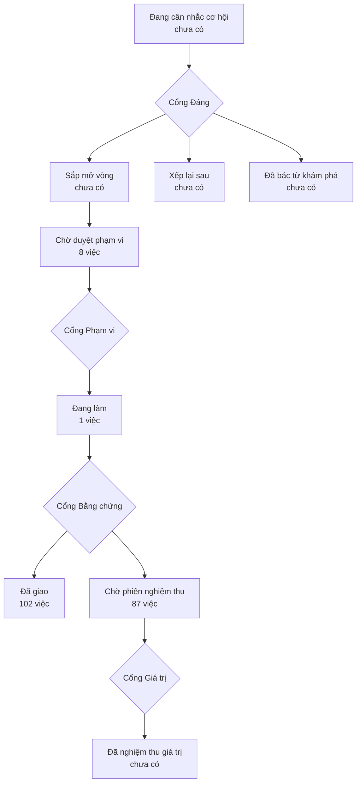

# Bản đồ sản phẩm

> Bản đồ vẽ lại từ hồ sơ của xưởng mỗi lần một người ký một cổng — đừng sửa tay.
> (đọc từ thư mục `_acceptance/` và `.out-of-scope/`)
> Lộ trình: [LO-TRINH.html](LO-TRINH.html)

> **Bốn cổng người** — mỗi cổng là một câu hỏi chỉ người trả lời được:
> **Cổng Đáng** việc này có đáng làm không · **Cổng Phạm vi** bộ tiêu chí
> đã đủ và đúng chưa · **Cổng Bằng chứng** đã làm đúng thứ đã hứa chưa ·
> **Cổng Giá trị** thứ đã giao có ăn thua không.

## Chờ duyệt phạm vi

- ADR-0015 «đường lệnh kéo một chiều cloud → máy thu» và bản sửa đổi ADR-0007, kèm thuật ngữ mới và ROADMAP §2.3–2.4 khớp thực tế (`adr-duong-lenh-keo`)
- Ca CD-AC-7b chờ request lưu ghi xong rồi mới đọc params, hết chập chờn trên CI (`che-do-thu-test-cho-luu`)
- Tài liệu và đánh dấu của kho khớp các chốt 23–24/10 (tên nhóm S03 tầng C, luật S08, luật phép đo Zalo, ROADMAP V9) (`chep-chot-2410`)
- CI bỏ qua ca «DF-AC-3 DB thật» cần tin rao thật ở DB local (chỉ chạy ở máy thu) (`ci-bo-qua-df-ac-3`)
- Bật nhóm khoá kit 2.34.0 cho làn ghim lại và lưới hoá cũ; gỡ đường cache 2.32.0 khỏi config (`kit-khoa-nhom-1`)
- Lớp chép CI của Acceptance Gate Kit lên 2.34.0 và kế hoạch chuyển bản cho đợt dot0-cam-mau (`nang-kit-2-34-0`)
- Nhận kit 2.35.0 — đổi đường bộ đệm có số sang 2.35.0 và khai vùng giao diện (design-floor bậc M1) (`nhan-kit-2-35-0`)
- Nhận kit 2.36.0 — chép lớp CI theo thẻ, vẽ lại bản đồ, bật GITATTR-TEP-SINH (`nhan-kit-2-36-0`)

## Đang làm

- Công tắc cho bước gộp Người theo SĐT trong job đêm, mặc định tắt, bật/tắt bằng lệnh có lý do ghi ops_audit (`cong-tac-gop-nguoi-dem`)

## Đã giao — chờ phiên nghiệm thu

- Người duyệt vai Vận hành ở máy thu thấy ảnh tin chỉ có URL gốc (S06, S05) trên thẻ duyệt — ảnh đi qua máy chủ theo media_key, trình duyệt không nhận URL hay tên miền nguồn (`anh-goc-qua-may-chu`)
- audit-all không còn PASS giả ở backup và membership S03, và kiểm các trang /ops ở đúng cổng :3456 (`audit-all-noi-that`)
- Khách đăng nhập hoặc đăng ký qua auth-4/auth-5 không còn chuyển động bị cấm, gradient tự chọn hay chữ kích thước tuỳ ý, và lỗi nhóm (auth) hiện error.tsx (`auth-hop-chuan`)
- Bộ bóc SĐT của S03/S05 bắt đủ bốn dạng viết tách lạ, bỏ số 11 chữ số, và tin chọn SĐT theo luật rõ trên mọi bài của tin — dạng số ra giữ nguyên (`boc-sdt-du-va-chon-ro`)
- Bước chụp trang của kho gặp lỗi ở bất kỳ bước nào cũng không in hay đặt tên nguồn thật ra ngoài tiến trình, và không ghi ảnh khi chưa che xong tầng A (`buoc-chup-khong-in-ten-that`)
- Bảng canonical không còn tin sinh từ dữ liệu thử, và transform từ chối post thử nếu lọt vào (`canonical-khong-tin-gia`)
- /ops/sources hiện và đổi chế độ thu (Chờ · Bùng · Duy trì) của từng điểm thu — bật Bùng chỉ admin và bắt buộc hạn ≤ 14 đêm; máy tự hạ bùng quá hạn về Duy trì; mọi lần đổi ghi ops_audit (`che-do-thu-tren-ops`)
- Luật ghép căn và bảng so thẻ duyệt so ô đường theo tên đường — bỏ ngõ/ngách/hẻm/số nhà và đuôi địa chỉ, không còn loại oan «đường khác» (`chuan-hoa-o-duong`)
- Job cloud-sync thoát khác 0 khi bất kỳ bước nào hỏng, và push-ops-facts kết nối theo DATABASE_URL (`cloud-sync-bao-loi-that`)
- Nhà đầu tư mở So sánh ở /compare (301 từ /so-sanh) và Đã lưu, cả hai có PageHeader, trạng thái tải/trống/lỗi, Đã lưu trống dùng c-empty-11 (`compare-saved-trang-thai`)
- Công tắc bật/tắt nhóm thu ở /ops/sources không hạ nhóm đã gỡ hay đã xong về tạm dừng, không hồi sinh chúng qua tắt rồi bật, và không đổi nhóm nháp thành tạm dừng khi tắt (`cong-tac-khong-ha-nhom-go`)
- Ca thử công tắc nhóm thu đối chứng với bản route trước sửa đã ghim cố định trong kho, nên vẫn xanh sau khi PR (`cong-tac-test-ghim-ban-cu`)
- /api/v1/ops/coverage trên máy chủ trả độ tươi từng nguồn S0x từ khối độ tươi máy thu đẩy lên (ADR-0014), có cờ tươi / cũ / chỉ đo ở máy thu, không trường nào chứa tên nguồn thật (`coverage-cloud-got-tang-a`)
- DB local tự khởi động lại sau khi Docker hoặc máy khởi động lại (`db-tu-khoi-dong`)
- Mỗi căn và mỗi tin chưa gắn căn có bậc dữ liệu B0–B5 tính bằng một hàm, phân bố bậc theo thị trường × loại hình được chụp mỗi ngày và in ra được, và một kiểm chất lượng giữ bất biến «mọi đề xuất enrich đã áp có phát biểu tương ứng» (`de-xuat-thanh-phat-bieu-bac`)
- /api/v1/deals chỉ trả dữ liệu cho token ops cho tới khi tin mock được rút khỏi canonical (`deals-api-tam-dong`)
- Người vận hành mở «Căn giá tốt» /ops/deals không thấy căn có diện tích hay số phòng phi lý, danh sách không dồn ở trần giảm giá, và thẻ ghi «đăng 1 lần» thay «mới» (`deals-loai-tin-phi-ly`)
- Người xem và bearer chung không nhận định danh tài khoản thu hay mã nhóm Zalo ở bề mặt Thu thập; mã nhóm không lên cloud (`dinh-danh-tai-khoan-thu-theo-vai`)
- Mỗi đêm đo trục SĐT của danh bạ Người và ghi vào dq_check_results để /ops/quality hiện (`do-danh-ba-sdt`)
- Mỗi đêm scorecard ghi tỉ lệ thẻ ghép căn chờ duyệt có đủ dữ liệu hai bên (ảnh, đặc trưng nhà, người đăng, tin còn sống) (`do-the-duyet-du-du-lieu`)
- Người vận hành mở /ops/data-flow trên cloud và thấy số chặng bài → tin rao → căn theo nguồn và số tin từng bậc, cùng số với máy thu, không còn khung «Chỉ xem ở máy thu» (`dong-chay-len-cloud`)
- Người vận hành mở /ops/data-flow ở máy thu khi bước làm tươi số dòng chảy hỏng quá 45 phút thì thấy cảnh báo số cũ như trên cloud, không phải số cũ trình bày như số mới (`dong-chay-so-cu-may-thu`)
- Người vận hành mở «Kiểm chất lượng» trên /ops/quality thấy bản mới nhất của mỗi kiểm theo từng thực thể, số kiểm đếm đúng, và kết quả độ phủ không ghi «Đạt» xanh khi độ phủ 0% (`dq-moi-nhat-moi-kiem`)
- Enrich chạy mỗi đêm sau lượt nạp S03/S05 — mỗi tin một giao dịch ngắn, ghi đề xuất và áp luật xác định, lỗi LLM có đếm, dòng tổng kết đếm đúng, không bốc lại tin đã thử (`enrich-chay-sau-nap`)
- Người vận hành dữ liệu chạy eval:classify và nhận độ đúng từng (cách đọc × trường × phân khúc) theo cận dưới Wilson so với ngưỡng F3, ghi vào dq_check_results (`eval-classify-wilson`)
- check-freshness đo S03/S05/S06 theo giờ THU thật của snapshot thay vì giờ NẠP — nguồn ngừng thu mà bị nạp lại bản cũ phải báo quá hạn (`freshness-do-gio-thu-that-s03`)
- check-freshness đo độ tươi theo bảng thật của từng nguồn, có SLO cho S05 và S06, không còn dòng quá hạn giả (`freshness-theo-nguon-that`)
- Gỡ tài khoản Zalo kiểm bản cấu hình sau khi gỡ trước lệnh đăng xuất: cấu hình phạm bất biến bộ canh thì từ chối mà không đăng xuất phiên nào (`go-tai-khoan-kiem-cfg-truoc-logout`)
- Route gỡ tài khoản thu DELETE /api/v1/ops/zalo/accounts từ chối id rỗng hoặc không có trong danh sách tài khoản trước khi gọi openclaw (`go-tai-khoan-kiem-id`)
- Ảnh của tin chỉ-ảnh S03 (ảnh gửi riêng trước hay sau tin chữ, cùng người, dưới 2 phút) vào đúng offer trong bảng ảnh canonical; bảng nạp và sale_offers giữ nguyên (`gop-tin-chi-anh-o-transform`)
- Người vận hành mở «Hiệu chuẩn» trên /ops/quality thấy mỗi thị trường một bộ số nhất quán giữa các bảng, định nghĩa «tự thu» ghi rõ ở từng bảng, mẫu mỏng có cờ, và thị trường chưa có số gộp thành một dòng; bước chụp trang của kho chụp được /ops đã đăng nhập (`hieu-chuan-mot-bo-so`)
- Mỗi tin có người đăng gắn với một người trong danh bạ Người của đúng nguồn ấy qua vai «người đăng» là một phát biểu có bằng chứng, và nạp lại không nhân người (`ho-nguoi-theo-nguon`)
- Mọi job đêm thoát khác 0 khi không tới được DB, và watchdog cảnh báo khi DB sập (`job-bao-loi-that`)
- Thẻ ghép căn do judge-run sinh mang đủ mười trường của bảng so cho cả Tin A và Tin B (`judge-evidence-du-truong`)
- Chấm lại ghép căn không đổi thẻ người vừa quyết, và so phường theo cùng khoá với thẻ duyệt (`judge-giu-quyet-dinh-nguoi`)
- Bộ đánh giá ghép căn loại trừ tất định một cặp khi một đặc trưng nhà khác rõ, ghi đặc trưng nào khác vào evidence (`judge-luat-loai-tru-dac-trung`)
- Ghép căn kết luận bằng luật ngưỡng trong code, LLM chỉ viết lời giải thích; mỗi lần chấm ghi model và trace lên thẻ; mọi cặp ứng viên needs_llm sinh đúng một thẻ ghép căn (`judge-nguong-la-code`)
- Thẻ duyệt ghép căn và luật chấm cùng coi «P.12» là «Phường 12» (`khoa-phuong-chung-phuong-so`)
- Leak gate của sync cloud đỏ khi role anon còn SELECT được bất kỳ bảng hay view nào (`leak-gate-kiem-anon`)
- Nhà đầu tư mở /listing/[id] thấy đầu trang product-detail-5, ảnh tự thu khi có (không có thì ẩn gallery), lịch form-5 không còn điều khiển thô, vùng dữ liệu có Skeleton và Empty (`listing-detail-product-detail-5`)
- Nhà đầu tư duyệt listing lọc bằng filters (màn hẹp filter-sidebar-5) và bản đồ @mapcn/store-locator gom cụm, vẫn lọc theo khung nhìn khi kéo hoặc zoom (`listings-filters-store-locator`)
- Nhật ký thao tác Ops (GET /api/v1/ops/audit) không trả dấu máy enrich:thu — thao tác của người không bị đẩy khỏi 100 dòng gần nhất (`loc-enrich-thu-ops-audit`)
- Trên máy chủ, ô và lưới Khoá an toàn đọc khối lockdown máy thu đẩy lên; không có số thì 8/8 lớp «Chỉ kiểm ở máy thu», không lớp nào xanh; Kev gate và collector API ở Máy móc cùng trạng thái với Khoá an toàn (`lockdown-cloud-theo-facts`)
- Route POST /api/v1/ops/zalo/login từ chối accountId không có trong danh sách tài khoản trước khi spawn openclaw channels login (`login-kiem-id`)
- Người gắn nhãn mở màn gắn nhãn trên /ops, gắn trường lõi cho tin của lát mà không thấy giá trị máy đoán, và 20% tin được gắn trùng để đo đồng thuận (`man-gan-nhan-mu`)
- Bản khai công cụ app/docs/api/mcp-tools.json khớp sổ bề mặt API: công cụ tin rao đòi bearer ops hoặc bị gỡ, không công cụ nào ghi «public» trái sổ (`mcp-tools-theo-so-be-mat`)
- Ảnh của tin S03 và S06 nằm ở một bảng media canonical theo RESO Media nối với offer, và /ops/review, /ops/data-flow ở máy thu đọc ảnh từ bảng này (`media-canonical-reso`)
- Nạp lại mọi nguồn không xoá hàng: khoá tin bền, retired_at thay DELETE, mọi khoá ngoại tới sale_offers và listings là RESTRICT (`nap-lai-khong-xoa`)
- Danh bạ Người gộp người theo SĐT vào người theo tài khoản cùng nguồn khi nối một–một, mỗi lần gộp có vết và tách lại được (`nguoi-noi-theo-sdt`)
- Người gắn nhãn gõ giá có dấu chấm ngăn nghìn hay gửi đơn vị lạ thì bị chặn với lỗi dưới ô thay vì lưu sai 1000 lần, và mất mạng khi Lưu thì thấy thông báo (`nhan-gia-va-luu-loi-mang`)
- Bảng nhóm S03 ghi đúng số nhóm đang bật trong danh sách cho phép và «Vào bảng thô» theo nhóm — ở máy thu đo trực tiếp, trên máy chủ đọc khối s03 máy thu đẩy lên; thiếu số thì «—», không 0 (`nhom-s03-tren-cloud`)
- Ô KPI ba trang Ops trên cloud đọc số máy local đẩy lên kèm mốc đo giờ VN; không có số thì «—» và «Chỉ đo ở máy local» một lần; số cũ quá 45′ thì báo, không badge xanh (`o-kpi-chi-do-local`)
- Người vận hành mở /ops/data-flow ở máy thu và thấy dòng chảy bài → tin → căn, chất lượng từng chặng và bậc nghiêm của từng tin; cột «bài thô» S03 không lẫn bài S05 và bài thử (`ops-dong-chay-df0`)
- Sau mỗi lượt cloud-sync, máy local đẩy lên cloud năm khối số tổng hợp Ops có mốc đo, qua bộ soát tầng A, và cloud có một hàm đọc chung báo số cũ quá 45′ (`ops-facts-so-tong-hop`)
- Người vận hành đọc /ops/collections và /ops/quality chỉ thấy mã S0x kèm vai trò, không tên nguồn thật — kể cả nhãn job đẩy từ máy thu (`ops-nhan-ma-nguon`)
- Người duyệt mở /ops/review và thấy hàng chờ dạng bảng theo solution-agents-5, lọc theo loại thẻ, bấm một hàng mở sheet chi tiết có dải ảnh tin xem được cả ở màn 390px (`ops-review-khung-hang-cho`)
- Bảng phát biểu append-only và bộ phân xử ba lớp dựng cột canonical kèm provenance, chạy lại ra y nguyên (`phat-bieu-va-phan-xu`)
- Thẻ duyệt ghép căn và luật chấm đọc trọn các cách ghi phường số (`phuong-so`)
- Proxy ảnh tin /api/zalo-media chỉ phục vụ ảnh raster an toàn (jpeg/png/webp/gif); SVG và kiểu ảnh lạ trả 415; mọi phản hồi ảnh mang nosniff + CSP sandbox (`proxy-anh-chan-svg`)
- Mọi route /api/v1/ops/** kiểm vai theo một bảng bốn vai (viewer, ops, admin, owner) ở ops-access.ts, và mỗi thao tác ghi đúng một dòng ops_audit mang id người thật trong cùng transaction (`quyen-bon-vai-mot-cho`)
- Quyết định trên thẻ ghép căn chỉ ghi khi chạm đúng một ứng viên còn chờ; không chạm được thì route trả lỗi có tên, thẻ vẫn chờ, không dòng nào được ghi (`quyet-dinh-phai-cham-ung-vien`)
- resolve-properties tự thử lại có hạn khi Postgres báo deadlock (40P01), không đổi logic resolve (`resolve-thu-lai-deadlock`)
- Transform S03 đọc giá và diện tích không lẫn URL/SĐT, chuẩn hoá cách viết giá của môi giới, chặn giá phi lý, gom repost theo mã toà/căn, ghi tên người bán và phường theo thị trường của nhóm (`s03-cam-mau-so-lieu`)
- Giá tỷ chẵn viết bằng đồng («3.000.000.000 đ») không bị bước gạt SĐT của transform S03 nuốt mất (`s03-gia-ty-chan-dong`)
- Giá tỷ viết bằng đồng mà ngay sau là khoảng trắng/xuống dòng rồi số 1–2 chữ số («3.000.000.000\n50m2») không bị bước gạt SĐT của transform S03 nuốt mất (`s03-gia-ty-sau-khoang-trang`)
- Bộ nhận loại tin S03 nhận tin bán và tin thuê không ghi chữ «bán/cho thuê» theo tín hiệu chữ, đơn vị giá và bối cảnh nhóm; vẫn loại bài khách tìm nhà; bài đã có loại không đổi (`s03-nhan-loai-tin-rong`)
- check-freshness và /ops đo S05 theo nhịp 2 lượt/tuần: SLO_HOURS.S05 = 96 giờ ở cả hai bản chép, giữ parity với /ops (`s05-slo-theo-lich`)
- Tin và danh bạ Người lưu số gốc SĐT ở một dạng +84…, danh bạ có bí danh số gốc, và bảng người bán thành view trên danh bạ (`sdt-luu-goc-e164`)
- Bước tổng hợp người bán thêm dòng cho mọi SĐT mới trên tin, không chỉ cập nhật và xoá dòng đã có (`sellers-them-dong-lai`)
- Người vận hành thấy cùng một số SLO trên /ops và /ops/collections (`slo-mot-nguon`)
- Mọi route API của app nằm trong một sổ bề mặt và chỉ trả đúng thứ sổ cho phép (`so-be-mat-api`)
- Người vận hành mở /ops và thấy chi phí, token, độ trễ của mọi cuộc gọi AI theo việc, model và ngày (`so-cuoc-goi-ai`)
- Người vận hành khai mọi đơn vị thu (nhóm S03, nhóm S05, vùng S06, market S02) trong một sổ trên /ops, mỗi đơn vị có mã ổn định dạng S03-N012, thị trường, dự án nhóm chuyên và trạng thái vòng đời (`so-nhom-mot-noi`)
- Một sổ từ vựng sinh bảng ref_*, hằng TS/JS, enum prompt và nhãn tiếng Việt; lint đỏ khi có enum viết tay ngoài sổ (`so-tu-vung-mot-nguon`)
- Mọi đường dữ liệu rời máy (sync và ops-facts) qua cùng một bộ soát tầng A chặn khi lỗi (`soat-tang-a-moi-duong-len-cloud`)
- Người vận hành dữ liệu sinh được một tập tin mẫu của lát Ocean Park 1 có đáp án biết sẵn, sinh lại ra đúng tập cũ, mang dấu mẫu và không bao giờ tới bảng canonical — để PL9 chấm cách đọc tin trước khi đội gắn nhãn xong (`tap-nhan-mau-ocp1`)
- Người duyệt mở /ops/review và thấy mọi trường kèm căn cứ, ảnh tin và toàn văn tin, không có «AI tự tin %», rồi quyết kèm lý do được ghi audit cùng giao dịch (`the-duyet-du-can-cu`)
- Thẻ ghép căn có một bên đã rời kho tự rút khỏi hàng duyệt kèm lý do «tin rời kho» và vết audit (`the-ghep-can-tin-roi-kho`)
- Người duyệt mở thẻ ghép căn và thấy bảng so đọc giá trị sống của hai tin, ô thiếu một bên hiện «Thiếu» chứ không tính là «Lệch» (`the-so-doc-gia-tri-song`)
- Mọi phát biểu có thời điểm quan sát; mỗi tin có trạng thái chào được phân xử từ bằng chứng theo thời gian; giá và trạng thái của tin được giữ thành lịch sử gom được theo căn; căn lên B5 khi đang chào, còn trong cửa sổ độ tươi và có lịch sử giá (`thoi-gian-va-hieu-luc`)
- Khách mở trang chủ và /methodology (301 từ /phuong-phap) thấy định nghĩa dạng faq-3, hero và thẻ thị trường không còn màu cứng, lỗi nhóm marketing có error.tsx và lỗi toàn cục có global-error.tsx (`trang-chu-methodology`)
- Job nạp Zalo hằng đêm thoát khác 0 khi bước transform-zalo hoặc refresh-bait-gap hỏng, mỗi bước hỏng in một dòng JOB FAIL; phần nạp giữ nguyên (`transform-zalo-boc-job-run`)
- Thẻ hiệu chuẩn của khu vực gộp nhiều market S02 cho tỉ lệ «Listing» khớp bảng Độ phủ trung thực: tự thu của cả khu vực chia cho tổng listing S02 của mọi market thành phần (`ty-le-listing-khu-vuc-gop`)
- Vai người xem (viewer) vào được Cổng Ops nhưng không thấy nội dung thẻ duyệt và bài gốc — chỉ vai vận hành trở lên thấy (`viewer-khong-thay-the-duyet`)
- source_registry và sổ nhóm có vòng đời năm trạng thái kiểm bằng CHECK kèm lý do và điều kiện bật lại, và một hàm isRunnable trả quyết định chạy cho từng nguồn và đơn vị thu (`vong-doi-nguon`)
- Nhà đầu tư dùng /yield thấy bảng chi phí vận hành và phần «Dòng tiền vốn vay» dựng bằng data-grid-advanced-7, còn link /vn/<market>/dau-tu cũ chuyển 301 về /yield?area=…#financing (`yield-dong-tien-von-vay`)
- Phép so phần nạp của zalo-import-daily.sh (ZJ-AC-5) chứng trên hai commit cố định của vòng transform-zalo-boc-job-run, không báo đỏ giả khi làn ZCode sửa hợp lệ phần nạp (`zalo-import-so-phan-nap-khong-do-gia`)

## Đã giao

- Ca «AER-AC-2 không lệnh nào đổi nghĩa» so cặp commit cố định của vòng sửa config.yaml thay vì merge-base origin/main, để PR khác thêm, sửa hay xoá khoá trong _acceptance/config.yaml không bị CI chặn nhầm (`aer-ac2-so-cap-co-dinh`)
- Listing Airbnb bị transform cho nghỉ ngoài phường mang toạ độ của lần thu mới nhất, nên reassign-areas không đánh thức nó bằng toạ độ cũ (`airbnb-nghi-khong-hoi-sinh`)
- Sổ bề mặt API khai /api/zalo-media rộng bằng hoặc hơn quyền thật sau PL3 (ảnh snapshot cho vai Vận hành), route và hai bộ kiểm tĩnh khớp sổ (`api-surface-anh-vai-ops`)
- AU3 phần nạp — tác vụ Chợ Tốt và Facebook báo lỗi rõ khi nạp hỏng, không nhảy qua snapshot lỗi (`au3-nap-bao-loi`)
- audit-all.sh và trang Ops ở máy local đọc log job ở checkout chính dù chạy từ worktree, không báo LIMITED hay «Hỏng» giả vì thư mục log rỗng (`audit-all-doc-log-o-checkout`)
- ca ON16-AC-2 của audit-all.test.mjs thôi chập chờn qua ranh giới phút — hộp test ghim mốc giờ của dòng tiêu đề bằng bản giả date (`audit-all-test-moc-phut`)
- ZC3 — watchdog Zalo không sót log đầu ngày, cảnh báo drop bất thường và DB chết; nạp Zalo đêm phục hồi sau khi DB sập (`audit-p1-resilience`)
- Ô E2 đã ký của auth-error-thu-lai-retry được thay bởi một tiêu chí tả đúng ba ca AC-2 hiện có (YAML chuẩn, bộ đọc kit khớp bộ đọc chuẩn, so trước-sau trên cặp commit cố định) — sổ hồ sơ hết lệch với code (`auth-error-e2-superseded`)
- Khi trang đăng nhập hoặc đăng ký lỗi lúc dựng, nút «Thử lại» tải lại phần trang từ server (retry) thay vì chỉ vẽ lại phía client (reset); _acceptance/config.yaml thành YAML chuẩn (`auth-error-thu-lai-retry`)
- backfill ảnh Zalo xét cả snapshot zalo-agent schemaVersion 3, không chỉ v2 (`backfill-zalo-media-v3`)
- Bật gói dieu-phoi ở cấp kho — thêm dieu-phoi@acceptance-gate-kit vào enabledPlugins của .claude/settings.json, cùng nguồn marketplace với các gói kit khác, không đổi gì khác (`bat-dieu-phoi-cap-du-an`)
- Vai Người xem không dò được bí danh đã che qua ô tìm của /ops/people — máy chủ bỏ ?q= và trang ẩn ô tìm với vai dưới Vận hành (`che-tim-bi-danh-viewer`)
- bước kiểm local-only của check-s08-inventory chạy được trên main sau khi import-airbnb nhập import-s08-row (`check-s08-harness`) — đã giao — máy thông, cửa veto còn mở
- nạp lại một snapshot Chợ Tốt cũ hơn không làm lùi giá, tiêu đề và nội dung của tin đã có bản mới (`chotot-khong-lui`)
- CI chạy typecheck và test của app, pipeline, agent, data-api trên mọi PR (`ci-test-module`)
- Đồng bộ cloud nguyên tử — prod không trống/thiếu dữ liệu giữa các lượt sync; chốt luật sale_offers lên cloud (`cloud-sync-atomic`)
- Người vận hành mở /ops/collections không thấy số S02 nào ở biểu đồ, bảng hay panel Rotation; số S02 chỉ ở /ops/quality và tiêu đề biểu đồ nói rõ đang đếm gì (`collections-khong-so-s02`)
- script cài collector :9210 dưới launchd (ZC4 bước code) — kiểm điều kiện chạy trước, ghi plist, KHÔNG tự khởi động (`collector-api-launchd`)
- Collector API :9210 tắt êm — SIGTERM/SIGINT flush hết buffer rồi mới thoát (`collector-graceful-shutdown`)
- 2510-2 — collector API không còn treo cứng khi một lượt flush có hơn 5000 tin mới; bộ nhớ khử trùng giữ đúng 5000 id mới nhất; lô HTTP có trần (`collector-seen-cap`)
- công tắc thật — mọi đường thu S01, S02, S05, S06 hỏi vòng đời nguồn × đơn vị qua một cổng trước khi gọi nhà cung cấp, hết danh sách cứng, lỗi DB thì dừng (`cong-tac-that`)
- Trang /ops/people cho người vận hành xem danh bạ Người ở máy thu — người theo nguồn S0x, số tin đã đăng, bí danh, nhãn suy luận chỉ hiển thị (`danh-ba-nguoi-tren-ops`)
- Dữ liệu DB local nằm trong volume có tên — sao lưu, khôi phục kiểm được, chuyển và lùi (`db-vao-volume`)
- Tự kiểm live của DB local đo đủ bốn nhánh dữ liệu, gồm volume khác tên (`db-volume-check-volume-khac-ten`)
- Thước live của DB local không đòi bản lùi tồn tại mãi (`db-volume-live-ban-lui`)
- test DB theo lược đồ sau 044 — DP-AC-5 xoá cột PII trên bảng bản ghi, test không áp lại 044 khi DB đã có (`deals-phi-ly-test-theo-view`)
- tài khoản ops thử chỉ ở DB local cho máy tự đăng nhập dev (`dev-ops-account`) — đã giao — máy thông, cửa veto còn mở
- Biểu đồ «Chặng theo ngày» trên /ops/data-flow vẽ đủ mọi ngày của cửa sổ, ngày nguồn im là điểm 0 (`df0-chang-theo-ngay-diem-0`)
- Đầu trang /ops/data-flow đếm «đề xuất làm giàu» theo trạng thái chờ thật (queued), thôi luôn là 0 (`df0-dem-de-xuat-lam-giau`)
- Phép đo gán khu vực tin rao (kiem-tin-rao-gan-khu-vuc --thu) tự dựng tin mồi trỏ khu vực không hợp lệ trong transaction, không dựa vào trạng thái DB thật (`do-khu-vuc-tu-dung-moi`)
- đo nền hiệu năng DB local + 5 trang chính (Invest, Ops) trên build prod — số nền vào docs/research, ngưỡng chỉ đề xuất (`do-nen-hieu-nang`)
- Bộ test design-floor dọn mọi thư mục tạm nó tạo (clone sau-gộp, bản chép, cap-config, reuse-plan) khi tiến trình thoát, để mỗi lượt chạy không bỏ lại rác trong TMPDIR (`don-clone-tam-design-floor`)
- Mã giao diện của app hết hex thô ngoài thư mục vendor — màu bản đồ dời sang app/src/lib, mặt nạ quét dùng black, giữ đúng từng giá trị màu (`don-hex-tho`)
- dựng sẵn nguyên liệu M2 của design-floor (chưa bật) — lệnh sinh tokens DTCG + danh mục thành phần, skill onehub-ui buộc reuse-plan.md ở S1 (`dung-m2-song-song`)
- ca «AC-6 để sau» của agent/tests/enrich-db.test.ts khoanh lượt backlog vào tin của chính ca — hết đỏ ngẫu nhiên trên DB :5433 dùng chung (`enrich-db-test-khoanh-tin`)
- Hậu kỳ enrich-qua-de-xuat — đề xuất sống qua nạp lại, hoàn tác có audit, E1 không suy đất từ tên nhóm (`enrich-hau-ky`)
- Enrichment qua đề xuất — giá trị LLM không ghi thẳng sale_offers/properties (`enrich-qua-de-xuat`)
- Người vận hành đọc mọi mốc giờ trên cổng Ops theo giờ Việt Nam có ghi múi, ngày gom theo giờ Việt Nam, và nguồn quá hạn hiện đúng mức trễ thay vì tuổi bằng SLO (`gio-ops-gio-vn`)
- 2410-1 — mốc thu captured_at của stg Zalo và Chợ Tốt luôn là giờ thu snapshot, nạp lại không làm sai, có script khôi phục kèm sao lưu (`giu-captured-at`)
- Ngôn ngữ chuẩn — CONTEXT.md, luật đặt tên, bối cảnh sản phẩm, test slug route (`glossary-context`)
- ZC6 nối tiếp — hook Zalo giữ tin lại hàng đợi khi khoá collector sai (401/403/404) và có trần thời gian cho cả lượt xả (`hook-spool-nghiem-ngat`)
- ZC6 — hook Zalo giữ tin trong hàng đợi cục bộ khi collector chết rồi gửi lại, không làm treo gateway (`hook-zalo-spool`)
- importer S08 nạp snapshot S08 vào stg_s08_inventory, chạy lại không nhân dòng, đổi số an toàn, bỏ snapshot thử (`import-s08`)
- PL1 — importer bỏ qua mọi snapshot thử (zalo-mock, e2e, TEST), không ghi chúng vào stg_* (`importer-bo-qua-du-lieu-thu`)
- Bản đồ đích cổng Invest — block đích cho mọi route Invest trước khi dọn tiếp (`invest-target-map`)
- ZC1 nối tiếp — cứng hoá ingest của collector API (media rác không làm hỏng lô, id tin chữ giữ nguyên, payload nguyên vẹn) (`kev-nhan-cung-hoa`)
- sửa thước kiểm kev-nhan đỏ sẵn trên main — tên thư mục giả theo khuôn PL1 và chữ log Kev hỏng theo ZC6 (`kev-nhan-thuoc-sau-pl1`)
- PL4 — hook Zalo đẩy mọi tin tới collector kèm điểm Kev (meta.kev), không bỏ tin theo điểm (`kev-thanh-nhan`)
- kho tri thức riêng tư đi kèm — nguồn của mọi bản phạm vi đang dùng là trang tri thức ghim băm (`kho-tri-thuc-invest`)
- khoá nạp Zalo tự gỡ khi tiến trình giữ khoá đã chết hoặc khoá quá 2 giờ; S05 tạm dừng thì bước thu không gọi Apify; lịch S05 xuống 2 lượt/tuần (`khoa-nap-s05-paused`)
- Trang /ops gọi đúng tên thị trường vùng mới của S06 (Đà Nẵng, Hải Phòng, Khánh Hoà) khi bảng khu vực còn giữ mã dài — bản tạm ở app tới khi đổi mã khu vực (`khu-vuc-vung-moi-s06`)
- Danh sách tệp bản đồ được dùng hex (MAP_FILES) viết trước chỉ ghim chữ ở một module chung; LB-AC-1 và DHT-AC-5 cùng đọc nó (`lb-ac-1-map-files-mot-nguon`)
- Gỡ ảnh và chữ AirDNA khỏi trang chi tiết listing (Invest) (`listing-airdna-photos`)
- Lộ trình máy đọc + quy định «mỗi loại thông tin một chỗ» — bật gói road-map, cắt đợt phan-loai-2310 và cam-mau-2310 (`lo-trinh-2310`)
- Lockdown tính ở máy local không báo «Ổn» cho lớp không kiểm được và «Dòng log cuối» của job là dòng có nghĩa (`lockdown-local-noi-that`)
- Lối vào các script Node chạy được khi gọi qua symlink ~/dev/one-invest (job đêm launchd) (`loi-vao-script-chay-qua-symlink`)
- Người vận hành đọc «Luồng 7 ngày qua» trên /ops/collections thấy mỗi cột đếm đúng thứ nhãn nói — tin rao đúng nguồn, đủ 7 ngày từ số máy thu đẩy lên, cột không có số trên máy chủ ghi «Chỉ ở máy thu» (`luong-7-ngay-dung-so`)
- Ca «M2-AC-10 chỉ thêm hai dòng config» so cặp commit cố định 3b3a33e5^→3b3a33e5 thay vì merge-base origin/main, để bộ test design-floor không đỏ trên main sau khi gộp hay trên nhánh khác sửa config.yaml (`m2-ac10-so-cap-co-dinh`)
- Dọn luật hỏi quyền rộng — rào push main chuyển sang branch protection GitHub như crm/kit (`narrow-ask-rules`)
- Dòng kiểm chất lượng ảnh tin media:local-file có nhãn tiếng Việt trên /ops/quality (`nhan-dq-media-local-file`)
- Tick bật nhóm trên /ops/sources luôn ghi requireMention true, và bộ ghi cấu hình OpenClaw từ chối mọi bản cấu hình phạm bất biến bộ canh trước khi ghi (`nhom-moi-requiremention`)
- Vùng giao diện của design-floor liệt kê dương (loại thư mục vendor), có test bắt thư mục sót, và sàn thiết kế S4 được nối (`noi-design-floor`)
- hai việc nối tiếp ZC4 — script cài collector tạo thư mục log và không để plist rỗng; lượt thu bị bỏ qua không để lại thư mục ẩn rỗng (`noi-tiep-zc4`)
- hai test app chập chờn thành tất định — ON22-AC-5 (lớp hạ tầng đo trực tiếp máy) và listings-browse (ngăn lọc đóng theo nhịp hẹn giờ, assert inspect phần tử jsdom treo tiến trình) (`on-dinh-test-app-chap-chon`)
- Siết quyền — cổng Ops đóng mặc định, /api/zalo-media chỉ ảnh staging (`ops-access-hardening`)
- Đổi URL cloud cứng từ project Vercel cũ sang prod mới onehub-invest.vercel.app (`ops-ingest-url-onehub-invest`)
- Người trực mở bảng Ops trên điện thoại 390px thấy cột Trạng thái ngay sau cột tên, không phải cuộn ngang mới thấy Hỏng hay Ổn (`ops-mobile-cot-trang-thai`)
- Người vận hành đọc cổng Ops thấy nhãn theo CONTEXT.md, không chữ tiếng Anh hay mã thô, chi tiết kiểm chất lượng diễn giải tiếng Việt, tên thị trường có dấu đầy đủ (`ops-nhan-theo-context`)
- /ops và /ops/collections trên cloud không còn vỡ khi thiếu source_registry — nói rõ độ tươi chỉ đo ở máy local (`ops-prod-sap-source-registry`)
- /ops/review và /ops/sources trên cloud không còn 500 khi thiếu bảng tầng A — nói rõ chỉ có ở máy local (`ops-review-sources-500-tren-cloud`)
- Áp hay hoàn tác một đề xuất làm giàu thì mọi tin chung bài đăng được phân xử lại; dữ liệu đã lệch được sửa một lần; hai ca đỏ của bộ test phát biểu xanh lại trên main, và test dòng chảy cloud tự dọn lược đồ tạm (`phat-bieu-db-do-tren-main`)
- Vá ranh giới cổng — Căn giá tốt sang Ops, gỡ AirDNA khỏi Mô phỏng đầu tư (`portal-deals-airdna`)
- Bộ kiểm sổ bề mặt API (check-api-surface) không đỏ vì tệp đột biến tạm của test khác bị xoá giữa lúc quét — CI app thôi đỏ chập chờn ở QV-AC-9 (`qv-ac-9-khong-chap-chon`)
- Khu vực Hà Nội chỉ gồm phường/xã của Hà Nội; metrics tính lại theo ranh giới đúng (`ranh-gioi-khu-vuc-dung`)
- script đo nền hiệu năng chỉ chạy trên DB local — rào assertLocalDatabaseUrl trước mọi lệnh ghi DB (`rao-db-local-do-nen`)
- Ảnh tin trên thẻ hàng duyệt /ops/review (dải ảnh + phóng to, nối loadReviewMedia) (`review-card-photos`)
- Backend ảnh tin cho hàng duyệt /ops/review (route /api/zalo-media + loader ảnh theo thẻ) (`review-media-backend`)
- Đưa view ruler v_ruler_p2_area + v_ruler_p2 vào migration và hướng dẫn bắt kịp schema cloud (`ruler-p2-views-migration`)
- Tin rao S03 thôi gộp nhầm bài của nhiều người khi thiếu phường/diện tích, và cột «Luồng 7 ngày» đếm đúng tập bài transform đọc (`s03-gop-trung-dung`)
- bộ nạp S03 lọc U+0000 khỏi mọi chuỗi trước khi ghi stg_zalo_posts — gỡ kẹt nạp đêm từ 29/10 (`s03-null-byte`) — đã giao — máy thông, cửa veto còn mở
- Phép đo danh bạ SĐT chặt — mỗi số một người đo mỗi đêm, đúng ảnh và tên đúng người khi chuyển 060, che số /ops/people qua loader thật (`sd3-lam-chat-do-danh-ba`)
- snapshot thu thập chỉ hiện ra cho bước nạp khi đã ghi trọn vẹn, nên lượt nạp không bao giờ đánh dấu «đã nạp» một snapshot dở dang (`snapshot-nguyen-tu`)
- ZC1 — hai tin chỉ có ảnh cùng nhóm cùng thời điểm đều vào raw với sourceId khác nhau (`sourceid-tin-anh`)
- Bảng staging stg_s08_inventory cho danh mục căn S08 (migration 040) (`stg-s08-inventory`)
- Nạp ảnh Zalo N1 (meta.mediaFiles) xuống stg_zalo_posts.media_files (`stg-zalo-media-files`)
- Khoá Data API Supabase prod — thu quyền anon/authenticated, bật RLS mọi bảng public (migration 037) (`supabase-lock-anon-rls`)
- ảnh mẫu snapshot trong các bộ test scripts/ có manifest, theo cổng «chỉ nạp snapshot đã ghi xong» của 2510-8 (`test-anh-mau-co-manifest`) — đã giao — máy thông, cửa veto còn mở
- test gỡ đúng worktree tạm của mình — bỏ git worktree prune trên kho dùng chung (zalo-import-job-lan.test.mjs và selftest hook typecheck-changed) (`test-khong-prune-worktree`)
- test app thôi đỏ nền khi nhiều bộ test dùng chung DB :5433 — giới hạn song song, thử lại lỗi DB tạm thời; chứng CT-AC-1 không còn phụ thuộc nhịp chờ (`test-nen-on22-on12`)
- hai bộ test scripts/ theo khuôn tên snapshot và captured_at = giờ thu sau (`test-scripts-sau-87-90`) — đã giao — máy thông, cửa veto còn mở
- Hàng Phường của bảng so ghép căn ở /ops/review so theo tên phường chuẩn, không báo «Lệch» khi hai tin cùng phường chỉ khác cách viết (`the-duyet-phuong-lech-gia`)
- collector S08 thu danh mục quỹ căn (gồm OCP1) vào raw — chỉ đọc, cấu hình nguồn ở máy local, không lộ nguồn trong kho công khai (`thu-danh-muc-ocp1`)
- Tin rao bán và bước gán theo toạ độ chỉ gán vào phường hợp lệ — không vào khu vực lạc hay khu vực không phải phường OSM (`tin-rao-gan-khu-vuc-dung`) — đã giao — không đo, khai ở Cổng Đáng
- hai ca test bước chụp (UC-TA-5, UC-BR) hết đỏ chập chờn khi bộ test scripts/ chạy song song (`uc-ta-5-tmp-rieng`)
- Bộ chuẩn UI/UX ReUI — đợt B1 (dọn cổng Ops tới khi không còn UI tự vẽ tay) (`ui-clean-b1-ops`)
- Chuẩn UI ReUI — đợt B3 thống nhất biểu đồ (bảng màu chuỗi chung, gom code chép trùng, tách file > 200 dòng) (`ui-clean-b3-charts`)
- Bộ chuẩn UI/UX ReUI — Phần A (setup: skill + MCP ReUI, skill onehub-ui, lint chặn tự vẽ tay, cắm vào kit) (`ui-standards-reui`)
- thước baseline UI của ui-standards-reui theo kịp các đợt dọn — tệp mẫu suy từ suppressions, tài liệu baseline so lần đo mới nhất (`ui-standards-reui-thuoc-loi-thoi`)
- Bộ test sổ từ vựng trên DB (vocab-db.itest) đo đúng sổ hiện tại — nạp phần từ vựng của mọi migration sau 043 — nên xanh trên main và trên DB đi trước main (`vocab-db-itest-xanh-tren-main`)
- Giá trị wanted → inquiry «Yêu cầu» trong Ý định tin, mô hình Listing (bên bán) ↔ Yêu cầu (bên mua) ở CONTEXT.md, và ba chữ «tin» chỉ bài ở /ops/collections (`wanted-thanh-inquiry`)
- ZC3 nối tiếp — watchdog Zalo quét nốt đuôi log ngày cũ khi xoay ngày (`watchdog-l4b-cuoi-ngay`)
- bộ canh Zalo không còn tắt nhầm gateway vì quét lại lịch sử khi tệp log gateway bị coi là «tệp mới» (`watchdog-l4b-history`)
