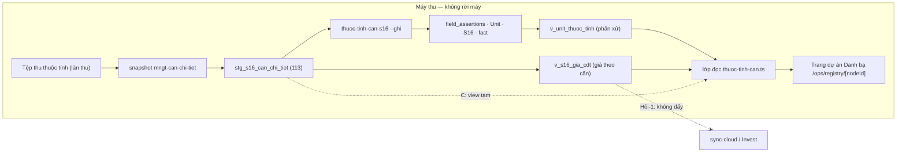

# Thiết kế — thuoc-tinh-can-s16 (DA40): thuộc tính căn S16 vào danh bạ, hiện trên Ops máy thu

Ngày 18/11/2026 · dãy P1 · hạng T3 (migration) · hàng lộ trình DA40 (nhánh cắt lượt, PR #482). Bảng phủ ca:
`_acceptance/thuoc-tinh-can-s16/bang-phu-ca.md`. Phân tích của phiên liên làn: `research-local/s16/thuoc-tinh-can-phan-tich-1811.md`
ở checkout chính (gitignored).

## 1. Đích

Lời Mạnh 18/11: «đưa bộ thuộc tính căn S16 (enrich từ chủ đầu tư) vào pipeline», «Tôi muốn dữ liệu được hiển thị trong danh bạ
để tôi có thể kiểm tra». Đích đo trên màn: trang dự án của Danh bạ trên Ops máy thu (`/ops/registry/[nodeId]`) — mỗi căn trong
lưới toà hiện diện tích thông thuỷ và tim tường, phòng ngủ, WC, hướng, loại hình, giá chủ đầu tư, nhãn nguồn `S16` và mốc thu;
đầu trang một ô phủ «căn có thuộc tính / căn trong danh bạ». Hàng xong khi các ô ấy đổi trên dữ liệu thật của DB máy thu
(dự kiến: 0 → 84.820 / 111.329 căn có thuộc tính; 0 → 11.852 căn có giá chủ đầu tư).

## 2. Hiện trạng (đo 18/11)

- `units` chỉ có khoá (`unit_key`, `building_key`, `stack_key`, `floor`, `sub_id`, `catalog_tier`), rào chỉ-thêm (082).
- `field_assertions` đã nhận resource `Unit` (khoá `unt_…`, 082/096) nhưng chưa có trường diện tích, hướng; trục trường hiện
  có `property_type`, `bedrooms`, `bathrooms`. Chưa có phát biểu Unit nào. Bảng không nằm trong `FILL` của `sync-cloud.mjs`.
- `registry_aliases` nối 111.329 căn với mã căn S16 (`<du_an>/<MÃ>`), chỉ ở năm dự án đã nối (DA33 Hỏi-1).
- Tệp thu thuộc tính (làn thu, chưa đóng gói): 181.937 dòng, 95.798 khoá. Mọi lệch giá trị nằm ở 860 mã trùng hai toà — nhóm
  `mo_ho` của `v_s16_can`, không có căn danh bạ nào (bảng phủ ca §2).
- Trường có giá trị là của chủ đầu tư: ở mọi dòng, trường nằm trong `editableFields` (chủ căn được sửa) khi và chỉ khi nó rỗng.

## 3. Chỗ chứa thuộc tính — phương án chọn

**A (chọn).** Thuộc tính vật thể là phát biểu `field_assertions` trên resource `Unit`; giá chủ đầu tư không phải thuộc tính của
căn, đọc từ stg qua view.

- Căn cứ: ADR-0016 §3 «Không thuộc tính viết tay: mọi thuộc tính (diện tích, phòng, tầng, hướng, năm xây, tên toà…) là phát biểu
  trong `field_assertions` … bộ phân xử dựng cột chuẩn». ADR-0016 §7.1: «Trường thuộc listing (giá, trạng thái, người đăng)
  không bao giờ đi từ vật thể xuống; chiều lên chúng gom thành *lịch sử* theo vật thể (giá theo căn)». Giá chủ đầu tư là giá
  chào bán sơ cấp, không phải sự thật của căn.
- Lợi: đường kế thừa xuống tin (ADR-0016 §7, `registry_inherit`) và DA41 dùng chung một chỗ; nguồn khác (S08) sau này phát
  biểu cùng trường, bộ phân xử chọn.
- Giá: phải mở trục `assertion_field` trong `pipeline/mappings.yaml` + sinh lại sổ từ vựng (tệp `*.generated.*`, khối
  `CONTEXT.md`) — các tệp này ngoài ranh giới hàng, xin ở S1 (§9); `mappings.yaml` đang do TG2 giữ.

**B (không chọn).** Bảng `unit_attributes` cột cứng theo `unit_key`. Chết vì trái câu ADR-0016 §3 trích trên (cột viết tay,
không bộ phân xử), và nguồn thứ hai phải sửa bảng.

**C (không chọn làm đích, giữ làm bản lùi).** Chỉ view trên stg nối `unit_key`, không phát biểu. Rẻ nhất, không chạm sổ từ vựng
— nhưng thuộc tính không đi qua bộ phân xử, DA41 và kế thừa phải đọc stg của một nguồn. Nếu Mạnh muốn thấy số trên màn trước
khi TG2 gộp, có thể làm C trước rồi đổi sang A ở hàng kế (Hỏi-3).

### 3a. Hình — luồng dữ liệu (A chọn, C nét đứt)

## 4. Migration 113 (một tệp, chạy lại an toàn, chỉ DB local)

1. **`stg_s16_can_chi_tiet`** — bảng nạp của kind snapshot `mngt-can-chi-tiet` (DATA-CONTRACT v14, làn thu). Khoá
   `(snapshot_id, du_an, toa, ma_can, dong)`; `snapshot_id` FK `airbnb_snapshots ON DELETE CASCADE` như 103. Cột giữ tên trường
   nguồn đã gõ kiểu: `khu`, `toa`, `ma_can`, `height_type`, `property_type`, `floor_number`, `bedroom`, `bathroom`, `direction`,
   `balcony_direction`, `house_style`, `sale_price` (bigint), `area_using`, `area_building` (numeric), `editable_fields` (text[]).
   **Không có cột** cho `purchasePrice`, `purchaseDate`, `initialInvestmentCost`, `investmentCapital`, `loanAmount`,
   `juridicalStatus`, `deliveryStatus`, `furnitureStatus`, `houseStatus` (tài chính, tình trạng do chủ căn nhập — bảng phủ ca §2).
   CHECK: `ma_can`, `du_an` không rỗng; diện tích ≥ 0; `sale_price` ≥ 0. Không đặt tên bảng/cột theo tên nguồn thật.
   Danh sách cột chốt cùng nháp DATA-CONTRACT v14 của làn thu — lệch thì làn thu đề xuất, migration theo (AGENTS «chỗ giáp ranh»).
2. **Trục trường phát biểu**: `field_assertions_field_chk` = tập của 096 + `living_area`, `building_area_total`,
   `direction_faces`. Trigger `field_assertions_vat_the_082` thay thân tại chỗ (như 096): ba trường mới chỉ ở `Unit` và
   `Property`. Trigger miền mới `field_assertions_gia_tri_113`: `living_area`, `building_area_total` là số > 0 và ≤ 100.000;
   `direction_faces` ∈ tám mã của trục `direction_faces`.
3. **View `v_unit_thuoc_tinh`** — bộ phân xử của căn: một dòng mỗi căn có ít nhất một phát biểu Unit sống; mỗi trường lấy phát
   biểu lớp cao nhất (fact > observed > inferred), rồi `observed_at` mới nhất («lần thu sau thắng»), rồi `id` lớn nhất;
   `direction_faces` là mảng mọi giá trị của cùng lần thu thắng. Cột: `unit_key`, `living_area`, `building_area_total`,
   `bedrooms_total`, `bathrooms_total_integer`, `direction_faces`, `property_sub_type`, `nguon` (mảng mã S0x), `observed_at`.
   Bỏ qua `registry_inherit` (ADR-0016 §7.3).
4. **View `v_s16_gia_cdt`** — giá chủ đầu tư theo căn (bản hiện hành; mọi snapshot vẫn nằm trong stg nên lịch sử giá theo căn
   dựng được ở DA41/hàng sau mà không thu lại): dòng stg của snapshot mới nhất có `sale_price > 0`, nối `unit_key` qua
   bí danh `ma_nguon` S16, chỉ khoá một toà; cột `unit_key`, `list_price`, `gia_m2_thong_thuy`, `snapshot_id`, `thu_luc`.
5. Không đổi `units`, `buildings`, bí danh; không sửa migration cũ; không thêm gì vào cloud.

## 5. Lệnh `pipeline/scripts/thuoc-tinh-can-s16.mjs` + lõi `pipeline/lib/thuoc-tinh-can-s16.mjs`

- Lõi thuần `phatBieuTuDong(dong)` → danh sách `{field, value}` theo luật dưới; `gopKhoa(dongs)` gộp dòng cùng (dự án, toà, mã);
  không DB.
- Luật trường (ma trận viết trước ở AC-3):
  - `area_using` > 0 → `living_area`; `area_building` > 0 → `building_area_total` (m², số như nguồn).
  - `bedroom` > 0 → `bedrooms`; `bathroom` > 0 → `bathrooms`; 0 = chưa có, không phát biểu.
  - `property_type`: APARTMENT, PENT_HOUSE → `apartment`; ROW_HOUSE, SEMI_DETACHED_VILLA, DETACHED_VILLA, QUADRUPLE_VILLA →
    `house`; SHOP_HOUSE, ROW_SHOP_HOUSE, SEMI_DETACHED_SHOP, DETACHED_SHOP, COMMERCIAL_SERVICE (7.111 khoá) → `commercial` theo
    khuyến nghị Hỏi-4 (lối khác: không phát biểu loại hình cho nhóm này tới khi Q7 chốt mã local); UNDEF và mã lạ → không phát
    biểu, đếm. (Shophouse = commercial theo `docs/architecture/reso-khung-phan-loai.md` dòng «sale × commercial … shophouse: local khi Q7 mở».)
  - Hướng: `height_type` HIGH_RISE → `balcony_direction`, LOW_RISE → `direction` (Hỏi-2). Chuẩn hoá NE/N_E/NORTH… về tám mã;
    `XX_YY` hai mã khác → hai phát biểu; OTHER, rỗng, mã lạ → không phát biểu, đếm.
  - Tầng, giá: không phát biểu (tầng đã ở `units.floor`; giá theo §3).
- Ghép căn: chỉ qua `registry_aliases` `source='S16' kind='ma_nguon'` value `<du_an>/<MÃ HOA>` còn sống; khoá có dòng ở hai toà
  trở lên → không phát biểu; khoá không có căn → đếm theo dự án.
- Mặc định **chạy thử**: in bảng số theo dự án × trường (đúng khuôn bảng phủ ca §1) + số bỏ theo lý do; không ghi. `--ghi`: một
  transaction, chèn phát biểu `resource_name='Unit'`, `method='source_field'`, `evidence_tier='fact'`, `observed_at` = thời
  điểm snapshot, `evidence = {"nguon":"S16","snapshot_id":…,"truong_nguon":…}` (không mã căn, không tên nguồn),
  `ON CONFLICT DO NOTHING` theo `field_assertions_live_uq` → chạy lại 0 dòng mới. Không rút phát biểu cũ: lần thu sau có giá trị
  khác thì thêm phát biểu, view chọn lần sau.
- Chỉ đọc snapshot mới nhất của `stg_s16_can_chi_tiet` (cờ `--snapshot` để chọn).

## 6. Không rời máy

`stg_s16_can_chi_tiet` khớp `/^stg_s16/` của `BANG_CAM_S16`; `field_assertions` và hai view không ở `FILL`. AC-8 ghim cả hai
bằng ca hai chiều (cấy tên bảng vào danh sách đẩy → bộ soát đỏ). Kế thừa xuống tin (sẽ lên cloud qua `sale_offers`) là hàng sau,
khi đó câu «thuộc tính lấy bằng đăng nhập có được lên cloud» phải hỏi lại.

## 7. Màn (phần S3 sau khi DA36 gộp và giám sát nới ranh giới)

Lớp đọc `app/src/lib/ops/thuoc-tinh-can.ts`: hai câu SQL chỉ đọc theo nút dự án — (1) thuộc tính + giá theo `unit_key` của các
căn trong lưới đang mở (từ `v_unit_thuoc_tinh` ⟕ `v_s16_gia_cdt`), (2) ô phủ: căn danh bạ dưới nút, căn có ≥1 thuộc tính, căn
có giá chủ đầu tư, và «căn S16 có thuộc tính chưa có căn danh bạ». React chỉ đọc số (luật 10).

Khoá nối nút ↔ dự án S16: không có bí danh S16 trên nút dự án (bí danh S16 chỉ ở toà, trục, căn). Tập `du_an` của một nút = các
giá trị `split_part(value,'/',1)` của bí danh `ma_nguon` S16 trên các **toà** thuộc nút (qua lớp đọc toà → nút của DA36,
`v_toa_nut_vung`). N = khoá stg có thuộc tính thuộc tập ấy mà không có bí danh căn sống. Hệ quả: chỉ năm dự án đã nối (DA33 Hỏi-1)
có ô N; bốn dự án S16 chưa nối (royal-island 4.412, global-gate 2.681, hai-van-bay 1.534, happy-home-trang-cat 704 khoá) không có
toà S16 nên trang của chúng (nếu có nút) ghi «Chưa có nguồn thuộc tính căn» — số của chúng chỉ ở đầu ra lệnh chạy thử. Ví dụ dữ
liệu thật cho ô N: ocean-park 817, ocean-park-3 820, ocean-park-2 8, grand-park 2.

<!-- <<<UX-SPEC-TEMPLATE -->
## Đặc tả UX

### 1. Luồng

- Suôn sẻ: `/ops/registry` → bấm một dự án → `/ops/registry/[nodeId]` → đọc ô phủ đầu trang → mở một toà trong lưới «Toà và
  căn» → mỗi hàng căn thấy thông thuỷ / tim tường, PN, WC, hướng, loại hình, giá chủ đầu tư, nhãn S16 + mốc thu.
- Biên: dự án đã nối có mã S16 chưa có căn danh bạ (ocean-park-3: 820) → ô phủ thêm «820 căn S16 có thuộc tính chưa vào danh
  bạ»; dự án không có toà S16 (kể cả bốn dự án S16 chưa nối) → ô phủ ghi «Chưa có nguồn thuộc tính căn».
- Lỗi & quay lại: đọc thuộc tính lỗi → lưới toà vẫn hiện, cột thuộc tính là lỗi nội tuyến có nút «Thử lại».

### 2. Kiểm kê màn

| Màn | MỘT việc của màn | Vào từ / ra tới |
|---|---|---|
| Trang dự án Danh bạ `/ops/registry/[nodeId]` | soi toà, căn và thuộc tính căn của một dự án | từ `/ops/registry` / về danh bạ |

### 3. Bảng trạng thái

<!-- <<<UX-STATE-TABLE -->
| Trạng thái | Màn | Hiển thị gì | Người làm gì tiếp |
|---|---|---|---|
| ST-du-an-thuoc-tinh-loading | trang dự án | Skeleton ở ô phủ và các cột thuộc tính | chờ |
| ST-du-an-thuoc-tinh-co | trang dự án | ô phủ «84.820 / 111.329 căn có thuộc tính · 11.852 có giá chủ đầu tư»; cột số + Badge `S16` + mốc thu | mở toà, soi căn |
| ST-du-an-can-chua-thuoc-tinh | trang dự án | ô căn: «Chưa có thuộc tính» (Badge outline) | soi chỗ thiếu ở ô phủ |
| ST-du-an-thuoc-tinh-chua-noi | trang dự án | ô phủ thêm dòng «N căn S16 có thuộc tính chưa vào danh bạ» | không có hành động trên màn (việc DA3/DA18) |
| ST-du-an-khong-nguon | trang dự án | ô phủ «Chưa có nguồn thuộc tính căn» | về danh bạ |
| ST-du-an-thuoc-tinh-loi | trang dự án | Alert nội tuyến + nút «Thử lại» | bấm Thử lại |
<!-- UX-STATE-TABLE>>> -->

### 4. Hành vi

- Số theo `fmtInt`/định dạng VN; diện tích «68,5 m²»; giá «2,15 tỷ» kèm giá/m² thông thuỷ; hướng hai mã «Đông Bắc · Tây Bắc».
- Cột thuộc tính ẩn dưới `md` trừ diện tích thông thuỷ và giá (khổ hẹp), theo nếp cột «Nguồn» đang có.

### 5. Xuất xứ component

| Component | Nấc | Vì sao |
|---|---|---|
| `DuAnToaGrid` (data-grid ReUI) | mở rộng | thêm cột vào lưới cây toà → căn đang có |
| `Badge` reui (`outline`, `info-light`) | dùng | nhãn nguồn S16, «Chưa có thuộc tính» |
| `Frame` + ô số trong trang dự án | dùng | ô phủ cạnh các ô số sẵn có của trang |
| `Skeleton`, `Alert` | dùng | tải, lỗi nội tuyến |

### 6. Khuôn IA đã chọn + căn cứ

Khuôn IA: danh-sách-chi-tiết (master-detail)
Căn cứ: trang dự án đã là chi tiết của danh bạ; thêm cột vào lưới sẵn có, không thêm màn — luồng hiển nhiên, không tra.

### 7. Thẻ việc

| Trường | Giá trị |
|---|---|
| Ai dùng | Mạnh / người vận hành Ops máy thu |
| Việc chính | soi thuộc tính căn S16 đã vào danh bạ và chỗ còn thiếu theo dự án |
| Tần suất | mỗi tuần |
| Số bản ghi | hàng trăm trở lên (toà), hàng chục nghìn (căn) |
| Thiết bị | máy tính |
<!-- UX-SPEC-TEMPLATE>>> -->

## 8. Áp lên DB máy thu (sau khi PR gộp, từ `main`)

Năm thứ, ghi đủ trong `_acceptance/thuoc-tinh-can-s16/ap-may-thu.md` trước Cổng Bằng chứng:
lệnh áp (`psql … -f db/migrations/113_*.sql` hai lần; `node pipeline/scripts/thuoc-tinh-can-s16.mjs --ghi`) · số chạy thử (bảng
phủ ca §1 in lại từ stg trên DB thử chép máy thu) · sao lưu trước (`pg_dump -t field_assertions` + lược đồ) · cách lùi (rút phát
biểu `method='source_field' AND evidence->>'nguon'='S16' AND resource_name='Unit'` bằng `retracted_at` + lý do; migration lùi:
DROP hai view, khôi phục CHECK/trigger của 096, DROP bảng stg — tệp lùi trong hồ sơ) · lệnh kiểm sau (đếm `v_unit_thuoc_tinh`,
`v_s16_gia_cdt` theo dự án, so bảng chạy thử). Áp xong báo số thật cạnh số chạy thử; lệch thì dừng.

## 9. Phụ thuộc và vùng xin thêm

- Dữ liệu vào: snapshot `mngt-can-chi-tiet` + DATA-CONTRACT v14 + bộ nạp `import-*` (làn thu, tin claudedp-1811-1). Chưa có
  thì S3 vẫn làm được migration, lõi, lệnh, test (DB của lượt); AC-5/AC-10/AC-11 trên dữ liệu thật chờ bộ nạp.
- Vùng ngoài ranh giới phải xin (yêu cầu `cham-tep`): `pipeline/mappings.yaml` (khối S16 + ba mã `assertion_field` + khai sáu
  điều kiện; chờ TG2 gộp) · tệp sinh của `pipeline/vocab.mjs --write` (`app/src/lib/vocab.generated.ts`, bản pipeline/agent,
  khối `CONTEXT.md`) · `pipeline/lib/s16-soat.test.mjs` (ca AC-8) · vùng màn Danh bạ
  (`app/src/app/ops/registry/[nodeId]`, `app/src/components/ops/registry`, `app/src/lib/ops/registry`) sau DA36.
- DA37 không đổi `unit_key`; DA36 đổi lớp đọc trang — màn bám bản sau DA36.
