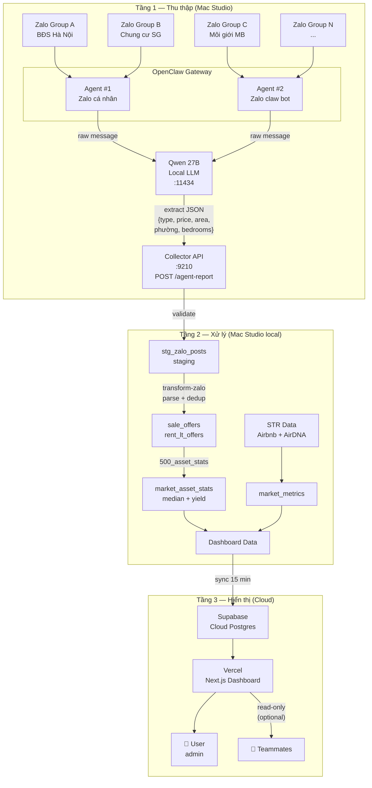
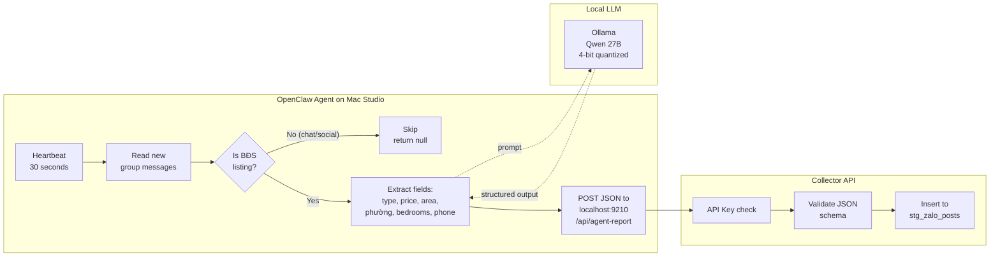
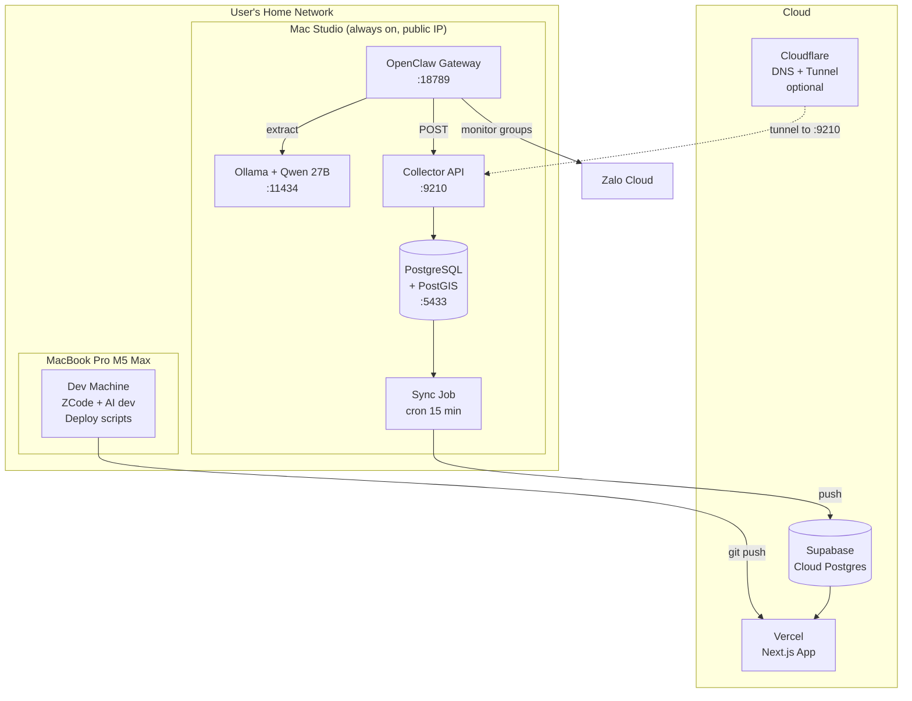
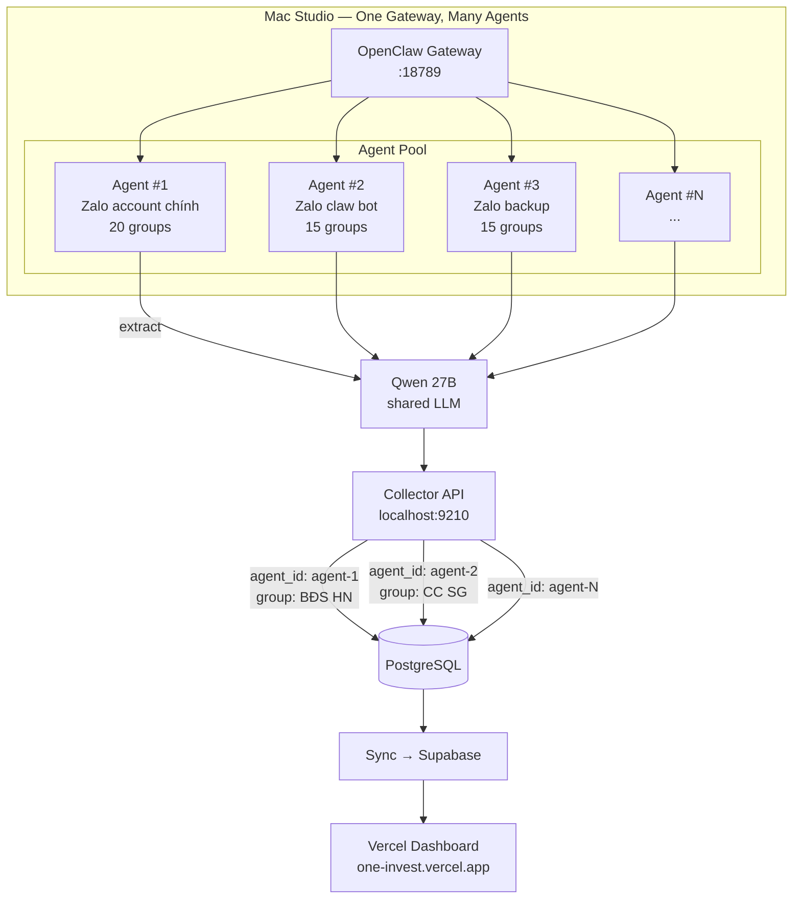
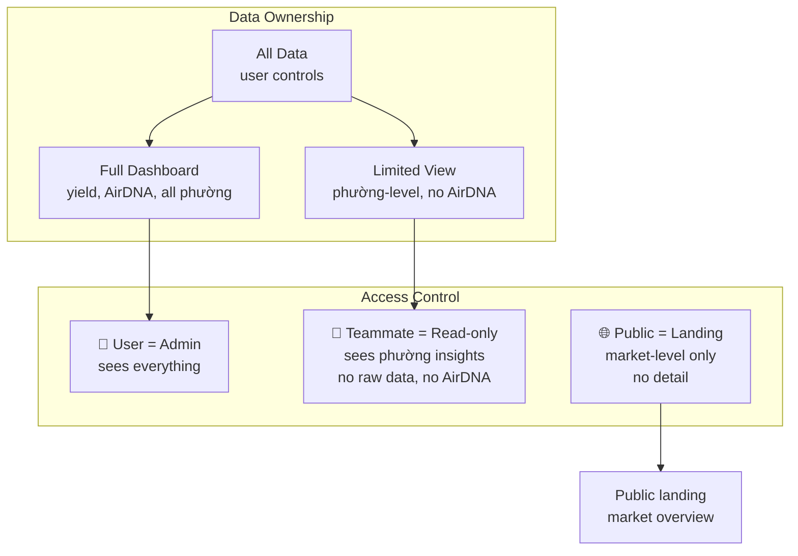

# Agent Swarm Architecture — Mermaid Diagrams

## 1. Data Flow: End-to-End (từ Zalo Group → Dashboard)



## 2. Agent Detail: OpenClaw Skill Pipeline



## 3. Deployment Topology



## 4. Multi-Agent Scaling (thêm teammate agents)



## 5. Sharing Model (ai thấy gì)



## 6. Security Model (đơn giản theo yêu cầu)

```mermaid
graph LR
    subgraph "Trust Boundaries"
        LOCAL[Localhost only<br/>agents + API + DB<br/>same machine]
        CLOUD[Cloud<br/>Supabase + Vercel<br/>public internet]
    end

    subgraph "Local (Mac Studio)"
        AGENT[OpenClaw<br/>agents] -->|API key<br/>one-invest-agent-{id}| API[Collector API]
        API -->|localhost only| DB[(PostgreSQL)]
    end

    subgraph "Cloud"
        SYNC[Sync job] -->|SUPABASE_URL<br/>service_role key| SUPA[(Supabase)]
        VERCEL[Vercel App] -->|anon key<br/>+ RLS policies| SUPA
        USER_B[User login] --> VERCEL
    end

    LOCAL -->|"sync job pushes<br/>(outbound only)"| CLOUD
```
