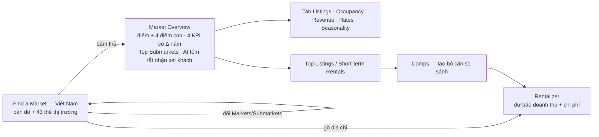

# AirDNA «Find a Market» cho Việt Nam — phân tích sản phẩm dựa trên bằng chứng

Ngày: 2026-11-03 · Trạng thái: nghiên cứu, chưa phải đặc tả · Phục vụ giai đoạn 1 «Chọn thị trường» và một phần giai
đoạn 3 «Chi phí, vốn, dòng tiền» của pipeline đầu tư (`docs/research/investment-pipeline-4-stages.md`).
Song song với `biggerpockets-market-finder-product-analysis.md` (cùng khung câu hỏi Q1–Q6).

Tài liệu AirDNA đã có — không lặp lại: `airdna-market-explorer-architecture.md` (kiến trúc), `market-finder-spec.md`
(API, bộ lọc, chú giải theo phân vị), `airdna-public-ia.md` (gói giá, bản đồ tính năng từ trang công khai),
`airdna-app-ia.md` (sơ đồ app dựng từ Help Center, chưa đăng nhập), `airdna-listing-api.md`, `airdna-integration-plan.md`,
`airdna-mcp-audit.md`. Điểm mới ở đây: **lần đầu quan sát trực tiếp giao diện Việt Nam khi đã đăng nhập**, đọc bằng
góc nhìn sản phẩm.

**Luật dữ liệu (AGENTS.md luật 5):** AirDNA (mã S02) chỉ để hiệu chuẩn. Tài liệu này ghi cấu trúc, nhãn, thứ hạng tương
đối và các đặc điểm chất lượng; **không chép bảng số theo thị trường**. Số thô và ảnh chụp ở
`research-local/airdna-vn-2026-11-03/` (không commit).

**Ký hiệu độ tin:** **QS** quan sát trực tiếp 03/11 trên `app.airdna.co/data/vn` (tài khoản đã đăng nhập, ego-browser,
chỉ đọc) · **CT** tài liệu chính thức AirDNA (Help Center, trang giá) · **BT** bên thứ ba · **SL** suy luận.

**Điều kiện quan sát:** tài khoản đang có bộ lọc đã lưu — căn hộ, 0–6 phòng ngủ, 1–4 WC (QS). AirDNA lưu bộ lọc trên
máy chủ theo tài khoản, nên tôi không đổi bộ lọc; mọi con số trên thẻ phản ánh tập căn hộ này, không phải toàn thị trường.

---

## 0. Tóm tắt điều hành

1. **Ở Việt Nam, AirDNA là thước đo thuê ngắn hạn duy nhất dùng chung một định nghĩa cho 43 thị trường.** Thế mạnh
   thật: bộ lọc phân khúc áp cho mọi con số, mức thay đổi so với năm trước trên mọi KPI, giá và số căn đã có khách
   **180 ngày tới**, và AI tóm tắt nhận xét của khách, kể cả phàn nàn (QS).
2. **Nhưng ở VN nó chỉ trả lời nửa câu hỏi của nhà đầu tư.** Không có giá mua nên không có lợi suất; không có tiền thuê
   dài nên không so được «thuê ngắn hay thuê dài». Ô xếp hạng ở VN chỉ có 4 chỉ số; ở Mỹ có thêm lợi suất và giá nhà (QS).
3. **Độ tin của số VN có giới hạn rõ:**
   - đơn vị trộn tỉnh cũ (trước sáp nhập 2025), thành phố, đảo, quận cũ;
   - căn ngoại lai giá hàng nghìn USD/đêm đứng đầu bảng «Top listings» Hà Nội;
   - doanh thu thị trường là **trung bình chứ không phải trung vị**;
   - mặc định chỉ tính Airbnb + Vrbo, trong khi Vrbo ở VN ≈ 0 và không có Agoda;
   - các nhà cung cấp lệch nhau gần gấp đôi: số listing TP.HCM 6,2–12,1 nghìn, công suất Đà Nẵng 37–64% (QS, CT, BT).
4. **Điểm «Regulation» suy từ hành vi host, không phải từ luật** (CT). Trong khi đó khung pháp lý cho thuê ngắn hạn ở
   chung cư VN đang thay đổi: Luật Nhà ở 2023; TP.HCM cấm 02/2025 rồi cho lại có điều kiện từ 04/2026 (BT).
5. **Cơ hội của One Invest:** là nơi duy nhất (trong những gì đã quét) có thể ghép **giá mua + thuê dài + thuê ngắn
   trên cùng một phường**, theo cây khu vực sau sáp nhập. Nên học cách trình bày của AirDNA, dùng AirDNA làm thước kiểm,
   và làm hơn ở chỗ AirDNA yếu: trung vị + lọc ngoại lai, phương pháp công khai, lớp pháp lý theo toà nhà.
   **Phát hiện phụ:** route công khai `/api/v1/markets` đang trả Market Score của AirDNA — trái luật 5 (§8.1).

---

## 1. Framing — câu hỏi nghiên cứu

| # | Câu hỏi | Vì sao cần cho One Invest |
|---|---|---|
| Q1 | AirDNA phục vụ ai ở Việt Nam, giúp họ làm xong việc gì? | Finder hiện tại của One Invest dựng theo mẫu AirDNA — cần biết mẫu đó hợp người dùng VN đến đâu |
| Q2 | Ở Việt Nam tính năng hoạt động thế nào: đơn vị, chỉ số, điểm, bộ lọc, nhịp cập nhật? | Biết phần nào AirDNA làm tốt để học, phần nào VN thiếu |
| Q3 | Lợi ích cho người dùng; AirDNA kiếm tiền thế nào? | Phân biệt giá trị thật với phễu bán gói |
| Q4 | Dữ liệu VN của AirDNA đáng tin đến đâu? | One Invest đang dùng AirDNA làm thước hiệu chuẩn |
| Q5 | Đối thủ, công cụ VN tương tự, khung pháp lý cho thuê ngắn hạn ở VN? | Định vị và rủi ro |
| Q6 | One Invest nên giữ, đổi, bỏ gì? | Đầu vào cho đặc tả Finder/Insight |

**Phương pháp.** (1) Duyệt trực tiếp trang quốc gia, trang thị trường Hà Nội (Overview, Listings, Rates) và Rentalizer —
chỉ đọc chữ và chụp màn hình, không gọi API, không đổi bộ lọc; (2) đối chiếu với tài liệu AirDNA đã có trong kho;
(3) bằng chứng phụ về phương pháp, giá, lời chê, đối thủ, luật VN; (4) đối chiếu với code và dữ liệu One Invest.

---

## 2. Tính năng nằm ở đâu trong sản phẩm AirDNA

- **Thanh điều hướng trái** (QS): Home · **Research** (Find a Market, Market Insights, Short-term Rentals, Rentalizer,
  Host Tools) · Adapt Pricing · Performance · Comps. «Find a Market» là cửa vào nhóm Research.
- **Phục vụ ba nhóm** (CT, `airdna-public-ia.md`): nhà đầu tư (chọn thị trường, ước doanh thu một căn), chủ nhà/host
  (so hiệu suất, đặt giá động), công ty quản lý vận hành (theo dõi đối thủ, tìm chủ nhà). Find a Market là bước đầu của
  nhóm nhà đầu tư; các bước sau (Rentalizer, Comps, Adapt Pricing) là nơi AirDNA thu tiền lâu dài.
- **Ô tìm kiếm chung** «Search market, submarket, or address» — gõ địa chỉ thì nhảy sang Rentalizer (QS, CT).

---

## 3. Người dùng và việc họ cần làm ở Việt Nam (Q1)

| Khi… | tôi muốn… | để… | AirDNA đáp ứng bằng |
|---|---|---|---|
| tôi định mua căn để làm Airbnb nhưng chưa chọn tỉnh/thành | thấy tỉnh/thành nào cho thuê ngắn hạn tốt | không đổ tiền vào nơi vắng khách | Bản đồ + danh sách 43 thị trường xếp theo Market Score (QS) |
| tôi đã nhắm một thành phố | biết khu nào trong thành phố tốt nhất | chọn đúng khu | Top Submarkets — Hà Nội có 7 (QS) |
| tôi đã nhắm một căn cụ thể | ước được doanh thu một năm và chi phí vận hành | quyết định mua hay không | Rentalizer: dự báo doanh thu, máy tính chi phí, căn so sánh tuỳ chỉnh (QS) |
| tôi đang vận hành | đặt giá theo mùa, theo đối thủ | tối đa doanh thu | Rates: giá theo ngày, giá 180 ngày tới; Adapt Pricing (QS) |

**Câu hỏi nhà đầu tư VN mà AirDNA không trả lời được** (QS + SL):
- **Mua căn ở đây giá bao nhiêu, lợi suất bao nhiêu?** Ở VN, ô xếp hạng chỉ có 4 chỉ số: Market Score, Occupancy,
  Revenue Potential, Daily Rate (QS). Ở Mỹ có thêm lợi suất ước tính và giá nhà (`market-finder-spec.md` §3.1) vì
  AirDNA chỉ có dữ liệu nhà rao bán ở Mỹ (CT, `airdna-public-ia.md`). **Ở VN không có mẫu số «giá mua» — nên không có
  lợi suất.**
- **Làm thuê ngắn hơn thuê dài bao nhiêu?** AirDNA không có tiền thuê dài hạn.
- **Pháp lý cho thuê ngắn hạn ở chung cư này/thành phố này ra sao?** Có điểm «Regulation» nhưng không nói căn cứ cho VN
  (xem §6).

---

## 4. Cách tính năng hoạt động ở Việt Nam (Q2)

### 4.1 Luồng

### 4.2 Trang quốc gia (QS)

- **Bộ lọc toàn cục**, áp cho mọi số trên nền tảng: Market · Beds/Baths · Property Types · Amenities · Price Tier ·
  Rating · All Filters · **Save** (lưu bộ lọc có tên).
- **All Filters** gồm: khu vực (market/submarket/zipcode), số listing, **Demand Driver** (sân bay, nghệ thuật, biển,
  golf, hồ, quân sự, núi, công viên quốc gia, trượt tuyết, đại học, vườn nho), **điểm con của Market Score** (Revenue
  Growth, Rental Demand, Seasonality, Regulation), phòng ngủ, WC, số khách, loại cho thuê (cả căn / phòng riêng / phòng
  chung), loại BĐS (Apartment, B&B, House, Unique), tiện ích (điều hoà, đỗ xe, bể bơi… và nhóm mới: lò sưởi ngoài trời,
  view biển/hồ, trượt tuyết…), 5 bậc giá, điểm đánh giá, số đánh giá, số ngày mở bán, chuyên nghiệp hay cá nhân, quy mô
  người quản lý, **kênh đăng (Airbnb · Vrbo · Booking — mới)**, **độ biến động giá (mới)**.
  Nhận xét (SL): bộ lọc thiết kế cho Mỹ — nhiều mục (trượt tuyết, vườn nho, quân sự, lò sưởi) vô nghĩa ở VN.
- **Danh sách**: «43 markets shown»; mỗi thẻ có ảnh, vòng Market Score, Revenue Potential, Occupancy, Daily Rate, ghi
  «Over the last 12 months»; nút tim để lưu (QS).
- **Chọn chỉ số tô màu/xếp hạng**: Market Score · Occupancy · Revenue Potential · Daily Rate (QS).
- **Chú giải 4 bậc theo phân vị của tập đang lọc** — trang quốc gia và trang Hà Nội có ngưỡng khác nhau (QS), khớp cơ
  chế p30/p60/p90 đã ghi ở `market-finder-spec.md` §3.2.
- **Nền bản đồ Google**, có nút **Draw** (vẽ vùng tuỳ chọn) và **Share** (QS).

### 4.3 Đơn vị thị trường ở Việt Nam — trộn ba cấp, theo ranh giới cũ

Đọc 40/43 thẻ (QS):
- **Tỉnh theo ranh giới trước sáp nhập 07/2025**: Quảng Nam, Bình Dương, Hà Giang, Đắk Nông, Bình Phước, Hà Tĩnh, Bắc
  Giang, Kiên Giang… — các tỉnh này đã nhập vào tỉnh khác.
- **Thành phố / thị xã**: Hà Nội, TP.HCM, Đà Nẵng, Vũng Tàu, Phan Rang–Tháp Chàm.
- **Đảo**: Côn Đảo tách thành thị trường riêng.
- Hai thị trường không có điểm («--») — khớp luật cần ≥15 listing mới chấm điểm (§4.4).
- 43 thị trường khớp đúng số market mà lượt thu hiệu chuẩn S02 đang xoay vòng (ROADMAP §2.4).
- **Thị trường con của Hà Nội: 7** — Đống Đa, Tây Hồ, «Hanoi City», Cầu Giấy, Ba Đình, Hoàn Kiếm, Thanh Xuân (QS).
  Theo tên **quận cũ** (cấp quận đã bỏ từ 07/2025); «Hanoi City» là ô gom phần còn lại — các khu đông như Hai Bà Trưng,
  Long Biên, Hoàng Mai, Nam Từ Liêm không có ô riêng (SL từ danh sách).
- Hệ quả cho One Invest (SL): bảng nối mã AirDNA ↔ khu vực One Invest phải chịu cả ba cấp lẫn lộn và ranh cũ —
  `app/src/lib/calibration.ts` đã có luật chọn «market S02 đại diện khi khu vực gộp nhiều market (sáp nhập tỉnh 2025)».

### 4.4 Market Score — điểm xếp hạng

- **Điểm 0–100 gồm 4 điểm con**: Rental Demand, Revenue Growth, Seasonality, Regulation (QS — trang Hà Nội và bộ lọc).
- **Định nghĩa chính thức** (CT, Help Center «How is Market Score calculated», 06/2026):
  - Thang 40–100, xếp chữ A (90–100) · B (75–90) · C (65–75) · D (50–65) · F (40–50).
  - Thị trường cần **ít nhất 15 listing** mới có điểm; chỉ so với thị trường **cùng quốc gia**; thị trường nhiều listing
    nặng ký hơn. **Không công bố trọng số** các điểm con.
  - Rental Demand = công suất năm + tăng trưởng số listing. Revenue Growth = thay đổi RevPAR so cùng kỳ, chỉ trên căn có
    khách ở cả hai kỳ. Seasonality: điểm cao = **ít** mùa vụ.
  - **Regulation suy từ «host and property behavior»**; điểm cao = quy định thấp hoặc không được thực thi.
  - Điểm con thứ năm, Investability, **chỉ có ở Mỹ**.
- **Thứ hạng ở VN trái trực giác người mua** (QS, dưới bộ lọc căn hộ): ba thị trường đứng đầu là Cần Thơ, Bình Dương, Lào
  Cai; TP.HCM và Hà Nội xếp sau; Quảng Ninh và Lâm Đồng (Đà Lạt) ở nửa dưới. Cần Thơ đứng đầu dù giá đêm thấp nhất nhóm
  đầu (SL: điểm đo **đà và độ ổn định**, không đo quy mô hay doanh thu tuyệt đối).
- Bài học (SL): một điểm tổng không giải thích được sẽ làm người dùng nghi; AirDNA bù bằng cách hiện 4 điểm con ngay cạnh
  điểm tổng và cho lọc theo từng điểm con.

### 4.5 Trang thị trường Hà Nội (QS)

| Khối | Nội dung |
|---|---|
| «How is this market performing?» | Market Score + 4 điểm con |
| 4 KPI | Annual Revenue · Total Active Listings · Average Daily Rate · Occupancy Rate — mỗi ô kèm **Δ so với năm trước** |
| Top Submarkets | 7 thẻ: Score, Revenue, Occupancy, RevPAR, ADR; bản đồ tô màu thị trường con |
| **AirDNA AI — «What Guests Are Saying About Hanoi»** | tóm tắt từ đánh giá của khách: tổng quan, khách thích gì, tiện ích được nhắc, nhóm khách điển hình, **phàn nàn thường gặp** (ồn, vệ sinh, khó tìm nhà trong ngõ, nước nóng, côn trùng) |
| Performance Highlights | biểu đồ 12 tháng: doanh thu, giá đêm, công suất — dữ liệu tới **tháng 09/2026** (trễ ~1 tháng) |
| Listing Overview | Supply Growth từ 2023 — số listing đang hoạt động **giảm so với năm trước** |
| Top-Performing Listings | xếp theo doanh thu tiềm năng (xem §6.1 về ngoại lai) |
| Tạo bộ so sánh | «Create a property comp set» |

**Tab Listings** (QS): cỡ phổ biến nhất 1 phòng ngủ; **kênh: ~86% chỉ Airbnb, ~5% chỉ Booking, ~9% đa kênh, Vrbo ≈ 0%**;
phân bổ theo số phòng, loại cho thuê, số ngày mở bán trong năm, **thời gian ở tối thiểu (đa số 1 đêm)**, chính sách huỷ,
tiện ích phổ biến, bảng **người quản lý lớn nhất** (số listing, số đánh giá, điểm).

**Tab Rates** (QS): giá đêm chung / cả căn / chuyên nghiệp / hạng sang kèm Δ năm; chuỗi 3 năm theo số phòng và bậc giá;
giá theo từng ngày 12 tháng qua; **«Future Daily Rates» — giá và số căn đã có khách trong 180 ngày tới**.

**Rentalizer** (QS): «Analyze Any Property's Short-Term Rental Potential» — dự báo doanh thu, máy tính chi phí vận hành
so với thu, bộ căn so sánh tuỳ chỉnh; lưu báo cáo để theo dõi.

### 4.6 Định nghĩa và phương pháp

Theo Help Center AirDNA (CT, các bài cập nhật 05–08/2026):

| Khái niệm | Định nghĩa | Hệ quả ở VN (SL) |
|---|---|---|
| Nguồn | quét trang công khai Airbnb, Vrbo, Booking.com **hằng ngày**; dữ liệu đối tác (>100 nghìn căn) chỉ để kiểm chất lượng | Không thấy nhắc Agoda — kênh lớn ở VN |
| Kênh mặc định | Revenue, ADR, Occupancy, Active Listings mặc định **chỉ Airbnb + Vrbo**; listing chỉ có trên Booking mới có dữ liệu từ 03/2025 | Vrbo ≈ 0 ở VN (§6.3) → số mặc định gần như chỉ là Airbnb |
| Đã đặt hay bị chặn | mô hình học máy dùng 16 tín hiệu (độ dài lưu trú, thời gian đặt trước, đánh giá…) tách đêm có khách khỏi đêm chủ chặn; ghép listing trùng giữa các kênh theo 14 tiêu chí | Sai số ước lượng nằm chủ yếu ở bước này |
| Occupancy | đêm có khách / đêm hoạt động (đêm không bị chặn: có khách hoặc còn trống) | — |
| ADR | doanh thu trung bình mỗi đêm có khách, **gồm phí dọn**, 12 tháng gần nhất | Khác «giá niêm yết» One Invest thu (`airdna-integration-plan.md` §2) |
| Revenue | tổng giá đêm + phí dọn − phí dịch vụ và giảm giá; doanh thu thị trường = **trung bình** trên các căn có ≥1 lượt đặt | Trung bình bị ngoại lai kéo lên (§6.1) |
| Revenue Potential | ước doanh thu nếu căn mở đủ 365 ngày, dựa trên căn so sánh | Nhân phóng ngoại lai: căn giá ảo × 365 ngày |
| Active listing | có đêm mở hoặc ≥1 lượt đặt trong tháng trước; căn chặn kín lịch bị loại | Hai khái niệm «active» khác nhau giữa trang tổng (1 tháng) và tab Short-term Rentals (12 tháng) |
| Ranh thị trường | mỗi nước chia thành market → submarket; cách vẽ ranh mới (không theo city/zip) **chỉ áp cho Mỹ**, ngoài Mỹ không mô tả | Khớp quan sát §4.3 |
| Xử lý ngoại lai | **không tìm thấy tài liệu** | Khớp quan sát §6.1 |
| AI tóm tắt nhận xét | chỉ thấy trên trang tiếp thị cho công ty quản lý («Catch issues before they impact ratings»); không có tài liệu kỹ thuật | Không rõ đọc bao nhiêu đánh giá, của kênh nào |

Nguồn: help.airdna.co — `15480669` (nguồn dữ liệu), `8062178` (occupancy), `8380352` (active listings), `8374548`
(revenue), `8062173` (ADR), `8958225` (revenue potential), `8062174` (market score), `9344843` (ranh thị trường).

---

## 5. Lợi ích và mô hình kinh doanh (Q3)

### 5.1 Lợi ích cho người dùng

| Lợi ích | Cơ chế | Độ mạnh ở VN (SL) |
|---|---|---|
| So hiệu suất thuê ngắn hạn giữa tỉnh/thành bằng một thước chung | cùng định nghĩa, cùng bộ lọc cho 43 thị trường | Mạnh — không có công cụ VN nào làm |
| Lọc đúng phân khúc mình định làm | bộ lọc căn hộ/số phòng/bậc giá áp cho **mọi** số | Mạnh — đây là điều số trung bình toàn thị trường không làm được |
| Thấy xu hướng, không chỉ ảnh chụp | Δ năm trên mọi KPI, chuỗi 3 năm, nguồn cung từ 2023 | Mạnh |
| Nhìn trước nhu cầu | giá và số căn đã có khách 180 ngày tới | Rất mạnh — One Invest không tự tính được (`airdna-integration-plan.md` §2) |
| Hiểu khách nghĩ gì mà không phải đọc hàng nghìn đánh giá | AI tóm tắt nhận xét, kể cả phàn nàn | Trung bình–mạnh; chưa thấy ghi nguồn đánh giá hay số lượng |
| Ước một căn cụ thể | Rentalizer | Trung bình ở VN — không nối với giá mua |
| Biết ai đang thống lĩnh | bảng người quản lý lớn nhất | Hữu ích cho người định vận hành |

### 5.2 Mô hình kinh doanh

- **Bậc thang gói** (BT, kiểm giá 09/2026; trang giá chính chủ trả 403):
  - Free: xem mọi thị trường toàn cầu, 12 tháng lịch sử, Rentalizer hạn chế; không có thị trường con, chuỗi 36 tháng,
    xuất CSV (BT, chưa xác minh).
  - **Market Research $125/tháng hoặc $400/năm**. Kho này ghi tài khoản đã mua $249/năm theo khuyến mãi
    (`airdna-integration-plan.md`).
  - Adapt Pricing (đặt giá động) **$20/listing/tháng**; Property Manager (từ 6 căn) và Enterprise/API báo giá riêng.
- **Find a Market là cửa vào, không phải nơi thu tiền chính** (SL):
  - Gói Research bán chiều sâu (thị trường con, lịch sử dài, căn so sánh).
  - Nguồn thu lặp lại lớn nằm ở Adapt Pricing (tính theo từng căn mỗi tháng) và công cụ cho công ty quản lý.
  - Đường đi: nhà đầu tư chọn thị trường → mua căn → thành host → trả phí đặt giá hằng tháng. Thanh điều hướng trái xếp
    đúng thứ tự đó: Research → Adapt Pricing → Performance → Comps (QS).
- **Bảng «người quản lý lớn nhất»** vừa là thông tin cho nhà đầu tư, vừa là danh sách khách tiềm năng cho gói Property
  Manager (SL).

---

## 6. Độ tin của dữ liệu Việt Nam (Q4)

### 6.1 Ngoại lai lọt vào bảng xếp hạng (QS)

- «Top-Performing Listings» của Hà Nội xếp đầu một căn **1 phòng ngủ cạnh Hồ Gươm với giá hàng nghìn USD/đêm** và doanh
  thu tiềm năng **hàng trăm nghìn USD/năm** — gấp khoảng trăm lần giá đêm trung bình thành phố. Hai căn kế tiếp cũng có
  giá đêm hàng nghìn USD với công suất thấp. Khả năng cao (SL): giá niêm yết để chặn lịch hoặc nhập nhầm đơn vị bị tính
  như giá thật.
- Xếp hạng theo «doanh thu tiềm năng» khuếch đại đúng các ngoại lai này — người dùng mới xem sẽ được một bức tranh sai.

### 6.2 Dấu hiệu gắn cờ tiện ích chưa sạch (QS + SL)

- Ở tập căn hộ Hà Nội: bể bơi ~1/3, bồn nóng ~1/5 số căn — cao bất thường cho căn hộ nội đô; có thể đếm cả tiện ích
  chung của toà. Bảng người quản lý có một dòng tên «Hotline» — tên host không phải tên doanh nghiệp.

### 6.3 Độ phủ kênh

- Ở Hà Nội ~86% listing chỉ có trên Airbnb, Vrbo gần như bằng 0 (QS). Ở VN, AirDNA về thực chất là **dữ liệu Airbnb**
  cộng một phần Booking — giá trị «gộp Vrbo» quan trọng ở Mỹ không có ý nghĩa ở VN (SL).

### 6.4 Ranh giới cũ

- Đơn vị theo tỉnh/quận trước 07/2025 (§4.3) — lệch với cây khu vực hành chính hiện hành.

### 6.5 Phương pháp và lời chê từ bên ngoài

- **Độ chính xác do AirDNA tự công bố:** 94,9% với Airbnb, 98,7% với Vrbo. Con số đo **ở cấp toàn nền tảng**, so với báo
  cáo tài chính của Airbnb/Vrbo — không phải ở cấp từng căn hay từng thị trường (BT: airdna.co/airdna-accuracy,
  rakidzich.com 02/2026).
- **Lời chê lặp lại** (BT, phần lớn từ đối thủ hoặc người có lợi ích — cân nhắc):
  - Đêm chủ chặn để dọn dẹp có thể bị tính là đêm có khách.
  - Thị trường dưới ~50 listing dễ bị vài căn ngoại lai làm lệch.
  - Thị trường con gộp những khu có công suất rất khác nhau (Airbtics, 04/2024).
  - Quét theo ảnh chụp lịch bỏ sót khoảng 20% lượt đặt sát ngày (Airbtics).
  - Diễn đàn BiggerPockets có giai thoại lệch cả hai chiều: báo 87% mà thực tế hiếm căn đạt; báo 67% mà thực tế 76%.
- **Không tìm thấy kiểm định độc lập nào cho VN hay Đông Nam Á** (BT).
- **Bằng chứng gián tiếp về độ bất định ở VN — các nhà cung cấp lệch nhau rất xa** (BT, 2025–05/2026):

  | Đại lượng | Nguồn A | Nguồn B | Nguồn C |
  |---|---|---|---|
  | Số listing TP.HCM | AirROI ~6,2 nghìn | bnbcalc ~10,6 nghìn | Airbtics ~12,1 nghìn |
  | Công suất Đà Nẵng | Airbtics 64% | bnbcalc 37% | — |

  Kết luận (SL): ở VN **không có «con số đúng» chung** cho thuê ngắn hạn. Giá trị nằm ở **định nghĩa rõ + cỡ mẫu + so
  nhiều nguồn**. One Invest đã đi theo hướng này ở `/ops/quality`; nên làm cho nó thấy được với người dùng.

---

## 7. Đối thủ và bối cảnh Việt Nam (Q5)

### 7.1 Công cụ phân tích thuê ngắn hạn dùng được cho VN/Đông Nam Á (BT)

| Công cụ | Phủ VN | Đơn vị | Miễn phí / giá | Điểm khác biệt |
|---|---|---|---|---|
| **AirROI** | Có, **xuống tới phường** (vd Thủ Thiêm, Võ Thị Sáu) | thành phố → phường | Web miễn phí; API từ $0,01/lượt; có MCP riêng | Đối thủ trực tiếp nhất của AirDNA ở VN; có trang luật VN |
| **Airbtics** | Có, 9 thị trường; báo cáo VN 2025 | thành phố | Free / Pro / Expert / Scale | Cập nhật hằng tuần; viết báo cáo thị trường VN |
| **PriceLabs Market Dashboard** | Chưa rõ (vùng tự vẽ) | vùng tự chọn | $9,99–$319,99/tháng theo số listing | Bán theo từng bảng thị trường, rẻ cho người làm nhỏ |
| **Key Data** | Chưa rõ | thị trường | báo giá | Mạnh nhờ dữ liệu từ hơn 65 phần mềm quản lý (đặt phòng thật, không suy) |
| **AllTheRooms** | Chưa rõ | thị trường | trả phí | Mạnh ở châu Âu/Mỹ Latinh |
| **Mashvisor, Rabbu, Chalet** | Không | — | — | Chỉ Mỹ (Mashvisor 13 nước, không có VN) |

### 7.2 Công cụ Việt Nam

- **Không tìm thấy công cụ Việt nào chuyên phân tích thị trường thuê ngắn hạn**; tìm bằng tiếng Việt chỉ ra AirROI và
  Airbtics (BT). Phía mua bán: Batdongsan, OneHousing, Guland chỉ có báo cáo tĩnh hoặc làm ở cấp dự án/thửa
  (`biggerpockets-market-finder-product-analysis.md` §7).

### 7.3 Khung pháp lý cho thuê ngắn hạn ở VN — vì sao «Regulation» của AirDNA không đủ

(BT; các mục ghi «theo AirROI» chưa đối chiếu văn bản gốc.)

- **Luật Nhà ở 2023** (27/2023/QH15), điểm c khoản 8 Điều 3: cấm dùng căn hộ chung cư vào mục đích không phải để ở. Ngày
  hiệu lực các nguồn ghi khác nhau (01/8/2024 hoặc 01/01/2025). Bộ Xây dựng coi lưu trú ngắn ngày có thu tiền là bị
  cấm, Bộ Tư pháp thì không; luật không định nghĩa «ngắn ngày».
- **TP.HCM:**
  - QĐ 26/2025/QĐ-UBND (27/02/2025) không cho thuê căn hộ theo giờ, theo ngày.
  - QĐ 19/2026/QĐ-UBND thay thế từ 25/4/2026: căn hộ du lịch phải đăng ký cơ sở lưu trú du lịch («Rather than a full ban»
    — Vietcetera 05/2026).
  - 05/2026, Sở Du lịch đề xuất bắt buộc có đồng thuận của cư dân/ban quản trị.
- **Hà Nội, Đà Nẵng:** không tìm thấy quyết định riêng; thực thi dựa vào Luật Nhà ở và **nội quy từng toà**.
- **Khung chung** (theo AirROI):
  - Luật Du lịch Điều 49 — lưu trú là ngành kinh doanh có điều kiện; NĐ 168/2017 — thông báo trước khi kinh doanh
    homestay.
  - Luật Cư trú sửa đổi — thông báo lưu trú của khách, hiệu lực 01/7/2026; NĐ 282/2025 phạt 2–12 triệu nếu không thông báo.
  - NĐ 117/2025 — nền tảng khấu trừ thuế của host từ 01/7/2025.
- **Hệ quả (SL):** ở VN rủi ro pháp lý nằm ở **cấp toà nhà và cấp thành phố**, và đổi trong vài tháng. Một điểm suy từ
  hành vi host ở cấp tỉnh không phản ánh được điều đó. Đây là khoảng trống One Invest có thể lấp bằng dữ liệu cấp toà
  (danh mục dự án → toà, FRAMING D1).

### 7.4 Số liệu công khai về thị trường thuê ngắn hạn VN (BT)

- HoREA (04/2025): khoảng 8.740 căn hộ cho thuê ngắn hạn trong 24 toà ở TP.HCM.
- Airbtics (2025): công suất trung bình VN ~45%; nguồn cung tăng ~43% so với năm trước.
- Savills: căn hộ dịch vụ TP.HCM đạt 83% công suất quý 4/2025 (phân khúc khác Airbnb).

---

## 8. One Invest: đang ở đâu, nên làm gì (Q6)

### 8.1 Hiện trạng liên quan

- **Finder** (`/vn`, UI «Thị trường Việt Nam») dựng theo mẫu AirDNA: bản đồ + xếp hạng thị trường
  (`market-finder-spec.md` §6). CONTEXT.md: «Market Score là của AirDNA (S02) — không lên cổng Invest (luật 5)».
- **Độ phủ thuê ngắn hạn tự thu (S01)**: ~500 listing ở Hà Nội + TP.HCM (ROADMAP §2.5). AirDNA đếm khoảng **9–10 nghìn**
  listing căn hộ đang hoạt động chỉ riêng Hà Nội — đó mới là con số dưới bộ lọc căn hộ của tài khoản, toàn thị trường
  còn lớn hơn (QS). Chênh ít nhất **một bậc độ lớn** — đúng lý do AirDNA là thước hiệu chuẩn
  chứ không phải nguồn thay thế.
- **Lợi thế One Invest mà AirDNA không có ở VN**: giá rao bán và tiền thuê dài hạn công khai (P2) theo phường, cây khu vực
  theo phường sau sáp nhập. Ghép với doanh thu thuê ngắn tự thu → **lợi suất thuê ngắn, lợi suất thuê dài, và chênh
  lệch giữa hai** trên cùng một phường — câu hỏi số 3 của `invest-portal-full-picture-spec.md` §1.
- **Phát hiện ngoài phạm vi nghiên cứu:** route `GET /api/v1/markets` khai **public** trong
  `app/src/lib/api-surface.ts` nhưng trả `marketScore` lấy từ `airdna_scores` — trái luật 5. Bảng này cũng lên cloud
  (đổi tên `ref_calib_scores`, `pipeline/sync-cloud.mjs`), nên trên prod route hoặc lộ số AirDNA, hoặc lỗi truy vấn —
  chưa kiểm trên prod. Xử lý ở một việc riêng.

### 8.2 Giữ — đổi — bỏ

| Thành phần AirDNA | Quyết định | Lý do |
|---|---|---|
| Bộ lọc toàn cục áp cho mọi số, lưu được | **Giữ** | Nhà đầu tư VN hỏi theo phân khúc («căn 1PN», «studio»), không hỏi trung bình toàn thành phố |
| Δ năm trên mọi KPI | **Giữ** | Rẻ, dễ hiểu; nhưng chỉ hiện khi đủ 13 tháng dữ liệu, không thì ghi «chưa đủ dữ liệu» |
| Chú giải theo phân vị của tập đang xem | **Giữ** | Đã có trong spec Finder |
| Điểm tổng + điểm con hiện cạnh nhau | **Giữ cách trình bày, không dùng điểm AirDNA** | Luật 5; nếu tự dựng điểm, mỗi điểm con phải có công thức công khai |
| Đơn vị trộn tỉnh cũ / thành phố / đảo / quận cũ | **Đổi**: tỉnh/thành sau sáp nhập → phường | Khớp cây khu vực hiện hành; phường là lợi thế dữ liệu của One Invest |
| 4 chỉ số thuê ngắn (doanh thu, công suất, giá đêm, điểm) | **Đổi**: thêm giá/m² và lợi suất thuê ngắn/thuê dài | Đúng khoảng trống AirDNA để lại ở VN |
| Xếp hạng «Top listings» theo doanh thu tiềm năng | **Đổi**: lọc ngoại lai trước khi xếp (cắt theo phân vị giá đêm trong cùng phường + số đêm thật có khách) | Tránh đúng lỗi §6.1 |
| AI tóm tắt nhận xét khách | **Cân nhắc sau** | Có giá trị; phải ghi số đánh giá đã đọc và giữ LLM ngoài đường dữ liệu (luật 7) |
| Giá và nhu cầu 180 ngày tới | **Không tự làm** | Cần dữ liệu đặt phòng tương lai; giữ ở `/ops/quality` làm tham chiếu |
| Bộ lọc kiểu Mỹ (trượt tuyết, vườn nho, quân sự…) | **Bỏ** | Thay bằng thứ VN cần: chung cư có cho phép thuê ngắn hạn không, gần biển, khu phố cổ, gần sân bay |
| Rentalizer | **Học cho giai đoạn 3** | One Invest có «Ước tính lợi suất»; điểm khác: nối thẳng với giá mua thật |

### 8.3 Cơ hội định vị (SL)

AirDNA ở VN trả lời «thuê ngắn hạn ở đâu chạy tốt». Nhà đầu tư VN hỏi rộng hơn: «**mua ở đâu, để làm gì — thuê ngắn,
thuê dài hay chờ tăng giá — thì lời nhất, và số này tin được không**». One Invest là nơi duy nhất (trong những gì đã
quét) có đủ ba mảnh giá mua · thuê dài · thuê ngắn trên cùng một phường. Phiên bản tối thiểu nên dồn vào đúng chỗ đó,
dùng AirDNA làm thước kiểm chứ không làm nguồn hiển thị.

---

## 9. Ledger — còn mở

| # | Điều chưa biết | Cách đóng |
|---|---|---|
| L1 | Số liệu không có bộ lọc (toàn thị trường) — tài khoản đang lọc căn hộ | Chỉ xem khi chủ tài khoản đồng ý tạm bỏ bộ lọc đã lưu |
| L2 | Bản đồ VN có tô màu đa giác ở mức zoom quốc gia không | Chụp lại ở zoom gần hơn |
| L3 | 3/43 thẻ chưa đọc (danh sách ảo hoá) | Không chặn |
| L4 | `/api/v1/markets` trên prod lộ số hay lỗi | Việc riêng (§8.1) |
| L5 | Trọng số các điểm con của Market Score | AirDNA không công bố — không chặn |
| L6 | Văn bản gốc các nghị định VN mà AirROI dẫn | Đối chiếu khi viết đặc tả lớp pháp lý |
| L7 | AirROI dùng thử thật ở cấp phường | Một buổi dùng thử — đối thủ trực tiếp nhất |

## Nguồn chính

- Quan sát trực tiếp (QS): `app.airdna.co/data/vn`, `/data/vn/47/overview`, `/data/vn/47/listings`, `/data/vn/47/rates`,
  `/data/my-rentalizer` — bản thu 03/11 trong `research-local/airdna-vn-2026-11-03/`.
- Help Center AirDNA (CT): https://help.airdna.co/en/articles/15480669-where-is-our-data-sourced-from ·
  https://help.airdna.co/en/articles/8062178-how-does-airdna-calculate-occupancy-rate ·
  https://help.airdna.co/en/articles/8380352-total-active-listings ·
  https://help.airdna.co/en/articles/8374548-how-does-airdna-calculate-revenue ·
  https://help.airdna.co/en/articles/8062173-how-does-airdna-calculate-average-daily-rate-adr ·
  https://help.airdna.co/en/articles/8958225-what-is-revenue-potential ·
  https://help.airdna.co/en/articles/8062174-how-is-market-score-calculated ·
  https://help.airdna.co/en/articles/9344843-airdna-mapping-market-boundaries
- Độ chính xác, giá (BT): https://airdna.co/airdna-accuracy · https://www.rakidzich.com/articles/airdna-tutorial-guide ·
  https://www.rakidzich.com/articles/how-much-does-airdna-cost-2026 · https://airbtics.com/how-accurate-is-airdna/ ·
  https://www.biggerpockets.com/forums/530/topics/873342-airdna-projections-inflated
- Đối thủ (BT): https://airroi.com/airbnb-data/vietnam/ho-chi-minh-city ·
  https://airbtics.com/short-term-rental-market-report-2025-vietnam · https://www.bnbcalc.com/markets/vn/ho-chi-minh-city ·
  https://help.pricelabs.co/portal/en/kb/articles/market-dashboard-billing-and-subscription ·
  https://help.mashvisor.com/en/articles/2068829-is-mashvisor-international
- Pháp lý VN (BT): https://www.airroi.com/airbnb-data/vietnam/regulations ·
  https://vietcetera.com/en/ho-chi-minh-city-re-allows-airbnb-in-apartments-with-tighter-control ·
  https://vietnamnews.vn/society/1693259/hcm-city-bans-short-term-rentals-in-residential-buildings.html ·
  https://tuoitre.vn/so-du-lich-tp-hcm-de-xuat-chi-cho-thue-can-ho-du-lich-khi-co-su-dong-thuan-cua-cu-dan-20260514172929466.htm ·
  https://news.tuoitre.vn/over-8700-apartments-in-ho-chi-minh-city-listed-on-airbnb-103250422165840386.htm
