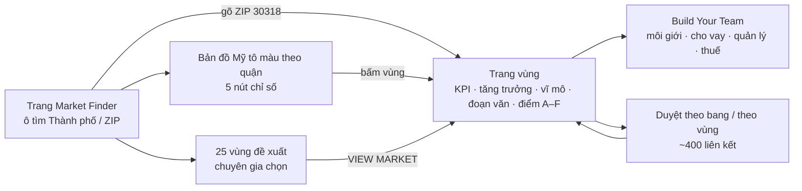

# BiggerPockets Market Finder — phân tích sản phẩm dựa trên bằng chứng

Ngày: 2026-11-03 · Trạng thái: nghiên cứu, chưa phải đặc tả · Phục vụ giai đoạn 1 của pipeline đầu tư
(«Chọn thị trường», `docs/research/investment-pipeline-4-stages.md`).
Nền kỹ thuật đã có: `biggerpockets-markets-architecture.md` (20/10, kiến trúc + JSON) — tài liệu này không lặp
lại phần kỹ thuật mà trả lời câu hỏi **sản phẩm**: tính năng giúp ai, làm việc gì, hoạt động ra sao, kiếm tiền thế
nào, yếu ở đâu, và Việt Nam nên làm khác chỗ nào.

Bằng chứng thô (không commit): `research-local/bp-market-finder-2026-11-03/` (chữ trang danh sách, trang Atlanta,
trang bang Georgia, ảnh hộp mời Pro) và `~/dev/one-invest/research-local/bp-markets-evidence-2026-10-20.json` +
`bp-screenshots/` (lượt 20/10, đăng nhập Pro).

**Ký hiệu độ tin của bằng chứng**

| Mã | Nghĩa |
|---|---|
| **QS** | Quan sát trực tiếp trên trang thật: 20/10 (đăng nhập Pro, REA) và 03/11 (khách chưa đăng nhập, ego-browser) |
| **CT** | Tài liệu chính thức của BiggerPockets (thông cáo, blog) |
| **BT** | Bên thứ ba (bài review, diễn đàn, trang đối thủ) |
| **SL** | Suy luận của người phân tích từ các bằng chứng trên |

---

## 0. Tóm tắt điều hành

1. **Market Finder là cửa vào phễu, không phải sản phẩm dữ liệu.** Ra mắt 07/08/2024 cùng Deal Finder, Property
   Manager Finder, Tax Pro Finder (CT). Banner trên trang nói thẳng hành trình: *«Pick markets, find deals, analyze
   and manage properties»* (QS 03/11). Tiền đến từ gói Pro ($39/tháng hoặc $390/năm) và từ dẫn khách cho môi giới,
   bên cho vay, quản lý nhà — không từ bán số liệu.
2. **Giá trị cho người dùng là «thu hẹp danh sách nhanh», không phải «quyết định».** Khoảng 400 vùng đô thị (MSA)
   được tô màu theo 5 chỉ số đơn giản; mỗi vùng có một trang đọc trong một phút; 25 vùng được chuyên gia chọn sẵn.
   Người mới vượt được «tê liệt vì phân tích» — nỗi đau có tên trong cộng đồng (BT).
3. **Điểm yếu lớn nhất là độ tin của số.** Trang ghi «Updated: November, 2026», nhưng Atlanta vẫn hiện giá tăng
   **+9,70%/năm** — Zillow cùng kỳ ghi **−2,9%**, Redfin **−0,5%** (BT). Số giá và tiền thuê y hệt lượt 20/10 trong khi
   tỉ lệ thất nghiệp đã đổi (3,3% → 3,5%): nhãn cập nhật áp cho cả trang, còn từng con số cũ mới khác nhau (QS+SL).
   Không công bố nguồn, không công bố công thức; chỉ số «Affordability» không tái tính được từ chính số trên trang.
4. **Đơn vị quá thô so với cách nhà đầu tư thật sự chọn.** Người dùng nói «khu phố quyết định, có khi từng con
   phố»; thứ họ hỏi thật là luật có lợi cho chủ nhà, thuế + bảo hiểm thật, và có tin được người quản lý tại chỗ (BT).
   Market Finder không trả lời ba câu đó bằng số — nó đẩy sang «Build Your Team».
5. **Cơ hội cho Việt Nam:** chưa thấy công cụ nào ở VN cho so sánh tỉnh/phường theo lợi suất thuê cho nhà đầu tư —
   S07 chỉ có báo cáo PDF tĩnh, OneHousing/Guland ở cấp dự án/thửa (BT, chưa dùng thử). One Invest đã có
   Finder cấp tỉnh và thước giá cấp phường; nên **học bộ khung 3 lăng kính (dòng tiền · tăng giá · chi trả) và phễu
   «chọn vùng → xem tin → gặp người giữ căn»**, nhưng **làm ngược BP ở độ tin**: ngày dữ liệu trên từng con số, cỡ
   mẫu, phương pháp công khai, và xuống tận phường.

---

## 1. Framing — câu hỏi nghiên cứu

| # | Câu hỏi | Vì sao cần cho bản VN |
|---|---|---|
| Q1 | Tính năng phục vụ ai, giúp họ làm xong việc gì? | Chọn người dùng và việc cần làm trước khi chọn chỉ số |
| Q2 | Hoạt động thế nào — luồng, đơn vị, chỉ số, công thức, nhịp cập nhật? | Bộ khung tối thiểu để dựng lại |
| Q3 | Lợi ích cho người dùng và cho BP là gì; BP kiếm tiền ở đâu? | Biết phần nào là giá trị thật, phần nào là phễu bán hàng |
| Q4 | Điểm yếu, rủi ro, lời chê có bằng chứng? | Không chép lỗi |
| Q5 | Đối thủ/tương tự làm gì; ở VN đã có gì? | Định vị khác biệt |
| Q6 | Chuyển sang VN: giữ gì, đổi gì, dữ liệu nào có sẵn? | Đầu vào cho đặc tả |

**Phương pháp.** (1) Quan sát trực tiếp hai trạng thái: khách chưa đăng nhập (03/11, ego-browser) và thành viên Pro
(20/10); (2) tái tính số trên trang để kiểm công thức; (3) đối chiếu số với chỉ số độc lập (Zillow, Redfin);
(4) tài liệu chính thức về ra mắt và giá; (5) tiếng nói người dùng trên diễn đàn BP và bài review; (6) quét đối thủ
Mỹ và công cụ VN. Giới hạn: không vào được Reddit; diễn đàn BP chỉ đọc qua trích đoạn tìm kiếm; không tải nguyên bộ
dữ liệu JSON lần này (bị chặn, không vòng qua — lượt 20/10 đã ghi lược đồ).

---

## 2. Tính năng nằm ở đâu trong sản phẩm BiggerPockets

- **Ra mắt 07/08/2024**, trong đợt BP nhận vốn từ The Chernin Group và đạt 3 triệu thành viên. Bốn công cụ mới:
  Market Finder và Deal Finder **thuộc gói Pro**; Property Manager Finder và Tax Pro Finder **miễn phí** (CT —
  thông cáo Business Wire, blog «A New Chapter at BiggerPockets»). Mô tả gốc: tìm kiếm các MSA trên toàn quốc,
  «evaluating cash flow, appreciation, and affordability metrics».
- **Vị trí trong hành trình** theo chính BP: chiến lược → **thị trường** → đội «Core 4» (môi giới, quản lý nhà, bên
  cho vay, thợ) → tìm căn → phân tích → quản lý (CT — blog long-distance investing, Core Four). Banner trên trang Market
  Finder: «Pick markets, find deals, analyze and manage properties» (QS 03/11).
- **Tài sản đi kèm**: báo cáo PDF «Top 100 Cash Flow Markets» miễn phí (bản mới nhất tìm thấy là 2024, Dave Meyer —
  BT/CT), quảng cáo ngay trên trang chi tiết; video Pro «Picking a Market for Your First or Next Real Estate
  Investment» (QS 20/10).
- **Diễn biến**: một chủ đề diễn đàn (~đầu 2025, ngày chưa xác minh) hỏi vì sao bản đồ «không còn tô màu theo chỉ số
  đã chọn» — lỗi đó đã không còn khi quan sát 20/10 và 03/11. Tháng 08/2026 BP mở «BiggerPockets Map» mới cho mọi
  thành viên — tìm căn, phân tích, gặp người tại chỗ (BT — bài đăng X của BP). Market Finder vẫn sống song song (QS).

---

## 3. Người dùng và việc họ cần làm (Q1)

**Người dùng chính** (SL từ nội dung trang + cộng đồng BP): nhà đầu tư nhà cho thuê cá nhân, phần lớn **mới hoặc đầu
tư xa nhà** (nơi họ sống quá đắt nên phải mua ở bang khác). Họ không có môi giới quen ở nơi định mua.

**Việc cần làm (JTBD):**

| Khi… | tôi muốn… | để… | Bằng chứng |
|---|---|---|---|
| tôi đã có vốn nhưng chưa biết mua ở đâu | thu từ 400 vùng còn 3–5 vùng đáng xem | không mất hàng tháng đọc báo cáo | Lời chào trang: «Easily identify your next market» (QS); «analysis paralysis… one of the most costly mistakes» (BT) |
| tôi phân vân giữa dòng tiền và tăng giá | thấy vùng nào thiên về bên nào | khớp với chiến lược của mình | Nhóm «cashflow / growth appreciation / hybrid» của 25 vùng đề xuất (QS); khung 3 loại thị trường của Dave Meyer (CT) |
| tôi đã chọn được vùng | gặp người tại chỗ tin được | làm được việc ở xa | «Build Your Team» xuất hiện 2 lần mỗi trang (QS); «the PM… makes or breaks your out-of-state deal» (BT) |

**Câu hỏi thật của người dùng mà trang KHÔNG trả lời bằng số** (BT — diễn đàn BP):
- Luật có lợi cho chủ nhà không; đuổi người thuê mất bao lâu («ask a property mgmt company how long…»).
- Thuế nhà + bảo hiểm thật là bao nhiêu — ở Memphis hai khoản này ăn gần hết dòng tiền «trên giấy».
- Khu nào trong vùng là ổn — «neighborhood-to-neighborhood, and sometimes street-to-street».

**Kết luận Q1 (SL):** Market Finder giải đúng một việc hẹp — **lọc vòng đầu ở cấp vùng** — và chuyển các việc còn lại
cho con người (đội tại chỗ). Đây vừa là giới hạn, vừa là chủ đích kinh doanh (§5).

---

## 4. Cách tính năng hoạt động (Q2)

### 4.1 Luồng người dùng

- **Tìm kiếm**: gõ thành phố hoặc mã ZIP → luôn quy về một MSA. ZIP 30318 → «Atlanta, GA»; ZIP nông thôn 59001
  (Absarokee) → MSA Billings (QS 03/11). Người dùng không cần biết MSA là gì.
- **Bản đồ**: tô màu **từng quận (county)** bằng số của MSA chứa nó; quận ngoài mọi MSA để xám. 8 bậc màu **cố định**
  cho mỗi chỉ số (ví dụ giá tăng: <0 · 0–2 · … · >12%) (QS 20/10).
- **Trang vùng** (QS, Atlanta): ảnh + một câu giới thiệu viết tay → «At a Glance: 5 lý do đầu tư» (tăng dân số, việc
  làm, nhà ở sinh viên, du lịch/STR, chi trả) → Key Stats 4 ô → đoạn văn «About» ~7 đoạn → Growth Stats 3 ô → Macro
  Stats 3 ô → Community Score 11 điểm chữ A–F → bản đồ vị trí → Build Your Team → liên kết theo bang/vùng.
- **Trang theo bang** (`/markets/states/ga`): «Major metros in Georgia» — mỗi vùng một thẻ cùng mẫu với thẻ đề xuất
  (QS 03/11).

### 4.2 Đơn vị và phạm vi

- Đơn vị = **MSA** (vùng đô thị thống kê liên bang), khoảng 400 vùng; chỉ thành thị — vùng nông thôn ngoài MSA không có
  số (xám trên bản đồ) (QS).
- Không có cấp nhỏ hơn MSA: không quận, không ZIP, không khu phố (QS). Đây là điểm bị chê nhiều nhất (§6).

### 4.3 Chỉ số và công thức

| Chỉ số (nhãn BP) | Định nghĩa BP ghi | Tái tính trên số Atlanta | Ghi chú |
|---|---|---|---|
| Appreciation | YoY Home Price Growth | 9,70% | Lệch chỉ số độc lập (§6.1) |
| Rent-to-Price (RTP) | tiền thuê tháng / giá nhà | $1.672 / $367.600 = **0,455%** ✓ | ×12 ≈ **lợi suất thô 5,5%/năm**; «quy tắc 1%» là ngưỡng dân gian |
| Affordability | Household Income to Price | $89.724 / $367.600 = **24,4%** ≠ 21,61% trên trang | **Không tái tính được** — nguồn thu nhập hoặc công thức khác, không công bố |
| Population growth | tốc độ tăng dân số | 1,29% | Có thể từ ước tính dân số liên bang (chưa xác minh) |
| Unemployment | tỉ lệ thất nghiệp | 3,30% (20/10) → 3,5% (03/11, trong đoạn văn) | Trường duy nhất thấy đổi giữa hai lượt |
| YoY Rent Growth | tăng tiền thuê | 6,97% | Chỉ ở trang vùng và thẻ |
| Median Rental Income / Home Price / Household Income / Population | trung vị | $1.672 / $367.600 / $89.724 / 6.256.377 | — |
| Community Score (11 mục A–F) | trường học, chi phí sống, an ninh, đa dạng, việc làm, đi lại, đi bộ, giao thông công cộng, thời tiết, sức khoẻ | B tổng | Không ghi nguồn (kiểu Niche — chưa xác minh) |

- **Nguồn dữ liệu: BP không công bố.** Bằng chứng gián tiếp: chỉ số năm 2017 của BP dùng Zillow ZHVI + giá thuê HUD;
  Dave Meyer từng nói trên podcast giá và tiền thuê lấy từ Zillow, dân số từ Census (BT/CT, chưa xác minh cho Market
  Finder). Một bài review 05/2026: dữ liệu «from third-party aggregators (not BiggerPockets proprietary research)»
  (BT).
- **Đoạn văn «About» sinh theo mẫu** từ chính các con số («Home prices in Atlanta are $367,600… changed 9.7%…»),
  cộng vài câu biên tập tay (ngành chủ lực, chủ thuê lớn, giấy phép STR phải gia hạn hằng năm) (QS).

### 4.4 Thẻ «25 vùng đề xuất» — tiêu chí ngầm

Tái tính 24/25 thẻ (QS 20/10; thẻ thứ 25 Watertown, NY không đọc được số):

| Đại lượng | Thấp nhất | Trung vị | Cao nhất |
|---|---|---|---|
| Giá nhà trung vị | $136.500 | $230.350 | $367.600 |
| Tiền thuê trung vị/tháng | $912 | $1.113 | $1.672 |
| Giá tăng/năm | 6,26% | 9,68% | 13,75% |
| RTP tháng | 0,35% | 0,49% | 0,68% |

- **Không vùng nào đạt quy tắc 1%**; 10/24 vùng ≥ 0,5%. Lợi suất thô cao nhất ≈ 8,2%/năm (McAllen, TX) (SL từ số).
- Toàn bộ là vùng **giá rẻ hơn mặt bằng chung**, tập trung Đông Nam và Trung Nam nước Mỹ (13 bang: GA, FL, TX, OK,
  NC, TN…) (QS).
- Trang hứa chia nhóm «cashflow / growth appreciation / hybrid» nhưng **thẻ không gắn nhãn nhóm** — người đọc không
  biết vùng nào thuộc nhóm nào (QS).

---

## 5. Lợi ích và mô hình kinh doanh (Q3)

### 5.1 Lợi ích cho người dùng

| Lợi ích | Cơ chế tạo ra | Độ mạnh (SL) |
|---|---|---|
| Thu hẹp nhanh 400 → vài vùng | Bản đồ một màu, 5 nút chỉ số, thang màu cố định dễ nhớ | Mạnh — đúng việc vòng đầu |
| Hiểu một vùng trong một phút, không cần biết đọc số | KPI lớn + đoạn văn viết sẵn + «5 lý do» | Mạnh với người mới |
| Bớt sợ chọn sai | «Chuyên gia chọn sẵn 25 vùng» | Trung bình — tiêu chí không công khai |
| Có người để gọi ở vùng đó | Build Your Team gắn sẵn tên vùng | Mạnh — đúng nỗi đau đầu tư xa |
| Đi tìm được bằng ZIP/thành phố | Quy mọi ZIP về MSA | Nhỏ nhưng gỡ rào thuật ngữ |

### 5.2 Lợi ích cho BiggerPockets — tính năng là phễu

- **Tầng khách (03/11, QS):** chỉ xem được bản đồ «Appreciation», giá nhà, giá tăng và tiền thuê tăng. Bấm 4 nút còn
  lại → hộp mời Pro «Analyze deals like a PRO»: **$39/tháng** hoặc **$32,50/tháng trả năm ($390)**, dùng thử 7 ngày.
  Thẻ đề xuất: thấy **3/25** vùng, phần còn lại «PRO · View All 25 Markets». Trang vùng khoá: tiền thuê, RTP,
  Affordability, dân số, thất nghiệp, thu nhập, «5 lý do», cả 11 điểm A–F.
- **Tầng Pro (20/10, QS):** mở hết; không thêm khối dữ liệu nào ngoài những gì khách thấy bị khoá.
- **Đính chính tài liệu 20/10:** kết luận «Pro chỉ bán tầng so sánh trên bản đồ, tầng đọc một vùng để công khai»
  **không còn đúng** — khách hiện bị khoá phần lớn số ở trang vùng.
- **Lỗ rò paywall:** đoạn văn «About» và đoạn mô tả trên thẻ vẫn in đủ tiền thuê, RTP, thất nghiệp, thu nhập cho khách
  («The average rent in Atlanta, GA is $1,672»). Có thể cố ý — đoạn văn phục vụ SEO; hệ quả là ô số bị khoá nhưng chữ
  thì không (QS+SL).
- **Dẫn khách cho người làm dịch vụ:** Build Your Team trỏ tới môi giới, bên cho vay, quản lý nhà, thuế; mỗi khối có
  «Interested in becoming a featured agent? Apply Now» — bên cung cấp dịch vụ trả tiền để được hiện (QS). Liên kết mang
  `itm_source=Market_Finder` để đo (QS 20/10).
- **SEO:** ~400 trang vùng + trang bang + «Browse by Market» là lưới liên kết (QS).
- Mô hình «số liệu miễn phí để dẫn khách dịch vụ» cũng là cách Awning làm (BT).

**Kết luận Q3 (SL):** dữ liệu thô của Mỹ gần như miễn phí (Zillow, Redfin, Realtor.com, FRED), nên giá trị BP bán là
**sự tiện + sự tuyển chọn + cộng đồng tin cậy**, rồi thu tiền ở gói Pro và ở người làm dịch vụ. Một bài review nói
gọn: «The value is convenience, not exclusivity» (BT).

---

## 6. Điểm yếu và rủi ro có bằng chứng (Q4)

### 6.1 Số liệu cũ dưới nhãn «mới cập nhật»

| Atlanta | BP Market Finder | Đối chiếu độc lập |
|---|---|---|
| Giá tăng/năm | **+9,70%** (nhãn «Updated: November, 2026») | Zillow ZHVI vùng Atlanta **−2,9%** (đến 30/06/2026); Redfin giá bán **−0,5%** (2026) |
| Tiền thuê tăng/năm | +6,97% | Chính blog BP (03/2026): tiền thuê trung vị cả nước **giảm 1,4%** |

- Giữa 20/10 và 03/11 nhãn đổi từ «June, 2026» sang «November, 2026»; giá, tiền thuê, giá tăng, tiền thuê tăng giữ
  nguyên; chỉ thất nghiệp đổi (QS).
- Toàn bộ thẻ trang bang Georgia đều cho giá tăng 9–12%/năm (QS 03/11) — không khớp thị trường 2026 đi ngang hoặc
  giảm (SL).
- **Hệ quả:** người mới chọn vùng «tăng giá mạnh» dựa trên số có thể đã cũ một đến vài năm. Đây là rủi ro uy tín lớn
  nhất của tính năng (SL, độ tin cao vì hai nguồn độc lập cùng chiều).

### 6.2 Không minh bạch phương pháp

- Không ghi nguồn, kỳ dữ liệu, công thức (QS). «Affordability» không tái tính được từ số trên chính trang (§4.3).
- 25 vùng đề xuất: không nêu tiêu chí, không gắn nhãn nhóm (QS).

### 6.3 Đơn vị quá thô

- MSA gộp hàng triệu dân; người dùng nói quyết định nằm ở khu phố, có khi từng dãy nhà (BT). Một trang review: công cụ
  «does not tell you which specific neighborhoods… are actually delivering 8% cap rates» (BT).

### 6.4 Bỏ trống ba câu hỏi người dùng hỏi nhiều nhất

- Luật cho thuê/đuổi người thuê, thuế + bảo hiểm thật, chất lượng người quản lý tại chỗ (BT §3). Chỉ có một câu biên
  tập «The state is landlord-friendly» trong đoạn văn (QS).

### 6.5 Tiếng nói người dùng mỏng

- Không tìm thấy chủ đề khen/chê đáng kể về Market Finder; người dùng nhắc nó như **một trong nhiều công cụ** (cùng
  Reventure, BestPlaces, CoStar) và than «the data isn't great with free tools» (BT). Tín hiệu (SL): tính năng không
  phải lý do chính người ta trả Pro.

---

## 7. Đối thủ và tương tự (Q5)

| Công cụ | Đơn vị | Chỉ số / điểm | Miễn phí / trả tiền | Khác biệt đáng học |
|---|---|---|---|---|
| **Mashvisor** Market Finder | thành phố, khu phố | lợi suất tiền mặt, cap rate, giá thuê/giá; điểm Mashmeter | bản đồ nhiệt chỉ gói Professional/Expert | Thuê dài hạn và ngắn hạn trên **cùng một bản đồ** |
| **S02** Market Explorer | vùng, tiểu vùng | Market Score 0–100 (gồm cả mức độ quy định) | 12 tháng lịch sử miễn phí; gói Research ~$34–39/tháng | **Luật đưa vào điểm**; legend theo phân vị động (xem `market-finder-spec.md`) |
| **Reventure App** | bang, 500 vùng, 3.000 quận, 30.000 ZIP | định giá cao (giá/thu nhập), tồn kho, giảm giá; điểm dự báo | freemium | Đi **xuống tận ZIP**; nội dung dự báo kéo người dùng |
| **Roofstock** Neighborhood Rating | khu thống kê (~72 nghìn) | 1–5 sao từ thu nhập, trường, việc làm, an ninh… | miễn phí, dẫn về sàn | Chi tiết hơn MSA nhiều bậc — nhưng người dùng báo đã ngừng hoạt động (BT) |
| **Zillow / Redfin / Realtor.com** | từ vùng đến ZIP | ZHVI, ZORI, giá bán, ngày bán, mức «nóng» | dữ liệu mở, miễn phí | Nguồn thô mà các công cụ khác đóng gói lại |
| **Rentometer** | bán kính quanh địa chỉ | căn thuê so sánh | 5 báo cáo/30 ngày miễn phí | Cấp căn, không cấp vùng |
| **Awning** | thành phố | doanh thu, giá đêm, công suất STR | miễn phí, sống nhờ dịch vụ quản lý | Cùng mô hình phễu dịch vụ như BP |

**Việt Nam** (BT, chưa dùng thử):
- **S07 (cổng rao)**: «Lịch sử giá» 5 năm theo dự án/khu vực trong từng tin; báo cáo quý dạng PDF có lợi suất cho
  thuê theo tỉnh (2024: Bình Dương ~4,7%, Hà Nội 3,7%, TP.HCM 3,6%). **Không có bản đồ so sánh tương tác.**
- **OneHousing**: định giá và so sánh **dự án** (2022); còn hoạt động hay không — chưa xác minh.
- **Guland**: «bản đồ giá» theo thửa/điểm, quy hoạch; không phải bảng màu theo phường.
- **Không tìm thấy** công cụ VN nào so sánh tỉnh/phường theo tỉ lệ thuê/giá cho nhà đầu tư → khoảng trống khả dĩ.

---

## 8. Chuyển sang Việt Nam (Q6)

### 8.1 Giữ — đổi — bỏ

| Thành phần BP | Quyết định cho VN | Lý do |
|---|---|---|
| 3 lăng kính dòng tiền · tăng giá · chi trả | **Giữ** | Khung tối giản đã được kiểm chứng; khớp 4 chiến lược của One Invest (thuê ngắn, thuê dài, chờ tăng giá, lai) |
| Đơn vị MSA, tô màu quận bằng số vùng | **Đổi**: tỉnh/thành (34 thị trường) **và phường** | VN không có MSA; One Invest đã có thước giá cấp phường — đúng chỗ BP bị chê |
| RTP tháng | **Đổi**: «lợi suất thuê thô %/năm» = tiền thuê × 12 / giá | Người VN quen nói lợi suất năm; dùng chung cho thuê dài và thuê ngắn |
| Affordability = thu nhập / giá | **Đổi**: «giá căn trung vị = bao nhiêu năm thu nhập» | Dễ hiểu hơn tỉ lệ %; phải tái tính được |
| Dân số tăng, thất nghiệp | **Giữ có điều kiện** | Chỉ khi có số cấp tỉnh đủ tươi (§8.2) |
| Community Score A–F | **Bỏ ở pha đầu** | Không có nguồn chất lượng sống cấp phường tin được; thay bằng «điểm tin cậy dữ liệu» |
| Đoạn văn sinh theo mẫu | **Giữ** | Giúp người mới và SEO; sinh từ số đã tính sẵn, không để LLM bịa số (luật 7) |
| 25 vùng chuyên gia chọn | **Đổi**: «nổi bật tuần này» tính từ dữ liệu, **ghi rõ tiêu chí** | BP không công bố tiêu chí; đội nhỏ không giữ được danh sách tay |
| Nhãn «Updated» một chỗ cho cả trang | **Bỏ** — ngày dữ liệu **trên từng con số** + cỡ mẫu | Tránh đúng lỗi §6.1 |
| Build Your Team | **Đổi**: «gặp người đang giữ căn» ở phường đó | Khớp FRAMING D2/D3: môi giới giữ mã căn là người dùng đầu tiên |
| Paywall tầng so sánh | **Ghi nhận, chưa áp** | One Invest chưa thu tiền; nếu sau này thu, đừng để chữ rò số như BP |

### 8.2 Dữ liệu cần — đã có gì

| Lăng kính | Chỉ số VN | Nguồn trong One Invest | Trạng thái (đọc số ở ROADMAP §2.5) |
|---|---|---|---|
| Dòng tiền — thuê dài | lợi suất thuê thô theo phường/loại căn | tin bán + tin thuê công khai (P2) | Có giá bán dày ở Hà Nội; tiền thuê dài cần đủ mẫu theo phường (ngưỡng mẫu: câu hỏi mở ở `invest-portal-full-picture-spec.md`) |
| Dòng tiền — thuê ngắn | doanh thu/giá | listing thuê ngắn tự thu (S01), Hà Nội + TP.HCM | Có; không dùng số S02 trên cổng Invest (luật 5) |
| Tăng giá | Δ giá/m² trung vị theo quý | chuỗi thời gian từ tin rao | Chưa đủ dài cho «so cùng kỳ năm trước» — phải nói rõ «chưa đủ dữ liệu» thay vì hiện số |
| Chi trả | giá căn trung vị / thu nhập hộ năm | thu nhập bình quân theo tỉnh từ Tổng cục Thống kê | **Cần kiểm**: số theo 34 tỉnh mới sau sáp nhập 2025 — có thể phải gộp lại từ tỉnh cũ qua bảng chuyển đổi |
| Sức cầu | dân số tăng, lao động | Tổng cục Thống kê theo tỉnh | Cần kiểm độ tươi và cấp tỉnh mới |
| Chi phí thật | thuế cho thuê, phí quản lý, phí dịch vụ toà | luật thuế + dữ liệu toà/dự án | Chưa có; đây là câu hỏi người dùng hỏi nhiều nhất ở Mỹ (§3) |
| Luật | quy định cho thuê ngắn hạn ở chung cư theo địa phương | biên tập tay | Chưa có; S02 cho thấy đưa luật vào điểm là khác biệt |

### 8.3 Phiên bản tối thiểu đề xuất (SL — cần duyệt trước khi thành đặc tả)

1. **Phạm vi:** Hà Nội trước, cấp phường (dữ liệu dày nhất); tỉnh khác hiện «đang thu thập» như hiện nay.
2. **Bản đồ phường** tô màu theo 3 lăng kính (lợi suất thuê dài · lợi suất thuê ngắn · giá/m²), thang màu theo phân vị
   của tập đang xem, ô nào dưới ngưỡng mẫu thì để xám kèm chữ «chưa đủ mẫu».
3. **Trang phường**: 4 ô số (giá/m² trung vị, tiền thuê trung vị, lợi suất thô, số tin đang rao) — mỗi ô có ngày dữ liệu
   và cỡ mẫu; một đoạn văn sinh từ số; danh sách tin trong phường (nối sang giai đoạn 2 «Chọn căn»).
4. **Tìm kiếm** bằng tên phường, tên dự án hoặc địa chỉ → quy về phường (học cách BP quy ZIP về MSA).
5. **Trang phương pháp** công khai: nguồn (theo nhãn tầng C), công thức, nhịp cập nhật.

**Thước đo thành công gợi ý:** tỉ lệ người xem bản đồ mở ít nhất một trang phường; tỉ lệ từ trang phường đi tiếp sang
xem tin (chuyển giai đoạn 1 → 2); tỉ lệ ô số có đủ mẫu; độ lệch giữa ngày dữ liệu và ngày xem.

### 8.4 Rủi ro khi làm ở VN

- **Mẫu mỏng** ở phường ngoài trung tâm → bản đồ loang lổ xám; phải chấp nhận và nói thật thay vì nội suy.
- **Giá rao ≠ giá giao dịch**: lợi suất tính trên giá rao sẽ thấp hơn thực tế; cần ghi chú trên trang và hiệu chuẩn khi
  có giá giao dịch.
- **Tin giả, tin trùng** làm lệch trung vị — phụ thuộc chất lượng lớp canonical (xem cảnh báo tin mock ở ROADMAP §2.5).
- **Nhãn «chuyên gia chọn»** dễ thành khuyến nghị đầu tư — chỉ hiện tiêu chí và số, không hiện lời khuyên mua.

---

## 9. Ledger — còn mở

| # | Điều chưa biết | Cách đóng |
|---|---|---|
| L1 | Nguồn thật của số BP (Zillow? Census? BLS?) | Không chặn — ta chỉ học cấu trúc |
| L2 | Công thức Affordability của BP | Không chặn — ta dùng công thức riêng, công khai |
| L3 | Tiếng nói người dùng trên Reddit | Công cụ tìm không vào được; nếu cần, đọc tay |
| L4 | Thu nhập, dân số theo 34 tỉnh mới — có số chính thức chưa | Kiểm khi viết đặc tả lăng kính «chi trả» |
| L5 | Công cụ VN (S07, OneHousing, Guland) — dùng thử thật | Một buổi dùng thử, chụp màn hình |
| L6 | Bộ JSON đầy đủ 400 vùng của BP | Không cần cho mục đích sản phẩm |

## Nguồn chính

- Trang BP (QS): `https://www.biggerpockets.com/markets`, `/markets/atlanta-sandy-springs-alpharetta-ga`,
  `/markets/states/ga` — bản thu 03/11 trong `research-local/bp-market-finder-2026-11-03/`.
- Ra mắt (CT): https://www.businesswire.com/news/home/20240807232251/en/
  https://www.biggerpockets.com/blog/a-new-chapter-at-biggerpockets
- Giá Pro (BT): https://www.kdsdevelopment.net/articles/biggerpockets-review-2026-is-pro-worth-it
  https://www.globenewswire.com/news-release/2026/03/03/3248432/0/en/
- Review dữ liệu (BT): https://firmtools.ai/biggerpockets-pro/
- Đối chiếu Atlanta (BT): https://www.zillow.com/atlanta-ga/home-values/ · Redfin Atlanta housing market
- Diễn đàn BP (BT): https://biggerpockets.com/forums/921/topics/1204990-data-tools-to-find-and-compare-markets
  https://www.biggerpockets.com/forums/921/topics/1227945-what-happened-to-the-market-finder-map
  https://biggerpockets.com/forums/311/topics/1113855-ready-to-invest-out-of-state-for-cash-flow-landlord-friendly-or-not
  https://www.biggerpockets.com/forums/12/topics/685786-memphis-cash-flow-doesnt-seem-to-be-that-great-so-why-memphis
- Khung đội Core 4 (CT): https://www.biggerpockets.com/blog/core-four-real-estate-team
- Top 100 Cash Flow Markets (CT): https://www.biggerpockets.com/resources/market-data/2024-top-100-cash-flow-markets
- Đối thủ (BT): https://help.mashvisor.com/en/articles/7177562-understanding-the-market-finder-heatmap
  
  https://learn.roofstock.com/neighborhood-rating · https://www.zillow.com/research/data/
  https://www.rentometer.com/products-and-pricing
- Việt Nam (BT): 
  
  https://vneconomy.vn/onehousing-cong-cu-dinh-gia-nha-thuc-day-minh-bach-hoa-thi-truong-bat-dong-san.htm
  https://guland.vn/ban-do-gia
