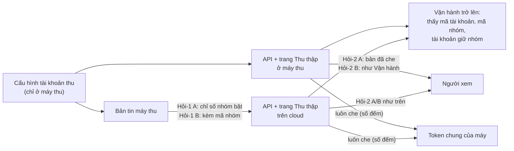

# Định danh tài khoản thu theo vai — thiết kế

Hồ sơ `_acceptance/dinh-danh-tai-khoan-thu-theo-vai/` · T3 · nguồn: Hỏi-1 Cổng Phạm vi `viewer-khong-thay-the-duyet` (Mạnh
chọn «mở hàng riêng» 27/10), trả lời giám sát P1-40.

## Hiện trạng (khảo sát 29/10, main 0103d246)

| Chỗ | Trường mang định danh | Ai nhận hôm nay |
|---|---|---|
| `GET /api/v1/ops/collections` (máy thu) | `zaloAccounts[]` (cloud mới có), `zaloAllowlist[].groupId` (mã nhóm Zalo đang bật, đọc `~/.openclaw/openclaw.json`), `zaloGroups[].ownerAccount` (mã tài khoản giữ nhóm) | `ops.read` = phiên từ vai Người xem trở lên, HOẶC bearer chung |
| `GET /api/v1/ops/collections` (cloud) | `zaloAccounts[]` từ bản tin: `accountId`, `profile`, `enabledGroups` (mã nhóm) | như trên |
| Trang `/ops/collections` (máy thu) | cột «tài khoản giữ nhóm» (`ownerAccount`), chú thích allowlist in đuôi 6 ký tự mã nhóm | vai Người xem trở lên |
| Trang `/ops/collections` (cloud) | không mã nhóm («mã nhóm chỉ xem ở máy thu»), `ownerAccount` null | — |
| Bản tin `push-ops-facts` → `ops_heartbeat` | `zaloAccounts[i].enabledGroups` (mã nhóm), `accountId` | lên cloud; bộ soát tầng A miễn trọn khối `zaloAccounts` (chỉ chặn `name`) |

Đã chốt từ trước (không hỏi lại): tên tài khoản thu là tầng A, bản tin gửi `name: null`; mã tài khoản (bí danh cấu hình,
không phải định danh thật — kiểm cục bộ 29/10: một tài khoản, bí danh chữ 7 ký tự) được hiện ở `/ops/sources` trên cloud
(hồ sơ `soat-tang-a-moi-duong-len-cloud`, Hỏi-1 = A). Người tiêu thụ bằng bearer: `scripts/audit-all.sh` đọc trên cloud
`zaloHealth.heartbeatAgeMin`, `len(zaloAccounts)`, `len(zaloGroups)`.

## Quyết định

- **Một hàm `xemDinhDanhThu(user)`** ở `app/src/lib/ops-access.ts`: vai có hiệu lực từ Vận hành trở lên (cùng bậc
  `BAC_VAI`, email `OPS_EMAILS` tính như ops). Bearer chung (`nguoi: null`) → không thấy.
- **Một hàm che `cheDinhDanhThu(payload)`** (thuần, ở `app/src/lib/collections-queries.ts`) cho người gọi không thấy:
  - `zaloAccounts[i]` → `{ accountId: null, name: null, profile: null, enabledGroups: [], soNhomBat: <n> }` — GIỮ số phần
    tử để `audit-all.sh` đếm tài khoản như cũ;
  - `zaloAllowlist[i]` → `{ groupId: null, enabled }` — giữ số phần tử và nghĩa `null` cả mảng = «chưa đọc được cấu hình»;
  - `zaloGroups[i].ownerAccount` → `null`.
  Người gọi thấy được nhận nguyên, cộng `soNhomBat` ở mỗi tài khoản.
- **API** `GET /api/v1/ops/collections`: che khi `!xemDinhDanhThu(q.nguoi)` (Người xem và bearer), ở cả máy thu lẫn cloud.
- **Trang** `/ops/collections` (máy thu): dữ liệu che ở máy chủ TRƯỚC khi trao cho thành phần client; cột «tài khoản
  giữ nhóm» hiện «—», chú thích allowlist ghi «danh sách cho phép đang bật N nhóm; mã nhóm chỉ hiện cho vai Vận hành trở
  lên.» (khuôn câu của «Bài gốc chỉ hiện cho vai Vận hành trở lên.»). Vai Vận hành trở lên: như hôm nay.
- **Bản tin cloud** (Hỏi-1, máy khuyên A): `push-ops-facts` gửi `zaloAccounts[i].enabledGroups = []` và `soNhomBat = n`
  — mã nhóm không rời máy, cùng luật khối `s03` («không mã nhóm, không tài khoản»); `factsChan` chặn bản tin còn phần tử
  trong `zaloAccounts[i].enabledGroups`; `/ops/sources` trên cloud đọc `soNhomBat` cho nhãn «N nhóm bật».
- Nhãn vai lấy từ `CONTEXT.md` («Vận hành»). Không thêm thuật ngữ.

## Ngoài phạm vi

- Tên tài khoản thu (đã chốt tầng A, đã che).
- Route ghi `POST /api/v1/ops/zalo/*` và trang `/ops/sources` (chỉ admin).
- Đổi bậc quyền `ops.read` hay bảng quyền bearer cho route khác.

## Kiểm bằng mắt

AC-9: đăng nhập dev bằng tài khoản thử viewer (`node scripts/dev-ops-account.mjs --vai viewer`) và admin, chụp
`/ops/collections` ở máy thu (cột tài khoản giữ nhóm, chú thích allowlist).

## Đặc tả UX

Bỏ khuôn đặc tả UX (dòng sổ `descope`): vòng chỉ đổi chữ một ô và một câu chú thích theo khuôn câu đã có.

## Ai thấy gì (hình cho Hỏi-1, Hỏi-2)

