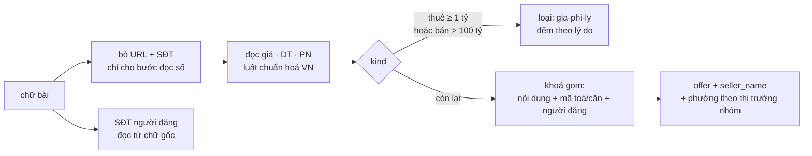
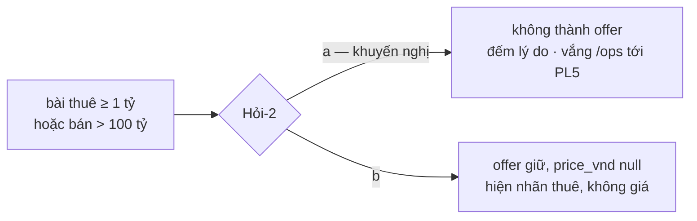
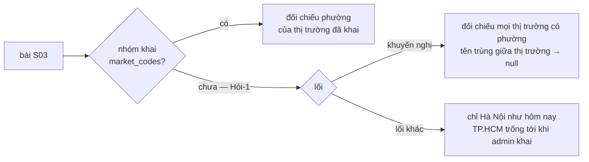

# N1 `s03-cam-mau-so-lieu` — cầm máu số liệu S03 ở transform

Hồ sơ: `_acceptance/s03-cam-mau-so-lieu/` · hàng N1 của `docs/plan/lo-trinh.json` · hạng T2 · không migration.
Căn cứ: `docs/research/s03-boc-tach-cau-truc-3010.md` §3 (số đo), §8.5 (N1 = B1 thu hẹp, N3 gộp vào), §9.2 (bảng cắt),
§9.4 (A4 `seller_name` giữ trong N1).

## Vấn đề

Transform S03 (`pipeline/transform-zalo.mjs`) đang đưa số sai lên `/ops` và cổng Invest:

- Đọc số trên chữ bài còn nguyên URL ảnh và SĐT: 6 bài ra giá lấy từ URL.
- Môi giới viết giá theo kiểu riêng mà parser đọc sai bậc: «2.650 tỷ», «2400 tỷ thu về» ra gấp 1.000 lần (579 bài bán
  trên 100 tỷ); «2ty450», «5tr5» mất phần lẻ; «Giá: 4,000 (thu về)», «7.000.000» không ra giá.
- Diện tích «64m», «43.2m» (thiếu «2») mất: 823 bài.
- Bước dò ý định kiểm «cho thuê» trước «bán», nên tin bán có chữ «đang cho thuê» thành tin thuê giá hàng tỷ (đo trên
  dữ liệu ngày 30/10: 207 bài thuê có giá từ 1 tỷ).
- Khoá gom khi thiếu phường và diện tích chỉ còn `kind|giá|PN|người đăng`: một môi giới rao nhiều căn 2PN cùng giá thành
  một offer (31 offer gom quá 10 nội dung khác nhau).
- `seller_name` của offer S03 trống 100% dù stg có `sender_name`.
- Phường chỉ nạp Hà Nội, trong khi gần một nửa số bài thuộc nhóm TP.HCM.

## Phạm vi — cầm máu bằng luật xác định, không vá ý định

Theo nguyên lý §8.1 của bản nghiên cứu: trích số là việc của luật xác định, phân loại ý định là việc của model quyết
định (PL5). Vòng này chỉ sửa phần **trích** và **khoá**, cộng một **chốt khoảng giá** để số phi lý không thành offer.

### 1. Bỏ URL và SĐT trước khi đọc số

`parsePost` đọc giá, diện tích, phòng ngủ trên chữ đã thay mọi URL (`http(s)://…`, `www.…`) và mọi SĐT khớp
`extractPhones` bằng một dấu cách. `phones`/`phone` vẫn đọc từ chữ gốc như hôm nay.

### 2. Luật giá VN

| Dạng | Ví dụ | Ra |
|---|---|---|
| tỷ, hai nhóm 3 chữ số sau dấu | «2.650 tỷ», «6,950 tỷ» | 2,65 tỷ · 6,95 tỷ |
| tỷ, số nguyên từ 1.000 không dấu | «2400 tỷ thu về» | 2,4 tỷ (môi giới viết triệu kèm chữ tỷ) |
| tỷ chen phần lẻ | «2ty450», «1ty650», «3ty2», «2 tỷ 450» | 2,45 · 1,65 · 3,2 · 2,45 tỷ |
| số đếm sau chữ tỷ (Ngoài-1, 4) | «8 tỷ 4 tầng», «5 tỷ 3 lầu», «3 tỷ 2 ô tô tránh», «6 tỷ 2 mặt tiền», «7 tỷ 3 căn» | 8 · 5 · 3 · 6 · 7 tỷ — số đếm không thành phần lẻ |
| đơn giá viết bằng đồng (Ngoài-2) | «45.000.000/m2», «45.000.000đ/m2» | giá/m² 45 triệu, tổng giá trống |
| triệu chen phần lẻ | «5tr5», «8tr5», «4tr8» | 5,5 · 8,5 · 4,8 triệu |
| «Giá:» theo sau số có nhóm nghìn, không đơn vị, tin bán | «Giá: 4,000 (thu về)» | 4 tỷ (đơn vị triệu); tin thuê giữ null |
| số đồng đủ ba nhóm, không đơn vị | «7.000.000», «Giá 7.500.000/tháng» | 7 triệu · 7,5 triệu |
| giữ như cũ | «2.9 tỷ», «2,93 tỷ», «3 tỷ», «45.5tr/m²», «8,5tr/tháng», «12 triệu/th» | không đổi |

Hai đổi nghĩa có chủ ý so với test cũ: «2.900 tỷ» nay ra 2,9 tỷ (test `parse.test.mjs` cũ ghim 2.900 tỷ đồng), vì
§3.2 đo 579 bài bán trên 100 tỷ đều là dạng này. Giá che số («36XX tỷ», «3.8x tỷ») KHÔNG đọc ở vòng này — giá khoảng là
việc của PL13.

### 3. Diện tích «64m»

Khi không có «m2/m²», đọc `<số>m` đứng một mình (không theo sau là chữ) trong khoảng 15–500 m², trừ khi 12 ký tự đứng
trước có «ngang», «mặt tiền», «mt», «rộng», «dài», «sâu», «hẻm», «ngõ», «đường», «lộ giới» (bề ngang, không phải diện
tích).

### 4. Chốt khoảng giá (`gia-phi-ly`)

Sau khi đọc: offer thuê có giá từ 1 tỷ và offer bán có giá trên 100 tỷ không thành offer. Bài bị loại đếm theo lý do
`thue-tu-1-ty` / `ban-tren-100-ty` trong kết quả `runTransformZalo` và dòng log. KHÔNG đổi `kind` của bài: đoán lại ý
định bằng regex là việc vòng này cố tình không làm (PL5 gánh).

**Hỏi-2** (người quyết): (a) bài phi lý không thành offer — khuyến nghị, vì tin mang loại sai thì hiện ra cũng sai;
(b) vẫn thành offer nhưng `price_vnd` null, tin còn hiện ở `/ops` dưới nhãn thuê, không giá. Cả hai đếm theo cùng lý do.

### 5. Khoá gom có mã toà/căn

Khi thiếu phường hoặc diện tích, khoá gom thêm danh sách mã toà/căn đọc từ chữ đã bỏ URL: chữ HOA 1–3 ký tự + 1–2 số
(S10, BS8, PR2, LD2), kèm đuôi căn tuỳ chọn (`.03`, `-1203`, `xx13`); bỏ mẫu `T<số>` (thường là «T4/2027»). Không có mã
thì khoá như hôm nay (`…|?|người đăng`). Đo 30/10 trên chữ đã bỏ URL, SĐT (trước khi sửa luật giá): khoá cũ có 4 offer
gom quá 10 nội dung, thêm mã còn 2. Đủ phường và diện tích: giữ khoá nội dung như hôm nay (bài của người khác đăng lại cùng căn vẫn gộp). Khoá này chỉ để gom; `offer_id`
vẫn theo post (khoá dính PL14).

«Nội dung khác nhau» của một offer đếm trên chữ đã bỏ URL và SĐT rồi chuẩn hoá: cùng một bài kèm ảnh khác nhau là một
nội dung.

### 6. `seller_name`

Offer S03 ghi `seller_name` = `sender_name` (đã trim) của bài mới nhất trong nhóm có tên; không bài nào có tên thì
null. Người bán trên tin rao là tầng C (ADR-0007 sửa đổi 23/10); `sync-cloud` vẫn loại cột này như hôm nay — vòng này
không đổi đường lên cloud.

### 7. Phường theo thị trường của nhóm

Bài S03 nối với nhóm qua `stg_zalo_posts.conversation_id = collection_units.group_key` (sổ nhóm PL12, 48). Nhóm khai
`market_codes` → đối chiếu tên phường của đúng các thị trường đó. Nhóm chưa khai (hôm nay: cả 11 nhóm S03) → **Hỏi-1**
(khuyến nghị: đối chiếu mọi thị trường có phường OSM trong `areas`, chỉ nhận khi tên khớp dài nhất thuộc một thị trường;
đo 30/10: chỉ 2 tên phường trùng giữa Hà Nội và TP.HCM). Phường lấy theo `docPhuongHopLe` như hôm nay; `area_id` giữ
tiền tố thị trường (`vn-hcmc-…`).

## Đo

- Ca thử thuần (`pipeline/scripts/cam-mau-s03.test.mjs`): ma trận dạng giá/DT/khoá viết trước, mọi chuỗi lấy từ bài
  thật (cắt đoạn, không SĐT thật); mỗi phép đo có cặp đỏ trên bản sao đột biến.
- Ca DB (`cam-mau-s03.itest.mjs`) trên **DB thử** `oneinvest_p1_n1` (`db/db-thu.sh`), BEGIN…ROLLBACK: seller_name,
  phường theo thị trường nhóm, khoá gom có mã.
- Phép đo trên dữ liệu thật (`pipeline/scripts/do-cam-mau-s03.mjs`): chạy `runTransformZalo` trên DB thử trong
  BEGIN…ROLLBACK, đếm bảy thước, exit 1 khi một thước trượt. Lượt đối chứng chạy transform của commit nền ghim
  `c333a342` (chép tạm cạnh tệp thật) và phải tái lập mốc gốc của TỪNG thước. Định nghĩa:
  - `gia_tu_url`: offer mang giá X mà có bài đọc chữ gốc (chưa gạt) ra X còn đọc chữ đã gạt URL không ra X.
  - `gom_qua_10_nhieu_nguoi` (Hỏi-3): số offer có quá 10 chữ khác nhau (đã gạt URL, SĐT, chuẩn hoá) mà bài của hơn một
    người đăng — đăng lại một căn có sửa chữ là gom đúng; số chữ khác nhau lớn nhất chỉ in ra. Đối chứng: transform của
    cây bỏ người đăng khỏi khoá gom.
  - `noi_nhom_pct`: % bài S03 có `conversation_id` khớp một `collection_units.group_key` của S03.
  - `hcm_sai_thi_truong`: offer có bài mang tên phường chỉ thuộc TP.HCM (không trùng tên Hà Nội), ở nhóm không khai
    thị trường loại trừ TP.HCM, mà `area_id` không phải `vn-hcmc-…`.

Không ghi `oneinvest :5433` trước khi gộp. Nạp lại thật sau gộp là việc triển khai (giám sát giao).

## Không làm (đã có hàng khác)

Ý định 3 lớp, Yêu cầu, bán/thuê (PL5) · tách bài nhiều căn (PL18, N2) · giá khoảng, mã căn có bậc, trường thuê (PL13) ·
nối mã toà vào danh mục (PL20, DB1) · gộp tin chỉ ảnh (PL28) · ghi phát biểu `rule_id` cho luật mới (PL17).
