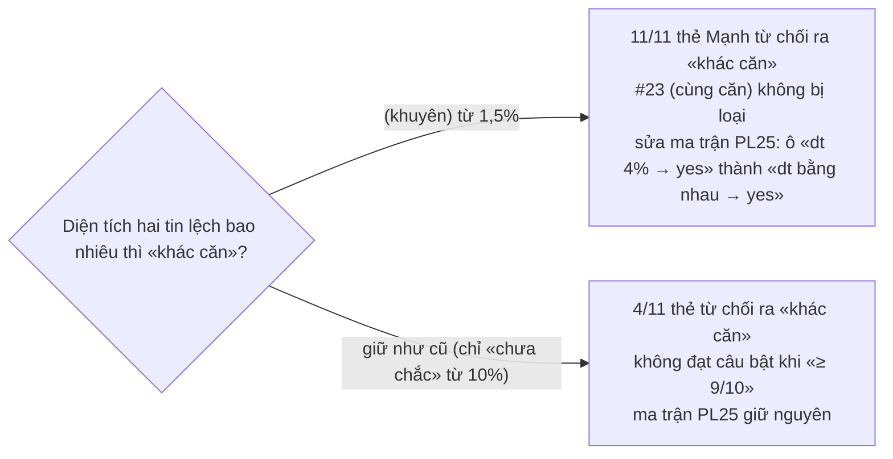

# Luật loại trừ theo đặc trưng nhà — thiết kế (HD2, `judge-luat-loai-tru-dac-trung`)

Hàng HD2 (đợt 1 hàng duyệt). Nguồn: audit `docs/research/audit-hang-duyet-3010.md` §7.1 #6 và §7.3, hàng
`judge-luat-loai-tru-dac-trung` ở §7.5. Cổng Đáng: Mạnh quyết ở §7.1.

## Vấn đề

`apNguong` (`agent/src/agents/judge-entity.ts`, `pl25-1`) chỉ so bốn trường: giá/m², diện tích, phường, loại hình. Chỉ ba
điều ra «khác căn»: giá/m² lệch quá 30%, khác phường, khác loại hình. Diện tích lệch từ 10% chỉ ra «chưa chắc». Cách Mạnh
duyệt thật thì khác: 10/10 thẻ «Khác căn» ngày 30/10 nêu ít nhất một đặc trưng khác, và Mạnh coi lệch diện tích nhỏ
(52 ↔ 53 m², 49 ↔ 51 m²) là khác căn.

## Đo trên 12 thẻ đã quyết (evidence chụp lúc sinh thẻ)

| Thẻ | Quyết | Diện tích A ↔ B | PN A ↔ B | Lý do chữ |
|---|---|---|---|---|
| 13 | Khác | 52 ↔ 51 (1,9%) | — ↔ 2 | (trống) |
| 14 | Khác | 49 ↔ 51 (3,9%) | — ↔ 2 | Diện tích khác, đường khác |
| 15 | Khác | 53 ↔ 52 (1,9%) | — ↔ 4 | Diện tích khác, tầng khác, đường khác |
| 16 | Khác | 53 ↔ 56 (5,4%) | — ↔ 3 | Diện tích, phòng ngủ, đường khác |
| 17 | Khác | 60 ↔ 60 | 4 ↔ 9 | Đường khác, phòng ngủ khác |
| 18 | Khác | 52 ↔ 52 | 3 ↔ 4 | Hình dạng khác, phòng ngủ khác |
| 19 | Khác | 30 ↔ 35 | 3 ↔ 2 | Diện tích, phòng ngủ, đường khác |
| 20 | Khác | 50 ↔ 49 (2%) | 3 ↔ 5 | Diện tích, phòng ngủ khác |
| 21 | Khác | 60 ↔ 54 | 4 ↔ 4 | Diện tích khác |
| 22 | Khác | 45 ↔ 40 | — ↔ 2 | Diện tích khác |
| 23 | **Cùng** | 45 ↔ 45 | — ↔ 2 | Cùng phường, cùng diện tích, cùng người đăng |
| 24 | Khác | 52 ↔ 60 | — ↔ 9 | Diện tích khác thì chắc chắn khác |

Tin A (S05) không có đường, WC hay tầng trong evidence. Mức lệch diện tích nhỏ nhất Mạnh ghi «khác» là 1,9%; thẻ cùng
căn duy nhất có diện tích bằng nhau.

## Cách làm

1. **Luật loại trừ trong `apNguong`, bản `pl25-2`.** Mỗi đặc trưng có giá trị ở CẢ HAI bên mà khác nhau thì ra «khác căn»
   và thêm một lý do có mã (`khac_<đặc trưng>`) kèm số đo hai bên ở `so`. Thiếu một bên thì bỏ qua, không thêm lý do loại,
   không suy ra gì. Các đặc trưng có trên `PairData` hôm nay:
   - phòng ngủ (`bedrooms`) và WC (`bathrooms`): số nguyên khác nhau;
   - đường (`street_raw`): khoá đường bỏ tiền tố «Đường/Phố/Đ.», bỏ dấu và hoa — khoá khác nhau;
   - mã căn (`block_raw`): khoá bỏ hoa và khoảng trắng — khác nhau;
   - tầng (`floor_raw`): số rút từ chuỗi — khác nhau;
   - diện tích: lệch từ ngưỡng chặt `NGUONG.dienTichNoMin = 0,015` (1,5%) trở lên. Ngưỡng nằm dưới mức nhỏ nhất Mạnh ghi
     khác (1,9%), trên sai số làm tròn nửa m² ở căn 50 m² (1%) — Hỏi-1.
2. «Cùng căn» chỉ ra khi không có lý do loại nào và diện tích lệch dưới ngưỡng chặt (thay 10%), cộng các điều kiện giá/m²,
   phường, loại hình như cũ.
3. Lý do loại đi vào `ly_do` của kết quả. `judge-run` đã ghi `ly_do` vào `evidence.cham` của thẻ, nên đặc trưng khác hiện
   trong evidence mà không phải sửa `judge-run.ts` (HD3 của P3 đang sửa tệp đó). `cau` của lý do không mang số (luật cũ
   AC-2: số không vào prompt), số đo ở `so`.

Không làm ở vòng này (chưa có trường trên `sale_offers`): số nhà, kích thước mặt tiền × sâu, số tầng nhà, toạ độ — chờ
hàng P1 `dac-trung-nha-s06-len-canonical` (HD5) đưa lên canonical; ghi chú của hàng: «trước đó dùng trường đang có».

## Phép đo

- `agent/tests/judge-luat.test.ts` (tệp mới): ma trận viết trước đặc trưng × {khác cả hai bên, giống, thiếu một bên}, hai
  chiều A↔B, chiều đỏ bằng `apNguong` bản cũ hoặc bản đột biến.
- Ma trận PL25 trong `agent/tests/judge-nguong.test.ts` sửa theo luật mới (Hỏi-1).
- Probe DB máy thu (bỏ qua dưới CI): chạy `apNguong` trên evidence của 12 thẻ đã quyết, so với quyết định của người.

## Đặc tả UX

Không chạm giao diện (dòng sổ «bỏ đặc-tả-UX»).

## Hình — Hỏi-1 (ngưỡng diện tích chặt)

