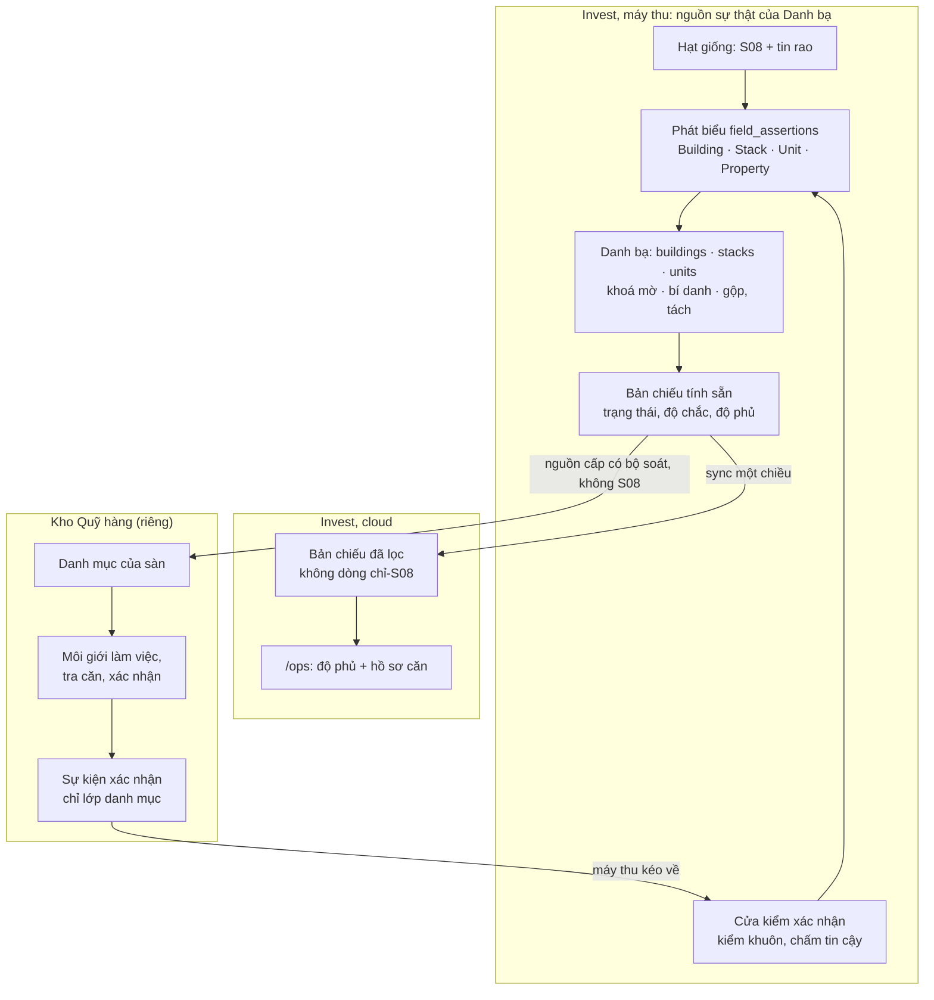

# Danh bạ nhà có mạng lưới môi giới xác nhận — mô hình kiến trúc

Ngày: 2026-11-03 · Trạng thái: **bản nháp chờ Mạnh duyệt** · Hàng mở vòng sau 05/11 · Dựa trên: ADR-0016 (danh bạ),
ADR-0017 (Quỹ hàng), ADR-0015 (đường lệnh kéo), ADR-0007 (SPL), FRAMING D1–D5 · Kho công khai: tài liệu này không ghi
danh tính sàn và không ghi dữ liệu S08 từng dòng.

Những phần ghi **[đề xuất]** là lựa chọn của phiên, chưa được Mạnh chốt.

## 1. Ý định

Mạnh (03/11): trang xem dự án, toà, căn là để **kiểm độ phủ** và **tra căn khi giao dịch**. Nền của nó là **định danh
nhà, giống Housing Dictionary của Beike**: mọi căn có một khoá, kể cả căn off-market, và mọi dữ liệu làm giàu gắn vào
khoá đó. Người xác nhận là đội đang giao dịch, mở rộng ra **mạng lưới môi giới của các sàn trên toàn quốc**.

Vì sao cần: tin rao thì trùng và mất đi, ngôi nhà thì còn. Không có khoá bền, FRAMING câu 1 (giá cùng căn theo thời gian)
và câu 4 (danh mục) không trả lời được. Không có người xác nhận, căn không lên được bậc B4 một cách đáng tin.

**Bài học từ Beike và Lianjia** ([Woshipm 2014](https://www.woshipm.com/operate/88542.html),
[NBD 2020](https://www.nbd.com.cn/articles/2020-05-13/1433282.html)): mỗi căn một mã; môi giới đếm từng căn từ 2008–2009;
năm 2019 có 219 triệu căn, 433 trường, 380.000 môi giới cập nhật. Điểm mấu chốt: **xác nhận là sản phẩm phụ của công việc
hằng ngày của môi giới**, không phải việc đi làm thêm. Quỹ hàng (ADR-0017) là chỗ công việc đó diễn ra.

## 2. Mục tiêu và ranh giới

**Mục tiêu**
1. Một khoá bền cho mọi toà, trục, căn, có hay không có tin rao.
2. Môi giới của sàn xác nhận được ngay trong lúc làm việc, ở bất kỳ tỉnh nào, không cần máy thu.
3. Một chỗ xem độ phủ cho đội vận hành; một chỗ tra căn cho người giao dịch.
4. Kiến trúc phục vụ toàn quốc; dữ liệu mở theo từng đợt dự án bằng cấu hình, không sửa mã.

**Không làm lúc này**: nhà phố và đất (giữ ADR-0016 §6, Đợt 2) · trang Invest cho Danh bạ · trả thưởng theo lượt · thu chủ
sở hữu · route Quỹ hàng trong `app/`.

**Phản mục tiêu** — chạy được vẫn coi là hỏng nếu:
- môi giới hay sàn thấy được dòng S08 (luật 5, ADR-0017 §5);
- lớp «nguồn» của sàn (chủ nhà, số, giá đáy, ảnh sổ) sang Invest (ADR-0017 §3);
- Invest lộ hàng một sàn đang giữ cho sàn khác;
- cổng Invest làm lộ mã căn mà người đăng đã che, kiểu `LD2xx11` (FRAMING §3.3);
- một sàn hay môi giới khai sai làm hỏng dữ liệu mà không rút lại được;
- hệ thống tự sinh căn rác rồi tính nó vào số căn;
- Danh bạ hiện «đã xác minh» cho thứ chỉ suy ra.

## 3. Hiện trạng đo được (DB local, 03/11)

| Đo | Số | Ý nghĩa cho thiết kế |
|---|---|---|
| S08, tính theo dự án | 150 dự án · 21.266 mã (13.562 cao tầng, 7.704 thấp tầng) | Đủ làm hạt giống nội bộ, không đủ làm danh bạ |
| Mã còn lại sau 8 ngày | 18.622/19.669 (95%), thêm 1.597 mã mới | Mã khá bền nhưng danh sách thay đổi: là quỹ căn, không phải sổ đủ |
| Lưới trục × tầng cao tầng (ước thô) | 12.490 mã / khoảng 53.000 ô (24%) · 60/343 toà đạt từ 70% | S08 thấy khoảng một phần tư; khung toà phải có người xác nhận |
| Khớp `asset_nodes` | 3/150 dự án khớp đúng tên hoặc bí danh · 20 khu đô thị | Phải có bước nối tên, một dự án có thể bị tách nhiều tên |
| Tin khớp S08 theo chữ | toà 349/2.220 · mã căn 99/9.473 | Khớp chữ gần như không dùng được; cần phát biểu và người |
| Bảng sẵn có | `registry_aliases`, `registry_events` nhận tiền tố `bld_`, `stk_`, `unt_` · `field_assertions` chỉ nhận `Property` | Khung chung có sẵn, cần mở ràng buộc |
| Cloud | `field_assertions` chỉ ở local; `asset_nodes`, `properties` có sync | Cloud chỉ nhận bản chiếu |
| Quỹ hàng | Kho riêng, dữ liệu riêng; Invest → Quỹ hàng đã chốt; chiều ngược đang tắt | Phải mở chiều ngược bằng thoả thuận (§6.4) |

## 4. Mô hình

### 4.1 Năm tầng

| Tầng | Là gì | Trạng thái |
|---|---|---|
| Vùng | `areas`, `asset_nodes` (khu đô thị, phân khu) | Có; cần bước nối tên dự án |
| Vật thể | `buildings`, `stacks`, `units` | Mới theo ADR-0016 §2–§4; không đổi khung |
| Bằng chứng | `field_assertions` mở thêm `Building`, `Stack`, `Unit` | Mở ràng buộc |
| Xác nhận | Kéo sự kiện, cửa kiểm, điểm tin cậy ở Invest; màn hình ở Quỹ hàng | **Mới** (§6) |
| Đọc | Bản chiếu, trang Ops, nguồn cấp Quỹ hàng | **Mới** (§7), nguồn cấp đã có trong ADR-0017 §5 |

### 4.2 Off-market là trạng thái suy ra

Căn off-market là căn trong Danh bạ **không có tin công khai còn hiệu lực trỏ vào**. Không lưu thành cột riêng; bản chiếu
tính từ liên kết tin và cửa sổ hiệu lực. RESO không có resource cho khái niệm này (`OffMarketDate`, `OffMarketTimestamp`
là của tin). Định nghĩa **không dùng trạng thái S08**, để số ở cloud và máy thu khớp nhau và số không làm lộ gián tiếp
«đã bán, chưa bán» của S08 **[đề xuất]**. Ở máy thu, trạng thái S08 hiện thành nhãn riêng bên cạnh. Căn off-market có thể
đang là hàng của một sàn trong Quỹ hàng; Invest không biết và không cần biết. Thêm thuật ngữ vào `CONTEXT.md` cùng hàng
đầu tiên dùng nó.

## 5. Dựng vật thể: khung toà trước, căn sau [đề xuất]

Sinh sẵn mọi ô trục × tầng thành căn sẽ tạo căn rác, vì toà Việt Nam hay bỏ tầng 4, 13, có 12A, tầng kỹ thuật. Vì vậy:

| Bước | Điều kiện | Kết quả | Hiện thế nào |
|---|---|---|---|
| 1. Toà tạm | Có mã S08 hoặc tin nói tới toà | `bld_`, trạng thái chưa xác nhận | «Suy ra» |
| 2. Khung toà | Một sàn khai số tầng, tầng bị bỏ, danh sách trục | Toà có khung tạm | «Một nguồn xác nhận» |
| 2b. Khung chắc | Khung đạt điều kiện lớp `fact` ở §6.2 | Toà có khung chắc | «Đã xác minh» |
| 3. Căn | Có bằng chứng về căn đó (mã S08, tin, xác nhận) | Đúc `unt_` một lần | Theo độ chắc của bằng chứng |
| Ô còn lại | Khung có nhưng chưa có bằng chứng | **Không đúc khoá**, tính lúc đọc | Ô trống trên lưới, không tính vào số căn |

Có khung rồi thì máy bắt được tin vô lý, như căn tầng 26 ở toà 25 tầng; lỗi loại này thành thẻ duyệt, không tự sửa.

Thấp tầng không có toà, trục: khu đô thị → phân khu → dãy → căn; `row_code` của S08 cho cấp dãy. Lát đầu chỉ làm cao
tầng **[đề xuất]**, nhưng khung không được giả định căn nào cũng có trục (ADR-0016 §2 đã nói không cấp nào bắt buộc).

Thêm hạt giống thứ ba: **bảng hàng sàn nhập** (ADR-0017 §5). Phần thuộc lớp danh mục về Invest qua sự kiện xác nhận.

## 6. Mạng lưới xác nhận

### 6.1 Xác nhận là sản phẩm phụ của công việc [đề xuất]

Đội của mình là một công ty như mọi công ty trong Quỹ hàng (ADR-0017 §3), nên đội và sàn đi cùng một đường. Môi giới
nhập hoặc mở một căn để làm việc: chọn căn từ danh mục, hoặc tạo căn mới nếu chưa có. Việc đó sinh ra sự kiện:

| Sự kiện | Nội dung | Không bao giờ có |
|---|---|---|
| Khung toà | Số tầng, tầng bị bỏ, danh sách trục | — |
| Thuộc tính căn | Mã căn, diện tích, số phòng, hướng | Chủ nhà, SĐT, giá đáy, ảnh sổ, giá chốt, trạng thái hàng |
| Báo sai | Trường nào sai, giá trị đúng là gì | Chữ tự do |

Sự kiện chỉ mang **mã công ty và mã người mờ**. Khung sàn nhìn thấy chỉ có phần danh mục đã qua bộ soát, không có S08, nên
luật 5 giữ được ở cửa ra Invest. Giá trị chưa chắc không điền sẵn vào biểu mẫu, để lời xác nhận không bị mớm.

Không làm việc giao riêng, không làm màn hình đi đếm ở lát đầu. Nơi không có sàn nào làm việc thì căn ở lại mức «suy ra».

### 6.2 Tin cậy

- Phát biểu mới dùng phương pháp `network_confirm`, lớp `observed`; không dùng `hitl` vì `hitl` xếp hạng cao nhất.
- Lên lớp `fact` khi **hai công ty độc lập** cùng giá trị, hoặc một công ty có điểm tin cậy đạt ngưỡng **[đề xuất; ngưỡng
  đo ở hàng code]**. Hai môi giới cùng sàn không tính là độc lập. Đội vận hành quyết bất đồng ở `/ops/review`.
- Một nguồn chưa đủ điểm **[đề xuất]**: mở được khung tạm, đúc được khoá, tính vào số căn, lên cloud kèm nhãn «Một nguồn
  xác nhận»; không tính vào số «đã xác minh», không lên bậc B4. Rút thì căn chuyển `retired` qua `registry_events`.
- Điểm tin cậy tính theo công ty: đồng thuận với công ty khác, đúng với giá trị đã `fact`. Máy chấm, người quyết.
- Rút dây chuyền: rút một công ty hoặc một người là rút mọi phát biểu của họ qua `retracted_at`, phân xử lại ra đúng
  (ADR-0016 §7.5).
- Bất đồng với S08 là tín hiệu nội bộ, lên thẻ; không báo cho sàn.

### 6.3 Đường đi, không mở cửa vào Invest

**Máy thu kéo sự kiện** từ API Quỹ hàng bằng token máy, ghi phát biểu ở máy thu; bản chiếu đi lên bằng đường đã có. Invest
không nhận webhook và không có cửa vào nào, đúng tinh thần ADR-0015 và ADR-0017 §5. Máy thu tắt thì sự kiện nằm chờ ở
hộp thư đi của Quỹ hàng. Trong `app/` không thêm route ghi, không thêm vai.

### 6.4 Sửa đổi luật cần Mạnh quyết

**ADR-0017 §6 (mở chiều ngược):** thêm loại kết nối «xác nhận danh mục», chỉ lớp danh mục, bằng thoả thuận từng sàn;
Invest nhận thành phát biểu qua cửa kiểm, đúng điều §6 đã đặt ra. Giá chốt vẫn tắt. Trước sàn đầu tiên ngoài đội phải
rà pháp lý như ADR-0017 đã ghi.

**ADR-0016 §9:** thêm điều kiện cho vật thể lên cloud và sang nguồn cấp: có ≥ 1 tin **hoặc có ≥ 1 xác nhận**. Giữ nguyên:
dòng chỉ-S08, bí danh mã căn S08, giá trị chỉ-S08, kể cả tên toà chỉ có từ S08, không đi đâu ngoài máy thu. Mã căn do sàn
khai được đi kể cả khi trùng S08, vì đó là lời của sàn.

Hệ quả phải nói rõ: **danh mục ngoài máy thu lúc đầu sẽ thưa** và dày dần theo xác nhận; toàn bộ dòng S08 chỉ thấy ở máy thu.

## 7. Bề mặt

| Bề mặt | Câu hỏi | Ai | Ở đâu |
|---|---|---|---|
| Độ phủ Danh bạ (`/ops/registry`, slug **[đề xuất]**) | Danh bạ phủ tới đâu, thiếu gì? Cây khu đô thị → toà, kèm số căn, số đã xác nhận, số có tin, số off-market | ops+ | `app/`, cloud + máy thu |
| Lưới toà (`/ops/registry/[toà]`) | Toà này có những căn nào? Lưới trục × tầng, mỗi ô một trạng thái | ops+ | `app/`, cloud + máy thu |
| Hồ sơ căn (`/ops/registry/[toà]/[căn]`) | Căn này thế nào? Tin, người đăng, lịch sử giá chào, độ chắc từng trường, bằng chứng | ops+ | `app/`; dòng S08 chỉ ở máy thu |
| Tra căn khi giao dịch và xác nhận | Căn khách hỏi là căn nào, có gì trên thị trường? | Môi giới | **Kho Quỹ hàng** **[đề xuất]** |

Trang Ops theo luật mỗi trang một câu hỏi; dòng S08 dùng vùng `LocalOnlyAlert` đã có; bước thiết kế chạy `onehub-ui` và
`design-pass` lúc mở vòng.

## 8. Thước đo

Số chính vẫn là north star FRAMING §5. Thêm: số toà có khung · số căn theo bậc · tỉ lệ tin cao tầng gắn được tới trục hoặc
căn · số căn off-market đã xác nhận · độ đồng thuận giữa các công ty · số sàn đang gửi xác nhận. Mọi số **chỉ đếm**, qua
`dq_check_results`.

## 9. Câu Mạnh phải chốt

| # | Câu | Vì sao đổi thiết kế | Đề xuất |
|---|---|---|---|
| Hỏi-1 | Tra căn khi giao dịch và xác nhận nằm ở Quỹ hàng, Ops chỉ để kiểm phủ và vận hành? | Quyết hàng nào ở kho này, hàng nào ở kho kia; đội mình phải dùng Quỹ hàng để giao dịch | Có |
| Hỏi-2 | Mở chiều ngược ADR-0017 §6 như §6.4, máy thu kéo về? | Không mở thì không có xác nhận | Có |
| Hỏi-3 | Sửa ADR-0016 §9 như §6.4? | Không sửa thì căn off-market đã xác nhận không ra khỏi máy thu | Có |
| Hỏi-4 | Lát đầu? | Quyết đợt nào chứng minh mô hình | Ocean Park 1 và Grand Park cao tầng; mở thêm bằng cấu hình |
| Hỏi-5 | Sàn nhận gì khi xác nhận? | Trả theo lượt sẽ đổi hẳn động cơ gian lận và cần chấm từ ngày đầu | Không trả theo lượt: sàn dùng danh mục và số thị trường, xác nhận đi kèm công việc |

## 10. Thứ tự hàng dự kiến [đề xuất, cắt bằng `cat-luot` sau khi chốt]

| Hàng | Việc | Quan hệ |
|---|---|---|
| DB1 (mở rộng) | Bảng vật thể, mở phát biểu, bộ dựng, nối tên dự án, lát Ocean Park 1 + Grand Park | Gộp DBG; xem lại PL10b vì S08 đã có Grand Park |
| DS2 | Dự án của tin S06 đi tới tin và căn | Độc lập |
| PL20 | Gắn tin vào Danh bạ ở mức sâu nhất | Đứng trên DB1 |
| Mới: trang Ops | Độ phủ, lưới toà, hồ sơ căn; đọc ở máy thu trước | Đứng trên DB1 |
| Mới: lên cloud | Bản chiếu có lọc, sửa ADR-0016 §9 | T3, đứng trên trang Ops |
| Mới: nguồn cấp Quỹ hàng | Bước đẩy kèm bộ soát (ADR-0017 §5) | Đứng trên DB1, chờ khuôn của kho Quỹ hàng |
| Mới: kéo xác nhận | Bước kéo, cửa kiểm, `network_confirm`, chấm tin cậy, sửa ADR-0017 §6 | T3, chờ khuôn sự kiện |
| Kho Quỹ hàng | Khuôn sự kiện, chọn và tạo căn, sinh sự kiện, tra căn | Cắt ở kho đó, không thuộc lộ trình này |

Đợt 2 (nhà phố, đất), DB2 và CGP1 giữ nguyên điều kiện của chúng.

## 11. Để người dựng tự quyết

Tên cuối của bảng và cột, nhịp kéo, thuật toán điểm tin cậy và ngưỡng (đo trên dữ liệu thật), cách tách mã căn theo từng
dự án, bố cục chi tiết các trang.
