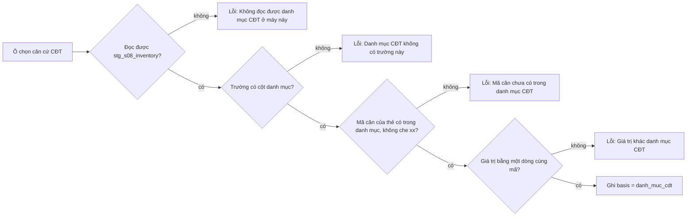

# Lượt trường nhãn 081 — thiết kế

Hồ sơ: `_acceptance/truong-nhan-s03-081/` · hàng GN1 của `docs/plan/lo-trinh.json` (#335) · hạng T3 (migration
`db/migrations/081_*`) · dãy P4, đợt dot0-cam-mau.

## Vì sao

Mạnh đang gắn nhãn lát `s03-theo-nhom` (322 thẻ đang hiện) và gặp nhiều thông tin bài có mà màn không có ô:
- nội thất;
- hướng;
- view;
- ngày vào ở;
- cơ sở giá («thu về», «đã gồm phí»);
- mã căn nguyên văn («PR6.xx10»).

Phiên trợ lý tạm ghi các giá trị này vào Lý do. Mạnh quyết thêm căn cứ thứ năm «Danh mục CĐT», nguyên văn «Thêm vào 081». Lời Mạnh về S08 do giám sát chép lại: «S08 là dữ liệu chủ đầu tư công bố, tin cậy cao nhất hiện nay, chưa chắc 100%».

Nhãn người là thước để đo máy đọc tin (PL9 `eval-classify`) và để gắn căn (GC1–GC3). Thiếu ô thì thước không có vàng cho các trường nhóm C (F3: hướng, view, nội thất). Thiếu `UnitNumber` nguyên văn thì PL13 không có vàng.

## Số đo — đếm lại trên lát thật (chỉ đọc, 06/11)

Tính trên 322 thẻ đang hiện (`trung_voi IS NULL`). Chữ lấy từ tin chữ ghép (`ghep.chu_ref`), không có thì lấy từ chính bài. Đếm bằng mẫu chữ (regex) nên là **sàn dưới**: bài viết tắt lạ hay chỉ có ảnh sẽ không được đếm. Cột «Trợ lý» là số ước của phiên trợ lý trên 356 bài, cách đếm khác.

| Ý | Thẻ có | % (322) | Trợ lý | Vòng này |
|---|---|---|---|---|
| Nội thất | 94 | 29% | 42% | thêm ô `furnished` |
| Hướng | 94 | 29% | ~34% | thêm ô `direction_faces` |
| View | 91 | 28% | 29% | thêm ô `view` |
| Ngày vào ở / bàn giao | 64 | 20% | 25% | thêm ô `availability_date` |
| Cơ sở giá (thu về, NET, gồm/chưa gồm) | 64 | 20% | ~17% | thêm ô `price_basis` |
| Mã căn (kiểu toà+số) | 91 | 28% | ~34% | thêm ô `unit_number` |
| – trong đó mã có che «xx» | 39 | 12% | 17% | (cùng ô) |
| Phí (PQL, bao phí, điện nước) | ~10 | ~3% | 24% | thêm ô `rent_includes` theo câu giao GN1 |
| Pháp lý | 14 | 4% | 10% | Hỏi-1 |
| Vay | 21 | 7% | 7% | Hỏi-1 |
| Cọc | 6 | 2% | 3% | Hỏi-1 |
| Ban công, lô gia, căn góc | 20 | 6% | 11% | Hỏi-1 |
| Giá theo phương thức thanh toán | 10 | 3% | 6% | Hỏi-1 |

Lệnh đếm nằm trong `_acceptance/truong-nhan-s03-081/probes/dem-y.sql` (chỉ đọc). Phí lệch xa nhất (3% so với 24%). Câu giao GN1 vẫn nêu «Phí đã gồm», nên ô vào phạm vi; số lệch ghi ở đây để Mạnh thấy.

## Thiết kế

### Bảy trường mới, tra RESO DD 2.1 trước

Tra bằng `research-local/reso/dd-2.1.json`, bản ghim SHA256 ngày 23/10.

| Trường (`eval_labels.field`) | RESO DD 2.1 | Kiểu | Giá trị trên màn |
|---|---|---|---|
| `furnished` | `Furnished` (Property) | một lựa chọn, lookup `Furnished` 4 giá trị | Đủ nội thất · Nội thất cơ bản · Nhà trống · Thoả thuận (`Furnished`, `Partially`, `Unfurnished`, `Negotiable`) |
| `direction_faces` | `DirectionFaces` (hướng cửa chính) nếu Hỏi-2 chọn hướng cửa; extension alias `DirectionFaces` nếu chọn hướng ban công | một lựa chọn, 8 hướng | Đông · Tây · Nam · Bắc · Đông Bắc · Đông Nam · Tây Bắc · Tây Nam |
| `view` | `View` (isCollection, lookup mở) | nhiều lựa chọn | Thành phố · Hồ · Sông · Công viên · Vườn, nội khu · Bể bơi · Toàn cảnh · Khác (`City`, `Lake`, `River`, `ParkGreenbelt`, `Garden`, `Pool`, `Panoramic`, `Other`) |
| `availability_date` | `AvailabilityDate` (Edm.Date) | chữ có khuôn | `ngay` (vào ở ngay), `YYYY-MM` hoặc `YYYY-MM-DD` |
| `rent_includes` «Phí đã gồm» | `RentIncludes` (isCollection, 13 giá trị) | nhiều lựa chọn | Phí quản lý · Điện · Nước · Internet · Không gồm gì · Khác (`Management`, `Electricity`, `Water`, `Internet`, `None`, `Other`) |
| `price_basis` | không có; gần nhất `ListingAgreement=Net`, nghĩa không trùng | extension `PriceBasis` (reso-khung-phan-loai §8) | Thu về (NET) · Đã gồm phí · Chưa gồm phí (`net`, `gom_phi`, `chua_gom_phi`) |
| `unit_number` | `UnitNumber` (Edm.String) | chữ nguyên văn | giữ cả dấu che «xx» và cách viết của bài, «PR6.xx10» |

- **Một nguồn từ vựng.** Năm trục chọn (`furnished`, `direction_faces`, `view`, `rent_includes`, `price_basis`) vào `pipeline/mappings.yaml` `enums:` (PL6). Từ đó sinh `vocab.generated.ts` và khối CONTEXT.md. Trục `price_basis` khai đủ sáu điều kiện extension của ADR-0011, ghi alias gần nhất là `ListingAgreement.Net`. Các trục RESO giữ `dd_lookup` đúng tên lookup. `direction_faces` khai theo nhánh Hỏi-2.
- **View, Phí đã gồm.** RESO cho hai trường này là danh sách nhiều giá trị, nên ô cho chọn nhiều. Giá trị lưu là các mã đã sắp xếp, nối bằng dấu phẩy. Hai người chọn cùng tập thì đồng thuận so khớp được bằng chữ (view 054/072 so chuỗi).
- **Ngày vào ở.** RESO dùng kiểu ngày, còn bài thường viết «vào ở ngay» hay «bàn giao tháng 12». Nhãn giữ `ngay` hoặc ngày, tháng theo ISO. Đổi sang kiểu `Date` là việc của bộ đọc khi đưa lên canonical, không thuộc vòng này.
- **Mã căn.** Lưu sau khi bỏ khoảng trắng thừa và đổi về NFC, không đổi chữ hoa thường. Khi căn cứ là «Chữ bài», mã phải có trong chữ bài (thêm vào `PHAI_TRONG_CHU`). `building`, `stack`, `floor` vẫn là các phần tách riêng.

### Căn cứ thứ năm «Danh mục CĐT»

- Giá trị `danh_muc_cdt` của `eval_labels.basis`, nhãn trên màn «Danh mục CĐT», nút ngắn «CĐT».
- Câu giao GN1: căn cứ này chỉ nhận giá trị có trong S08. Route ghi (tệp mới `app/src/lib/labels-s08.ts`, chỉ đọc) tra `stg_s08_inventory` theo mã căn của thẻ (`product_code`, không phân biệt hoa thường). Giá trị ô phải bằng giá trị của một dòng cùng mã ở trường tương ứng:

  | Ô | Cột S08 |
  |---|---|
  | mã căn | `product_code` |
  | phân khu | `subdivision_name` |
  | hướng | `base_direction_name`, đổi tên Việt sang mã; hướng đôi «Đông Bắc - Tây Nam» khớp một trong hai |
  | diện tích | `construction_area` hoặc `land_area` |
  | phòng ngủ | `number_of_room` |
  | WC | `number_of_wc` |

  Trường khác, mã căn không có trong danh mục hay bị che «xx», giá trị lệch, hay bảng không đọc được thì lỗi dưới đúng ô. Có 214 mã căn trùng giữa dự án: chỉ cần khớp một dòng.

- Giá trị truy được về dòng danh mục, nên căn cứ này không đòi Lý do.
- `eval-classify` đọc thêm cột `basis` và loại các ô có căn cứ này khỏi phép chấm máy đọc tin, vì máy đọc tin không thấy S08. Số ô bị loại đếm vào `danh_muc_cdt`. Bảy trường mới vào danh sách chấm theo nhóm F3: mã căn nhóm A, cơ sở giá nhóm B, năm trường mô tả nhóm C với ngưỡng 0,80 (thêm vào `NGUONG`). Bộ đọc chưa ra các trường này nên ô ghi `skip`, lý do `chua-co-cach-doc` — «đọc được các ô mới» theo câu giao. Phép đo enrich qua mã căn (GC2, GC3) sẽ dùng các ô CĐT ở việc sau.
- S08 chỉ dùng nội bộ (AGENTS.md luật 5). `eval_labels` vốn không sync cloud (072). Vòng này thêm một phép quét để giữ điều đó: không đường cloud nào đọc `eval_labels`.

### Migration 081

`081_labels_truong_moi.sql`:
1. Nới `eval_labels_field_check` thêm bảy trường.
2. Nới `eval_labels_basis_check` thêm `danh_muc_cdt`.
3. Dựng lại view đồng thuận của 072, thêm bảy trường vào danh sách. Cặp và khớp tính như cũ, `basis` không tham gia so.

Chạy lại nhiều lần không lỗi, dòng cũ giữ nguyên. Vòng này chỉ áp lên DB thử. Áp lên DB máy thu cần lời Mạnh và sao lưu ba bảng nhãn trước (Hỏi-3).

### Biểu mẫu theo nhóm

Thêm khối «Mô tả căn» (`mo-ta`) vào cột trái dưới khối «Căn», gồm nội thất, hướng, view, ngày vào ở. `unit_number` vào khối «Vị trí», đứng trước «Toà». `price_basis` và `rent_includes` vào khối «Giá», dưới hai đầu giá. Mọi ô theo đúng `NhomRow`: giá trị, căn cứ và «Không suy ra được». `NhomRow` nhận thêm kiểu `chon-nhieu` cho view và phí đã gồm, dùng `ToggleGroup multiple`, không dựng thành phần mới.

### Thẻ đã gắn trước vòng (50 thẻ, 850 dòng ở lát thật)

Không ghi lại và không đòi gắn bù. Ở tiến độ, lượt hai và bảng đồng thuận, thẻ cũ hiện ô mới là chưa gắn («—»), không tính là «Không suy ra được». Gắn bù 7 thẻ đã ghi tạm ở Lý do là việc của phiên trợ lý, ngoài vòng.

## Đặc tả UX

<!-- <<<UX-SPEC-TEMPLATE -->
## Đặc tả UX

### 1. Luồng

- Suôn sẻ: `/ops/labels?lat=s03-theo-nhom` → thẻ kế → điền năm khối cũ, khối «Mô tả căn», mã căn, cơ sở giá, phí đã gồm → Lưu → thẻ kế (điểm ra: hết thẻ).
- Biên: bài không nói gì về mô tả căn thì tick «Không suy ra được» ở bốn ô. View chọn nhiều giá trị. Mã căn có che «xx». Căn cứ «Danh mục CĐT» chỉ nhận khi mã căn có trong danh mục và giá trị khớp.
- Lỗi & quay lại: lưu thiếu ô hay sai khuôn thì lỗi hiện dưới đúng ô, chữ đã gõ giữ nguyên. Sửa ô thì lỗi của ô đó mất (TND-AC-6), lưu lại.

### 2. Kiểm kê màn

| Màn | MỘT việc của màn | Vào từ / ra tới |
|---|---|---|
| Biểu mẫu theo nhóm (`label-form-nhom`) | Gắn nhãn một thẻ của lát theo nhóm | `/ops/labels` / thẻ kế |
| Lượt hai (`luot-hai`) | So nhãn của mình với máy đọc, ghi trường hợp | `/ops/labels` lượt hai / thẻ kế |

### 3. Bảng trạng thái

<!-- <<<UX-STATE-TABLE -->
| Trạng thái | Màn | Hiển thị gì | Người làm gì tiếp |
|---|---|---|---|
| ST-nhom-o-moi-trong | Biểu mẫu theo nhóm | Bảy ô mới trống, căn cứ mặc định «Chữ», chưa tick | Điền hoặc tick «Không suy ra được» |
| ST-nhom-o-moi-loi | Biểu mẫu theo nhóm | Lỗi dưới đúng ô (giá trị ngoài sổ, ngày sai khuôn, mã không có trong chữ, «CĐT» không khớp danh mục) | Sửa ô hay đổi căn cứ rồi lưu lại |
| ST-nhom-view-nhieu | Biểu mẫu theo nhóm | Nhiều nút view cùng sáng | Bỏ hoặc thêm lựa chọn |
| ST-luot-hai-the-cu | Lượt hai | Thẻ gắn trước vòng: bảy ô mới hiện «—» | Ghi trường hợp như cũ |
| ST-nhom-loading | Biểu mẫu theo nhóm | Skeleton có sẵn (`labels-skeleton`) | Chờ |
| ST-nhom-het-the | Biểu mẫu theo nhóm | Trạng thái hết thẻ có sẵn | Chọn nhóm khác |
<!-- UX-STATE-TABLE>>> -->

### 4. Hành vi

- Bốn trục chọn: lựa chọn lấy từ sổ từ vựng. Giá trị ngoài sổ thì báo «Giá trị không có trong sổ từ vựng».
- Ngày vào ở: nhận `ngay`, chữ «ngay», `YYYY-MM`, `YYYY-MM-DD`, ngày phải có thật. Sai thì báo «Ngày vào ở: ghi «ngay», tháng (2026-12) hoặc ngày (2026-12-15)».
- Mã căn với căn cứ «Chữ bài»: mã phải có trong chữ bài (MSG_KHONG_TRONG_CHU có sẵn).
- Căn cứ «Danh mục CĐT»: «Danh mục CĐT không có trường này», «Mã căn chưa có trong danh mục CĐT», «Giá trị khác danh mục CĐT», «Không đọc được danh mục CĐT ở máy này», hiện dưới đúng ô.
- Phím và focus giữ như hàng cũ. Ở `sm` hàng xếp ba cột, dưới `sm` xếp một cột (NhomRow).

### 5. Xuất xứ component

| Component | Nấc (dùng / ghép / mở rộng / tạo) | Vì sao (1 dòng) |
|---|---|---|
| `NhomRow` | mở rộng | thêm kiểu `chon-nhieu` cho view, dùng `ToggleGroup multiple` có sẵn |
| `ui/toggle-group` | dùng | lựa chọn và căn cứ như các hàng cũ |
| khối biểu mẫu (`KHOI`) | ghép | thêm một khối khai báo, không dựng bố cục mới |

### 6. Khuôn IA đã chọn + căn cứ

Khuôn IA: một-cột-cuộn
Căn cứ: biểu mẫu theo nhóm đã là một cột cuộn hai cột khối (bản D, GC0). Thêm ô không đổi khuôn, nên không tra mẫu ngoài.

### 7. Thẻ việc

| Trường | Giá trị |
|---|---|
| Ai dùng | Mạnh, người gắn nhãn duy nhất của đợt |
| Việc chính | Gắn nhãn đủ trường cho một bài của lát theo nhóm |
| Tần suất | mỗi ngày nhiều lần |
| Số bản ghi | hàng trăm trở lên |
| Thiết bị | máy tính |
<!-- UX-SPEC-TEMPLATE>>> -->

## Ngoài vòng

- Phí quản lý theo số tiền, pháp lý, vay, cọc, ban công, căn góc, giá theo phương thức thanh toán: chờ Hỏi-1. Mặc định không thêm ô mà ghi vào Lý do (luật 11, đo trước khi dựng).
- Áp 081 lên DB máy thu (Hỏi-3) và gắn bù thẻ cũ.
- Bộ đọc máy (`parsePost`, LLM) ra bảy trường mới. Vòng này chỉ có nhãn vàng.
- Khử trùng lúc lấy mẫu: hàng GN2 `lay-mau-khu-trung-theo-tin`, hồ sơ riêng.
- Biểu mẫu chín trường `label-form.tsx` (lát đời trước).
