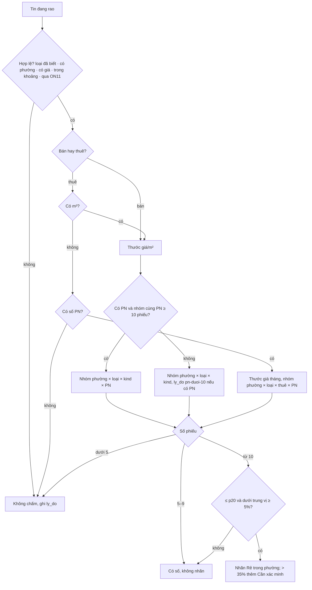

# CG9 `bang-hang-gia-m2` — Bảng hạng giá tính sẵn cho mọi tin đang rao

Ngày: 2026-11-14 · Hạng: T3 (migration) · Hồ sơ: `_acceptance/bang-hang-gia-m2/` · Bản phạm vi:
`docs/plan/pham-vi-can-gia-tot-vi-tri-0911.md` (Q1–Q5, 09/11, ROADMAP §3 mục 42) · Mỏ neo đợt 14/11: «ở dự án B, tháp X, tầng A —
căn nào giá tốt nhất» (QĐ3, QĐ4). Đứng trên CG8 (#439, thước cùng phường × loại).

## 1. Vấn đề và số nền (DB máy thu 14/11, chỉ đọc)

Hôm nay có hai «thước» cho Căn giá tốt: `bait_gap_pct` (P1 so với `v_ruler_p2`) ở `/ops/deals`, và `/v1/deals` của data-api tự
tính lại từ `v_ruler_p2` cho cả P1 lẫn P2. Cả hai chỉ có tin bán, chỉ cấp phường × loại, trung vị chỉ từ căn S06 (`v_ruler_p2` dựng
trên `properties`/`property_offers`, nơi chỉ có tin S06), không có hạng, p20 hay lý do. Tin thuê không có số nào.

| Đếm 14/11 | Bán | Thuê dài hạn |
|---|---|---|
| Tin sống (S03 · S05 · S06) | 2.289 · 25 · 43.411 | 3.728 · 5 · 50.527 |
| Tin có giá/m² trong nhóm phường × loại từ 10 tin | 42.825 | 49.947 |
| Tin thuê thiếu m² (phần lớn căn hộ) | — | 3.003, trong đó 2.949 có số phòng ngủ |

Ghi chú: số «từ 10 tin» ở đây đếm tin, chưa gộp mỗi căn một phiếu — phép đo AC-9 đếm lại theo phiếu.

## 2. Thiết kế

### 2.1 Bảng `offer_price_rank` (migration 104)

Một dòng cho mỗi tin đang rao (`sale_offers`, cả bán lẫn thuê, mọi nguồn), kể cả tin không chấm (để trang một căn đọc được lý do).

| Cột | Nghĩa |
|---|---|
| `offer_id` PK → `sale_offer_records` | tin |
| `kind`, `property_type`, `bedrooms` | chép từ tin lúc chấm |
| `thuoc` | `gia-m2` (giá/m², bán; thuê có m²) · `gia-thang-pn` (giá thuê/tháng, tin thuê thiếu m²) |
| `gia_tri` | giá/m² hoặc giá/tháng của tin |
| `cap` | cấp nhóm: `phuong` hôm nay; CHECK đã nhận `du_an`, `phan_khu`, `toa` để CG10, CG11 chỉ thêm cấp |
| `nut` | khoá nút của cấp: `area_id` ở cấp phường; `asset_nodes.id` ở cấp dự án trở xuống |
| `pn_nhom` | số phòng ngủ khi nhóm chia theo PN, NULL khi không chia |
| `n` | số phiếu (căn) trong nhóm |
| `trung_vi`, `p20` | trung vị và phân vị 20 của nhóm (theo phiếu) |
| `hang_pct` | phần trăm hạng của tin trong nhóm (0 = rẻ nhất, `percent_rank` theo phiếu) |
| `duoi_trung_vi_pct` | `ROUND((1 − gia_tri / trung_vi) × 100, 1)` |
| `nhan` | `re-trong-phuong` (cấp phường) · `gia-tot` (dự án trở xuống — chưa sinh ở hàng này) · NULL |
| `can_xac_minh` | `duoi_trung_vi_pct > 35` |
| `ly_do` | lý do lùi cấp hoặc không chấm (mã, bảng 2.3) |
| `computed_at`, `run_id` | lượt chấm |

### 2.2 Luật chấm (pipeline, `pipeline/sql/420_price_rank.sql` qua `pipeline/xep-hang-gia.mjs`)

1. **Tin vào chấm:** tin đang rao, có `area_id`, loại hình đã biết (khác NULL, `unknown`), qua luật phi lý ON11
   (`lib/deal-plausibility.mjs`), giá trị trong khoảng hợp lệ (bán 5–500 tr/m², như `v_ruler_p2`; thuê 20 nghìn–2 tr/m²/tháng;
   thuê theo tháng 1–500 tr/tháng — Hỏi-4).
2. **Mỗi căn một phiếu (Q4):** phiếu = căn của `property_offers` khi tin có căn (S06; nhiều căn thì lấy `property_id` nhỏ nhất),
   ngược lại chính tin (S03, S05 tới khi DA6 có khoá gộp căn). Giá trị phiếu = giá trị của tin thấy sau cùng trong phiếu. P1 và P2
   chung nhóm.
3. **Nhóm (luôn cùng loại hình × bán/thuê):** thử nhóm sâu nhất trước, lùi khi nhóm dưới 10 phiếu, ghi lý do:
   `phuong × loai × kind × PN` (khi tin có PN) → `phuong × loai × kind`. Chuỗi cấp đọc từ một CTE danh sách cấp; hàng này chỉ có
   cấp phường, CG10 thêm cấp dự án vào đầu chuỗi.
4. **Thuê:** tin thuê có m² so giá/m²/tháng như bán. Tin thuê thiếu m² so **giá thuê/tháng trong nhóm cùng số phòng ngủ** (1PN với
   1PN — QĐ4); nhóm này gồm mọi tin thuê cùng phường × loại × PN có giá tháng. Thiếu cả m² lẫn PN → không chấm.
5. **Ngưỡng (Q2, Q3):** nhóm từ 10 phiếu → có hạng, số và nhãn; 5–9 → có số (trung vị, p20, hạng, % dưới trung vị), không nhãn;
   dưới 5 → không chấm. Nhãn `re-trong-phuong` khi `gia_tri ≤ p20` **và** `duoi_trung_vi_pct ≥ 5`. `can_xac_minh` khi `> 35`;
   căn vẫn mang nhãn và vẫn hiện (QĐ3 — không giấu).
6. **Ghi:** một giao dịch, khoá advisory riêng, xoá trọn rồi chèn lại; lỗi giữa chừng → giữ bảng cũ nguyên vẹn. Chạy lại không đổi
   số. Bước riêng `xep-hang-gia` (`job_run`) trong phần transform (làn Claude) của ba job đêm, sau bước định vị cuối: sau
   `resolve-properties` ở job S06 (căn S06 mới đã vào phiếu), sau `refresh-bait-gap` ở job S03 và FB. DB chưa áp 104 → in «chưa áp
   104», thoát 0.
7. **`bait_gap_pct`** giữ nghĩa gốc: chênh giá câu P1 so với thước P2 cùng phường × loại (CG8), không đổi.




### 2.3 Mã lý do

Lùi cấp: `pn-duoi-10` (nhóm cùng PN dưới 10 phiếu, dùng nhóm không chia PN). Không chấm: `chua-ro-loai`, `thieu-phuong`,
`thieu-gia`, `ngoai-khoang`, `phi-ly:<lý do ON11>`, `thieu-dt-va-pn`, `nhom-duoi-5`. Có số không nhãn: `nhom-5-9`.

### 2.4 Đường đọc

- **`/ops/deals`** (`app/src/lib/deals.ts`, `deals-chi-tiet.ts`): danh sách = tin bán có `nhan` (P1 **và** P2 — gánh CG2; tin S06
  thiếu SĐT vào tab «Còn thiếu» như luật tab hiện có), xếp `can_xac_minh` rồi `duoi_trung_vi_pct` giảm dần; trần 50% và hạn 45
  ngày giữ như cũ (Hỏi-2). Trang một căn: dòng chứng minh «So với N căn cùng phường, cùng loại[, cùng PN]: thấp hơn trung vị X%,
  nằm trong 20% rẻ nhất» và nhãn «Rẻ trong phường»; `lyDoRoi` đọc `ly_do` của bảng. Bố cục trang không đổi; tin thuê lên Ops ở CG3.
- **`/v1/deals`** (data-api) và **`/api/v1/deals`** (app, chỉ ops): đọc bảng; thêm tham số `kind` (`sale` mặc định, `rent_lt`);
  giữ mọi trường cũ cùng tên và kiểu (`discountPct` = `duoi_trung_vi_pct`, `medianPerm2` = trung vị khi thước giá/m², NULL khi
  thước tháng); thêm khối `rank` (`level`, `n`, `median`, `p20`, `percentile`, `label`, `needsVerification`, `metric`,
  `bedroomsGroup`, `reason`) (Hỏi-1).
- **Bảng chưa có hay rỗng (Hỏi-5):** app trên Vercel đọc cloud; gộp vào `main` triển khai app trước khi Mạnh áp DDL cloud. Khuyến
  nghị: ba đường đọc kiểm bảng (`to_regclass` + có dòng); thiếu thì đọc theo cách CG8 (thước `v_ruler_p2`, chỉ bán) như hôm nay, không
  lỗi. Lối khác: chặn gộp tới khi DDL cloud đã áp.
```mermaid
flowchart LR
  Q[/ops/deals, /api/v1/deals, /v1/deals] --> C{Bảng offer_price_rank có và có dòng?}
  C -- có --> R[Đọc bảng: bán và thuê, P1 và P2, nhãn và hạng]
  C -- không, khuyến nghị --> O[Đọc như CG8: thước v_ruler_p2, chỉ bán]
  C -- không, lối khác --> X[Không xảy ra: chặn gộp tới khi DDL cloud đã áp]
```

- **Cloud:** `pipeline/sync-cloud.mjs` đẩy `offer_price_rank` như bảng con của tin sống; tệp catch-up DDL cho cloud nằm ở
  `docs/ops/`, áp là lời riêng của Mạnh. Cloud chưa có bảng → sync bỏ qua bảng này với một dòng cảnh báo, các bảng khác chạy như cũ.

## 3. Đo

- Ma trận viết trước trên DB của riêng lượt (`db/db-thu.sh --chay`): mỗi ô một assert, so với phép tính độc lập trong test (không
  gọi mã của hàng), có ca đột biến đỏ (bỏ gộp phiếu; lùi về thước cả phường; bỏ ngưỡng 5%).
- Dữ liệu thật: `pipeline/scripts/hang-gia-do.mjs` dựng DB thử `oneinvest_<việc>` chép từ DB máy thu, chạy bước chấm hai lần, đếm
  độc lập bằng SQL viết riêng (số tin được chấm theo bán/thuê × có nhãn/chỉ số/không chấm; lần hai bằng lần một), in mẫu số.

## 4. Lựa chọn

| # | Lựa chọn | Căn cứ |
|---|---|---|
| L1 | Bảng tính sẵn mới bằng migration 104 (số xin giám sát) | ô cơ hội: «T3: bảng mới bằng migration (đề xuất offer_price_rank, xin số ở sổ giám sát)» |
| L2 | Khoá nhóm `cap` + `nut` + `pn_nhom`, CHECK nhận sẵn bốn cấp | lời giao 14/11: «thiết kế khoá nhóm sẵn cho cấp dự án để CG10 chỉ thêm cấp» — Hỏi-5 |
| L3 | Phiếu = căn S06 hoặc chính tin P1, tới khi có DA6 | ô cơ hội: «mỗi căn một phiếu (khoá gộp căn DA6 khi có)»; DA6 chưa gộp |
| L4 | Thuê thiếu m² so giá tháng cùng PN | QĐ4 14/11 — Hỏi-3 |
| L5 | Không thêm rào: căn rẻ quá 35% vẫn hiện, nhãn «Cần xác minh» | QĐ3 14/11 — Hỏi-6 |
| L6 | Bước `xep-hang-gia` riêng sau bước định vị trong ba job đêm | ô cơ hội: «Bước SQL họ 400 (đề xuất 420_price_rank.sql), chạy sau định vị»; AGENTS.md: bước transform trở đi trong `*-daily.sh` là làn Claude |
| L9 | Đường đọc lùi về cách tính CG8 khi bảng chưa có hay rỗng | Hỏi-5 — chạm người dùng thật |
| L7 | Tin thuê chưa lên `/ops/deals` (màn lọc ở CG3) | vùng của hàng không có trang `/ops/deals`; CG3 «màn chọn vị trí + lọc» đứng trên CG9 |
| L8 | Bỏ design-pass và đặc tả UX | chỉ đổi câu chữ trên trang `/ops/deals` có sẵn, không bố cục hay luồng mới |

**Ngoài vòng:** `sellers.flags.median_gap_pct` (view 060, thước cả phường) — đổi view cần dựng lại view lớn, tách hàng riêng; nhãn
`gia-tot` cấp dự án (CG10); toà (CG11); tin thuê trên màn Ops (CG3); đẩy data-api ra repo công khai (`sync-public` do Mạnh gọi); áp
104 lên máy thu và cloud (lời riêng của Mạnh sau gộp).

## Đặc tả UX

Bỏ — xem L8 và dòng `descope` «bỏ đặc-tả-UX» trong sổ quyết định. Phép nhìn: một eval `ui-check` chụp `/ops/deals` và trang một căn
(căn có nhãn, căn cần xác minh, tin nhóm 5–9) ở sáng và tối.
