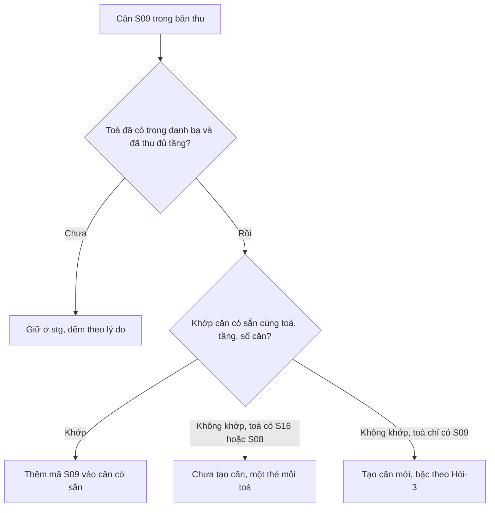

# Thiết kế DA43 — căn cao tầng S09 vào danh bạ

Ngày 18/11/2026, sửa 26/11/2026. Hàng DA43 `nap-s09-can-cao-tang-vao-danh-ba`, hạng T3, đợt `danh-ba-can-s09-1811`, nay ở dãy P1
của đợt dot0-cam-mau. Tài liệu này dừng ở Cổng Phạm vi: chưa có mã thi công, migration hay lượt ghi DB máy thu.

## 0. Sửa 26/11 — gói 2 đã thu, Cổng Phạm vi trình lại

Mạnh duyệt Cổng Phạm vi bản 18/11. Từ đó ba điều đổi, nên hồ sơ về nháp và trình lại:

1. **Gói 2 đã thu xong**, theo DATA-CONTRACT v16 kind `can-cao-tang` (mỗi item một tầng, `sourceId` = uuid tầng, `meta` mang mã dự
   án, toà, tên toà, tầng, tên tầng; payload `{code, data[{id, name, code, increment_number}]}`). Đếm thẳng bốn bản thu ngày 24–25/11:
   **358.032 căn** · 23.543 tầng đã gọi được (23.541 có căn, 2 rỗng hợp lệ, 0 lỗi) trên 23.708 tầng của gói 1, 165 tầng chưa gọi · 902 toà ·
   196 dự án. Số ước 237–379 nghìn của 18/11 nay là số đo.
2. **Lớp nạp thuộc DA56** (`nap-s09-quy-can-va-can-cao-tang`): DA56 nạp kind `can-cao-tang` vào `stg_s09_danh_ba` (bảng của 115) và
   dựng view `v_s09_db_can_cao_tang` (migration 130) chọn bản tốt mới nhất mỗi tầng; bản lỗi hay rỗng không đè bản tốt. DA43 không
   tạo bảng stg căn riêng, không viết bộ nạp: bước căn đọc view đó. AC-1, AC-2 cũ (nạp, khớp manifest) chuyển thành AC về **đầu vào
   của bước căn**: toà trọn, và số đếm khớp bộ đếm độc lập.
3. **Mã căn có nhiều khuôn hơn thiết kế giả định.** Luật 18/11 tách TOÀ.TẦNG.CĂN từ `code` và đòi phần toà, tầng khớp item. Đo trên gói
   2: chỉ 253.771 căn (70,9%) đúng khuôn ấy; 67.732 mã không đủ ba đoạn (vd `AK1-015.21`, `04.01`, `C-23.03`), 25.757 mã ghi toà
   viết tắt (vd toà «Lake 1» mã `AQL1.04.11`). Luật mới (Hỏi-4): **toà lấy từ cấu trúc bản thu** (uuid toà của item), **số căn** là
   đoạn sau dấu tách cuối (`.` hoặc `_`), **tầng** là đoạn số liền trước số căn trong mã, mã không có đoạn ấy thì lấy tầng của item.
   Theo luật mới: 353.386 căn (98,7%) tách được; 4.646 mã (1,30%) không có dấu tách → mã hỏng; 349.493 khoá (toà, tầng, số căn) duy
   nhất; 3.893 căn (1,09%, ở 41 toà) trùng khoá với một căn S09 khác cùng toà (Hỏi-5).

Mạnh hỏi «khi nào S09 vào danh bạ ở cấp tầng và căn». Tầng: DA42. Căn: hàng này, sau DA42 và DA56.

## 1. Kết luận

- Căn cao tầng S09 vào danh bạ dưới toà mà DA42 đã đưa vào. Mỗi căn S09 giữ một bí danh bền là mã căn của nguồn.
- Căn trùng căn S16, S08 thành bí danh của căn có sẵn. So theo toà, tầng và số căn, không so nguyên chuỗi mã, vì mã căn S16
  trong danh bạ có 81 khuôn viết.
- API gói 2 chỉ trả bốn trường mỗi căn. Danh bạ S09 vì thế chỉ có mã căn; diện tích, phòng ngủ, hướng, giá phải đến từ nguồn khác.
- Làn thu thu gói 2 sau khi hàng này qua Cổng Phạm vi, với đúng danh sách trường ở §3.

## 2. Phụ thuộc

- Thi công chỉ bắt đầu sau khi DA42 và DA56 vào `main` (DA37 đã vào). Lượt dựng thật trên DB máy thu sau khi DA42 đã áp và DA56 đã
  nạp bản thu v16.
- DA42 phải ghi bí danh cho mã toà của đường gói 1. Mã toà đường này khác `block_id` trong `stg_s09_item`; thiếu bí danh ấy thì
  căn không tìm được toà và AC-4 giữ toàn bộ căn ở stg.
- Không cần bảng stg mới (sửa 26/11). Nếu bước căn cần view hay chỉ mục mới, số migration xin Phiên giám sát lúc thi công.
- Bản thu là DATA-CONTRACT v16 (`can-cao-tang`), đã có trên `main` qua DA56.

## 3. Danh sách trường làn thu cần thu ở gói 2 (bản 18/11 — làn thu đã thu theo bảng này; khuôn thật ở §0)

Mỗi lời gọi theo một tầng, mỗi tầng một item, kể cả tầng trả rỗng.

| Cấp | Trường | Bắt buộc | Dùng để |
|---|---|---|---|
| Dự án | `id` (uuid) | Có | Khoá nối dự án của bí danh căn |
| Toà | `id` (uuid), `name` | Có | Tìm toà trong danh bạ qua bí danh DA42 |
| Tầng | `id` (uuid), `name` nguyên văn (vd «12B») | Có | Khoá item, tầng của căn |
| Căn | `id` (uuid) | Có | Bí danh bền, chạy lại không đúc thêm |
| Căn | `code` (TOÀ.TẦNG.CĂN) | Có | Tách số căn để khử trùng |
| Căn | `name` | Giữ theo phản hồi | Đối chiếu với `code`, ca khác nhau lên báo cáo |
| Căn | `increment_number` | Giữ theo phản hồi | Không dùng; có sẵn trong phản hồi nên không tốn thêm lời gọi |

**Không thu thêm**: không gọi lời nào ngoài danh sách căn theo tầng; không thu diện tích, phòng ngủ, hướng, loại căn, trạng thái,
giá (API này không trả); thấp tầng thuộc gói 1 của DA42.

**Hình dạng bản thu mong đợi**

- Raw giữ nguyên phản hồi `{code, data}`. Item có `sourceId` = uuid tầng, `meta` gồm mã dự án, mã toà, tên toà, mã tầng, tên tầng.
- Khoá bền: uuid từng cấp. Cùng một tầng ở hai bản thu thì lấy bản `fetchedAt` mới nhất.
- `manifest.files[]` có `name`, `sha256`, `bytes`. Manifest thêm số đếm: số tầng phải gọi, gọi được, trả rỗng, lỗi, và tổng số căn.
- Manifest liệt kê từng tầng đã gọi kèm mã toà, mã tầng và trạng thái (được, rỗng, lỗi), để bên nạp biết toà nào chưa trọn qua nhiều đêm.
- Thu theo tỉnh qua nhiều đêm thì mỗi đêm một snapshot, không ghi đè bản trước.

## 4. Bảng phủ ca

Dòng 1–11: DB máy thu, chỉ đọc, đo 18/11 và đo lại 26/11 (175 toà S09 · 109 có S16 · 1 chỉ S08 · 65 chưa căn · 66.019 căn trong 175 toà — khớp 18/11 trừ 2 căn). Dòng 12–15: đếm thẳng bốn bản thu gói 2 ngày 24–25/11, mỗi tầng lấy bản tốt mới nhất, đo 26/11. Số toà S09 sau DA42 (đích 928 toà) chưa có trên máy thu; phần chia sáu–bảy phần của AC-10 đo ở lượt diễn tập sau khi DA42 đã dựng trên bản chép.

| # | Chiều | Giá trị | Số | Xử lý | Ai đọc đầu ra |
|---|---|---|---:|---|---|
| 1 | Toà S09 | Đã có bí danh, cùng toà S16 | 109 toà | Khớp căn, trùng thành bí danh (AC-5) | Gắn căn tin rao, `/ops/registry` |
| 2 | Toà S09 | Đã có bí danh, cùng toà chỉ S08 | 1 toà, 49 căn | Như dòng 1 | Như dòng 1 |
| 3 | Toà S09 | Đã có bí danh, chưa có căn nào | 65 toà | Đúc căn mới (AC-7) | Như dòng 1 |
| 4 | Dự án S09 | Đã nối danh bạ | 2 dự án | Chạy đủ bước | Như dòng 1 |
| 5 | Dự án S09 | Trùng tên một dự án có sẵn, chưa nối | 9 dự án | Chờ DA42 nối; chưa nối thì ở stg | DA42, người duyệt nối |
| 6 | Dự án S09 | Tên gần giống, cần người xem | 35 dự án | Chờ DA42; chưa nối thì ở stg | DA42, người duyệt nối |
| 6b | Dự án S09 | Không thấy dự án nào trong danh bạ | 298 dự án | DA42 tạo nút ứng viên; chưa có thì ở stg | DA42 |
| 7 | Tên toà | Trùng tên trong cùng dự án | 93 dòng toà | Đi theo uuid toà của DA42, không so tên ở hàng này | DA42 |
| 8 | Căn có sẵn ở 110 toà trùng | Có toà, tầng, trục | 61.933 căn, mỗi bộ đúng một căn | So theo toà, tầng, số căn (AC-5) | Bước khử trùng |
| 9 | Căn có sẵn ở 110 toà trùng | Không tách được trục | 4.088 căn | So theo mã căn đã chuẩn hoá, không khớp thì theo Hỏi-2 | Bước khử trùng, người duyệt thẻ |
| 10 | Tầng có sẵn | Tầng có chữ (12A, 12B) | 2.804 căn | So nguyên văn sau chuẩn hoá hoa thường (AC-3) | Bước khử trùng |
| 11 | Số căn có sẵn | Khuôn `99` / `9A` / `99A` / `A99` | 58.549 / 1.568 / 1.561 / 255 | Bỏ số 0 đầu khi so (AC-3) | Bước khử trùng |
| 12 | Căn S09 gói 2 | Tách được số căn theo luật §0.3 | 353.386 / 358.032 (98,7%) | Vào danh bạ (AC-5, AC-7) | `/ops/registry` |
| 12a | Căn S09 gói 2 | trong đó tầng lấy từ mã / từ item | 351.194 / 2.192 | Như dòng 12 (AC-3) | Bước khử trùng |
| 12b | Căn S09 gói 2 | đúng khuôn TOÀ.TẦNG.CĂN cũ (luật 18/11) | 253.771 (70,9%) | Đối chứng: luật cũ bỏ 29% (AC-3) | Người ký Cổng Phạm vi |
| 13 | Căn S09 gói 2 | Mã không có dấu tách `.` hay `_` | 4.646 (1,30%) | Không đúc, đếm «mã hỏng» (AC-3, Hỏi-4) | Báo cáo chạy, làn thu |
| 13a | Căn S09 gói 2 | Trùng khoá (toà, tầng, số căn) với căn S09 khác cùng toà | 3.893 ở 41 toà | Căn đầu theo uuid vào; còn lại ở stg, đếm (Hỏi-5) | Báo cáo chạy |
| 13b | Căn S09 gói 2 | `code` khác `name` | 36.438 | Tách theo `code`, đếm (AC-3) | Báo cáo chạy |
| 14 | Căn S09 gói 2 | Tầng ngoài khuôn `^\d+[A-Z]?$` (vd «1+2», «1-2-3», «K1») | 147 căn | Căn không trục, giữ tầng ở stg (AC-7) | `/ops/registry` |
| 14a | Căn S09 gói 2 | Tầng có chữ (12A, 12B) | 14.957 căn | So nguyên văn sau chuẩn hoá với tầng S16 (dòng 10: 2.804 căn S16 có tầng chữ); khác quy ước thì lên thẻ (AC-6) | Bước khử trùng |
| 15a | Căn S09 gói 2 | Tầng tách từ mã khác tầng của item | 18.870 / 352.229 có dấu chấm (5,3%) | Lấy tầng của mã, đếm; ngưỡng 8% là phép kiểm độc lập của luật tách (AC-10) | Báo cáo chạy |
| 15 | Tầng gói 1 | Chưa gọi ở gói 2 / trả rỗng / lỗi | 165 / 2 / 0 | Toà có tầng chưa gọi hay lỗi chưa trọn, không vào (AC-1, AC-4) | Làn thu, báo cáo chạy |
| 16 | Căn S09 ở toà có S16 | Không khớp căn nào | Chưa đo | Theo Hỏi-2 | Người duyệt `/ops/review` |
| 17 | Thứ tự nguồn | S16 hay S08 nạp sau S09 | Chưa đo | Không sinh căn thứ hai (AC-8) | Lệnh dựng đêm |

**Năm dự án mẫu của làn thu không trùng danh bạ.** Đo 18/11: cả năm có 0 toà, 0 căn trong danh bạ, chỉ một dự án có nút. Phép đo
khử trùng vì vậy lấy mẫu ở 110 toà trùng thật của hai khu Ocean Park 1 và Grand Park.

**Ngoài phạm vi, vì:** thấp tầng (DA42 làm) · thuộc tính căn (API không trả) · nối dự án mới (DA42 và thẻ luật) · đưa căn lên cloud
và cổng Invest (ba bảng vật thể chưa đồng bộ) · 60 thẻ S16 đang chờ (DA37 xử).

## 5. Cách làm

1. (Sửa 26/11) Đọc view `v_s09_db_can_cao_tang` của DA56; hàm thuần tách số căn và tầng theo §0.3. Không bảng stg mới.
2. Bước S09-căn trong lệnh dựng danh bạ, chạy sau S08, S09 toà, S16, cùng giao dịch và khoá cố vấn.
3. Toà: tra bí danh S09 `danh-ba-toa/<uuid toà>` của DA42; toà chỉ vào khi mọi tầng gói 1 của toà có bản tốt hoặc rỗng hợp lệ. Không có thì đếm, không đúc toà.
4. Căn: tra bí danh S09 trước. Chưa có thì tìm căn cùng toà, tầng, số căn. Khớp một thì thêm bí danh; không khớp thì xử theo
   toà có S16, S08 hay chưa.
5. Toà chỉ có S09: đúc trục và căn ở bậc theo lời Hỏi-3 (khuyến nghị `mot_loi_khai`).
6. Bước S16 và S08 tra thêm căn S09 trước khi đúc. S16 đến sau toà chỉ có S09: căn khớp thành bí danh, căn S16 không khớp vẫn đúc, căn
   S09 còn lại lên một thẻ mỗi toà.
7. Bước đêm chỉ chạy phần căn S09 khi có bản thu mới.

Đã cân nhắc, không chọn: so nguyên chuỗi mã (81 khuôn S16 làm trượt phần lớn căn trùng); đúc hết rồi gộp sau (sinh căn hai khoá,
danh bạ chỉ thêm nên khó lùi); một thẻ mỗi căn lệch (không duyệt nổi ở quy mô vài trăm nghìn căn, lý do giống DA37).

## 6. Đặc tả UX

Hàng không đổi mã giao diện. Trang `/ops/registry` đọc số căn từ bảng `units`, nên số tự đổi sau khi dựng. Thẻ căn lệch hiện ở
`/ops/review` theo khuôn thẻ ghép có sẵn; duyệt thẻ ở hàng này không đổi dữ liệu.
