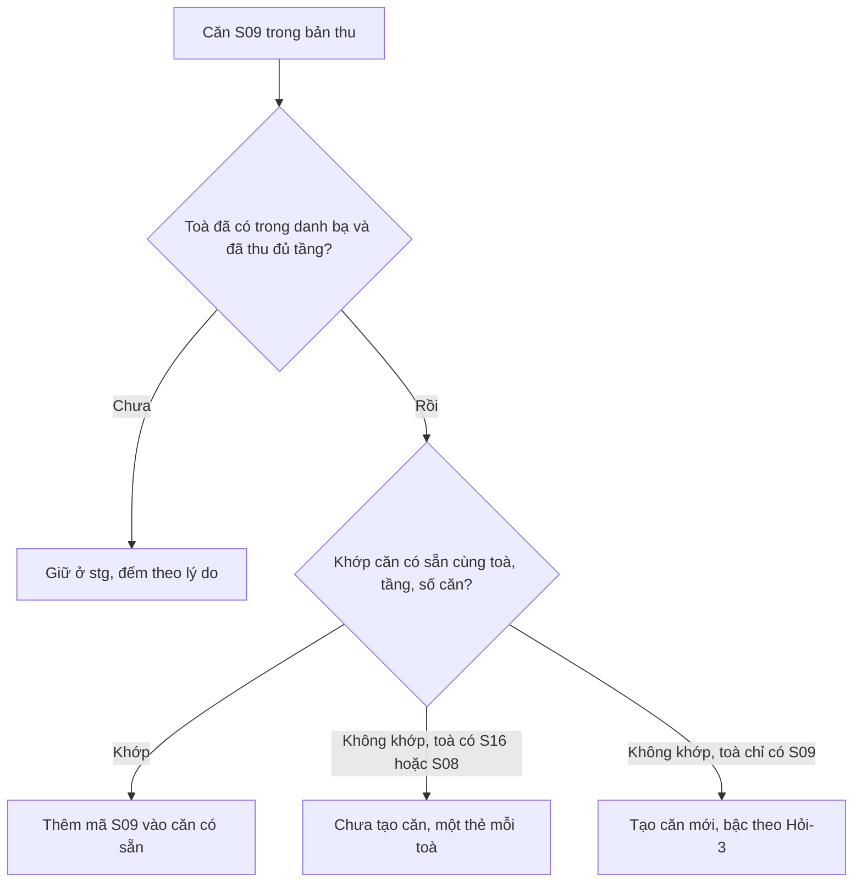

# Thiết kế DA43 — căn cao tầng S09 vào danh bạ

Ngày 18/11/2026. Hàng DA43 `nap-s09-can-cao-tang-vao-danh-ba`, hạng T3, đợt `danh-ba-can-s09-1811`. Tài liệu này dừng ở Cổng
Phạm vi: chưa có mã thi công, migration hay lượt ghi DB máy thu.

## 1. Kết luận

- Căn cao tầng S09 vào danh bạ dưới toà mà DA42 đã đưa vào. Mỗi căn S09 giữ một bí danh bền là mã căn của nguồn.
- Căn trùng căn S16, S08 thành bí danh của căn có sẵn. So theo toà, tầng và số căn, không so nguyên chuỗi mã, vì mã căn S16
  trong danh bạ có 81 khuôn viết.
- API gói 2 chỉ trả bốn trường mỗi căn. Danh bạ S09 vì thế chỉ có mã căn; diện tích, phòng ngủ, hướng, giá phải đến từ nguồn khác.
- Làn thu thu gói 2 sau khi hàng này qua Cổng Phạm vi, với đúng danh sách trường ở §3.

## 2. Phụ thuộc

- Thi công chỉ bắt đầu sau khi DA42 và DA37 vào `main`.
- DA42 phải ghi bí danh cho mã toà của đường gói 1. Mã toà đường này khác `block_id` trong `stg_s09_item`; thiếu bí danh ấy thì
  căn không tìm được toà và AC-4 giữ toàn bộ căn ở stg.
- Migration của hàng (bảng stg căn) lấy số từ 119 trở đi, xin Phiên giám sát lúc thi công.
- `schemaVersion` của bản thu do làn thu lấy số kế tiếp lúc nộp. Hợp đồng không ghim số: nháp S17 cũng đang ghi v15.

## 3. Danh sách trường làn thu cần thu ở gói 2

Mỗi lời gọi theo một tầng, mỗi tầng một item, kể cả tầng trả rỗng.

| Cấp | Trường | Bắt buộc | Dùng để |
|---|---|---|---|
| Dự án | `id` (uuid) | Có | Khoá nối dự án của bí danh căn |
| Toà | `id` (uuid), `name` | Có | Tìm toà trong danh bạ qua bí danh DA42 |
| Tầng | `id` (uuid), `name` nguyên văn (vd «12B») | Có | Khoá item, tầng của căn |
| Căn | `id` (uuid) | Có | Bí danh bền, chạy lại không đúc thêm |
| Căn | `code` (TOÀ.TẦNG.CĂN) | Có | Tách số căn để khử trùng |
| Căn | `name` | Giữ theo phản hồi | Đối chiếu với `code`, ca khác nhau lên báo cáo |
| Căn | `increment_number` | Giữ theo phản hồi | Không dùng; có sẵn trong phản hồi nên không tốn thêm lời gọi |

**Không thu thêm**: không gọi lời nào ngoài danh sách căn theo tầng; không thu diện tích, phòng ngủ, hướng, loại căn, trạng thái,
giá (API này không trả); thấp tầng thuộc gói 1 của DA42.

**Hình dạng bản thu mong đợi**

- Raw giữ nguyên phản hồi `{code, data}`. Item có `sourceId` = uuid tầng, `meta` gồm mã dự án, mã toà, tên toà, mã tầng, tên tầng.
- Khoá bền: uuid từng cấp. Cùng một tầng ở hai bản thu thì lấy bản `fetchedAt` mới nhất.
- `manifest.files[]` có `name`, `sha256`, `bytes`. Manifest thêm số đếm: số tầng phải gọi, gọi được, trả rỗng, lỗi, và tổng số căn.
- Manifest liệt kê từng tầng đã gọi kèm mã toà, mã tầng và trạng thái (được, rỗng, lỗi), để bên nạp biết toà nào chưa trọn qua nhiều đêm.
- Thu theo tỉnh qua nhiều đêm thì mỗi đêm một snapshot, không ghi đè bản trước.

## 4. Bảng phủ ca

Số đo trên DB máy thu ngày 18/11, chỉ đọc. Số căn của gói 2 là **ước của làn thu**, chốt lại khi có manifest.

| # | Chiều | Giá trị | Số | Xử lý | Ai đọc đầu ra |
|---|---|---|---:|---|---|
| 1 | Toà S09 | Đã có bí danh, cùng toà S16 | 109 toà | Khớp căn, trùng thành bí danh (AC-5) | Gắn căn tin rao, `/ops/registry` |
| 2 | Toà S09 | Đã có bí danh, cùng toà chỉ S08 | 1 toà, 49 căn | Như dòng 1 | Như dòng 1 |
| 3 | Toà S09 | Đã có bí danh, chưa có căn nào | 65 toà | Đúc căn mới (AC-7) | Như dòng 1 |
| 4 | Dự án S09 | Đã nối danh bạ | 2 dự án | Chạy đủ bước | Như dòng 1 |
| 5 | Dự án S09 | Trùng tên một dự án có sẵn, chưa nối | 9 dự án | Chờ DA42 nối; chưa nối thì ở stg | DA42, người duyệt nối |
| 6 | Dự án S09 | Tên gần giống, cần người xem | 35 dự án | Chờ DA42; chưa nối thì ở stg | DA42, người duyệt nối |
| 6b | Dự án S09 | Không thấy dự án nào trong danh bạ | 298 dự án | DA42 tạo nút ứng viên; chưa có thì ở stg | DA42 |
| 7 | Tên toà | Trùng tên trong cùng dự án | 93 dòng toà | Đi theo uuid toà của DA42, không so tên ở hàng này | DA42 |
| 8 | Căn có sẵn ở 110 toà trùng | Có toà, tầng, trục | 61.933 căn, mỗi bộ đúng một căn | So theo toà, tầng, số căn (AC-5) | Bước khử trùng |
| 9 | Căn có sẵn ở 110 toà trùng | Không tách được trục | 4.088 căn | So theo mã căn đã chuẩn hoá, không khớp thì theo Hỏi-2 | Bước khử trùng, người duyệt thẻ |
| 10 | Tầng có sẵn | Tầng có chữ (12A, 12B) | 2.804 căn | So nguyên văn sau chuẩn hoá hoa thường (AC-3) | Bước khử trùng |
| 11 | Số căn có sẵn | Khuôn `99` / `9A` / `99A` / `A99` | 58.549 / 1.568 / 1.561 / 255 | Bỏ số 0 đầu khi so (AC-3) | Bước khử trùng |
| 12 | Căn S09 gói 2 | Tách được TOÀ.TẦNG.CĂN | Ước ~309 nghìn (237–379 nghìn) | Vào danh bạ (AC-5, AC-7) | `/ops/registry` |
| 13 | Căn S09 gói 2 | `code` không mở đầu bằng toà và tầng của item | Chưa đo | Không đúc, đếm theo lý do (AC-3) | Báo cáo chạy, làn thu |
| 14 | Căn S09 gói 2 | Tầng ngoài khuôn của `units.floor` (vd «B1») | Chưa đo | Căn không trục, giữ tầng ở stg (AC-7) | `/ops/registry` |
| 15 | Toà S09 gói 2 | Có tầng lỗi, chưa trọn | Chưa đo | Không nạp toà đó tới khi đủ (AC-4) | Làn thu, báo cáo chạy |
| 16 | Căn S09 ở toà có S16 | Không khớp căn nào | Chưa đo | Theo Hỏi-2 | Người duyệt `/ops/review` |
| 17 | Thứ tự nguồn | S16 hay S08 nạp sau S09 | Chưa đo | Không sinh căn thứ hai (AC-8) | Lệnh dựng đêm |

**Năm dự án mẫu của làn thu không trùng danh bạ.** Đo 18/11: cả năm có 0 toà, 0 căn trong danh bạ, chỉ một dự án có nút. Phép đo
khử trùng vì vậy lấy mẫu ở 110 toà trùng thật của hai khu Ocean Park 1 và Grand Park.

**Ngoài phạm vi, vì:** thấp tầng (DA42 làm) · thuộc tính căn (API không trả) · nối dự án mới (DA42 và thẻ luật) · đưa căn lên cloud
và cổng Invest (ba bảng vật thể chưa đồng bộ) · 60 thẻ S16 đang chờ (DA37 xử).

## 5. Cách làm

1. Migration mới tạo bảng stg căn, khoá theo snapshot và uuid căn. Hàm dùng chung tách dòng; bộ nạp của làn thu gọi hàm này.
2. Bước S09-căn trong lệnh dựng danh bạ, chạy sau S08, S09 toà, S16, cùng giao dịch và khoá cố vấn.
3. Toà: tra bí danh S09 của DA42. Không có thì đếm, không đúc toà.
4. Căn: tra bí danh S09 trước. Chưa có thì tìm căn cùng toà, tầng, số căn. Khớp một thì thêm bí danh; không khớp thì xử theo
   toà có S16, S08 hay chưa.
5. Toà chỉ có S09: đúc trục và căn ở bậc theo lời Hỏi-3 (khuyến nghị `mot_loi_khai`).
6. Bước S16 và S08 tra thêm căn S09 trước khi đúc. S16 đến sau toà chỉ có S09: căn khớp thành bí danh, căn S16 không khớp vẫn đúc, căn
   S09 còn lại lên một thẻ mỗi toà.
7. Bước đêm chỉ chạy phần căn S09 khi có bản thu mới.

Đã cân nhắc, không chọn: so nguyên chuỗi mã (81 khuôn S16 làm trượt phần lớn căn trùng); đúc hết rồi gộp sau (sinh căn hai khoá,
danh bạ chỉ thêm nên khó lùi); một thẻ mỗi căn lệch (không duyệt nổi ở quy mô vài trăm nghìn căn, lý do giống DA37).

## 6. Đặc tả UX

Hàng không đổi mã giao diện. Trang `/ops/registry` đọc số căn từ bảng `units`, nên số tự đổi sau khi dựng. Thẻ căn lệch hiện ở
`/ops/review` theo khuôn thẻ ghép có sẵn; duyệt thẻ ở hàng này không đổi dữ liệu.
