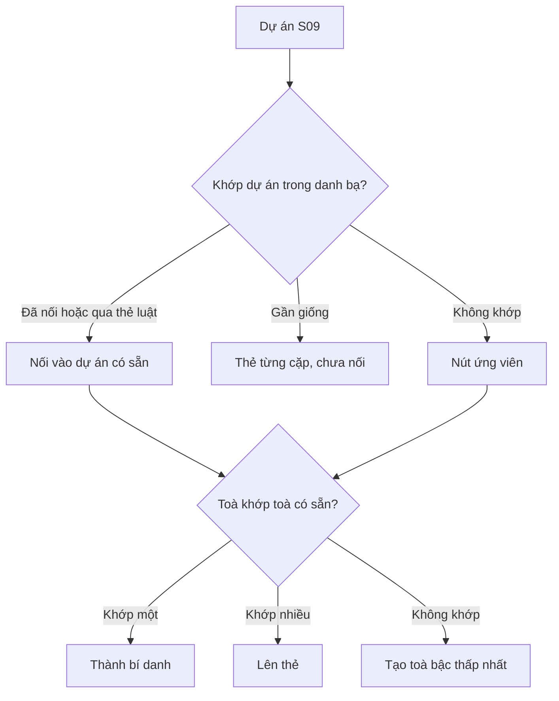

# Thiết kế DA42 — dự án, toà, tầng và thấp tầng S09 vào danh bạ

> **Sửa phạm vi 19/11 (Mạnh: «Chỉ làm cao tầng»):** lượt này chỉ làm dự án, toà và tầng. Khu và căn thấp tầng trong tài liệu này để dành cho lượt sau khi có bản thu bù; bản thu 19/11 có 32.602/72.374 căn và 48/91 khu bị cắt ở 500 căn.

Ngày 18/11/2026. Hàng DA42 `nap-s09-toa-tang-vao-danh-ba`, hạng T3, đợt `danh-ba-can-s09-1811`. Tài liệu dừng ở Cổng Phạm vi: chưa có
mã thi công, migration thật hay lượt ghi DB máy thu.

## 1. Kết luận

- Gói 1 của S09 (dự án, toà, tầng, khu và căn thấp tầng) nạp vào stg qua migration 115, rồi vào danh bạ.
- Toà trùng S16, S08 thành bí danh của toà có sẵn; ở dự án có S16 thì S16 thắng về cấu trúc.
- Dự án S09 không khớp dự án nào thành **nút ứng viên** theo lời Hỏi-2: thấy trên Ops, chưa nối tin, chưa lên Invest cho tới khi qua thẻ luật.
- Danh sách tầng của hàng này là căn cứ để DA43 biết một toà đã thu đủ tầng hay chưa.

## 2. Phụ thuộc

- Thi công sau khi DA37 vào `main` và gói 1 về máy thu. Migration số 115 đã giữ.
- Mã toà của đường gói 1 khác `block_id` của bản thu 13/11. Hàng này nối hai mã qua tên toà trong cùng dự án và ghi bí danh cho mã mới;
  DA43 dựa vào bí danh đó.
- DA18 (nút ứng viên từ tin) chưa làm. Hàng này chỉ tạo nút ứng viên từ danh mục S09 theo luật mục 44 của ROADMAP.

## 3. Bản thu gói 1 mong đợi

| Cấp | Trường cần | Dùng để |
|---|---|---|
| Dự án | mã (uuid) | Khoá nối |
| Toà | mã (uuid), tên | Nối toà, bí danh |
| Tầng | mã (uuid), tên nguyên văn, mã toà | Danh sách tầng cho DA43 |
| Khu thấp tầng | mã (uuid), tên, mã dự án | Nút khu |
| Căn thấp tầng | mã (uuid), tên, mã căn | Căn và bí danh |

Manifest có băm từng tệp và số đếm từng cấp. Thấp tầng trả theo trang: mỗi khu phải ghi tổng số căn nguồn báo, để biết đã lấy đủ các trang.

## 4. Bảng phủ ca

Số đo trên DB máy thu ngày 18/11, chỉ đọc, từ bản thu 13/11 (344 dự án). Số của gói 1 là **số làn thu đo**, chốt lại khi gói 1 về.

| # | Chiều | Giá trị | Số | Xử lý | Ai đọc đầu ra |
|---|---|---|---:|---|---|
| 1 | Dự án S09 | Đã nối danh bạ | 2 | Đi tiếp toà, tầng, khu | `/ops/registry`, DA43 |
| 2 | Dự án S09 | Trùng tên đúng một dự án có sẵn | 9 | Thẻ luật theo nguồn, Mạnh xem mẫu | Người duyệt, DA43 |
| 3 | Dự án S09 | Tên gần giống | 35 | Thẻ từng cặp, chưa nối | Người duyệt |
| 4 | Dự án S09 | Không thấy dự án nào | 298 | Nút ứng viên | `/ops/registry`, DA43 |
| 5 | Dự án S09 | Không có toà | 2 | Nút ứng viên, 0 toà | `/ops/registry` |
| 6 | Toà S09 | Đã có bí danh theo mã cũ | 176 dòng, 175 toà | Nối mã mới về đúng toà cũ | DA43 |
| 7 | Toà S09 | Trùng tên trong cùng dự án | 93 dòng | Lên thẻ, không tự gộp | Người duyệt |
| 8 | Toà trong danh bạ | Tổng hiện có | 307 toà | Không đổi cột gốc của toà có sẵn | `/ops/registry` |
| 9 | Gói 1 | Toà | 928 (số làn thu) | Bí danh hoặc tạo mới | `/ops/registry`, DA43 |
| 10 | Gói 1 | Tầng | 23.708 (số làn thu) | Lưu ở stg | DA43 |
| 11 | Gói 1 | Khu thấp tầng | 91 (số làn thu) | Theo Hỏi-1 | `/ops/registry` |
| 12 | Gói 1 | Căn thấp tầng | Chưa đo | Theo Hỏi-1, trùng thành bí danh | `/ops/registry`, gắn căn tin rao |
| 13 | Căn có sẵn | Căn không trục, phần lớn là thấp tầng | 28.259 | So theo mã căn đã chuẩn hoá | Bước khử trùng |

**Ngoài phạm vi, vì:** căn cao tầng (DA43) · nối tin vào nút ứng viên (cần thẻ luật) · đưa nút ứng viên lên Invest (mục 44) · thuộc
tính căn (nguồn không trả) · lên cloud (ba bảng vật thể chưa đồng bộ).

## 5. Cách làm

Đã cân nhắc, không chọn: mỗi nhà thấp tầng một toà (đúng ADR-0016 nhưng căn thấp tầng S16, S08 đang nằm dưới một toà gom nên không khử
trùng được); so toà chỉ bằng tên (hai toà thật cùng tên ở hai phân khu sẽ bị gộp, nên so thêm số tầng).

## 6. Đặc tả UX

Hàng không đổi mã giao diện. Trang `/ops/registry` đọc số dự án, toà, căn từ danh bạ nên số tự đổi sau khi dựng.
