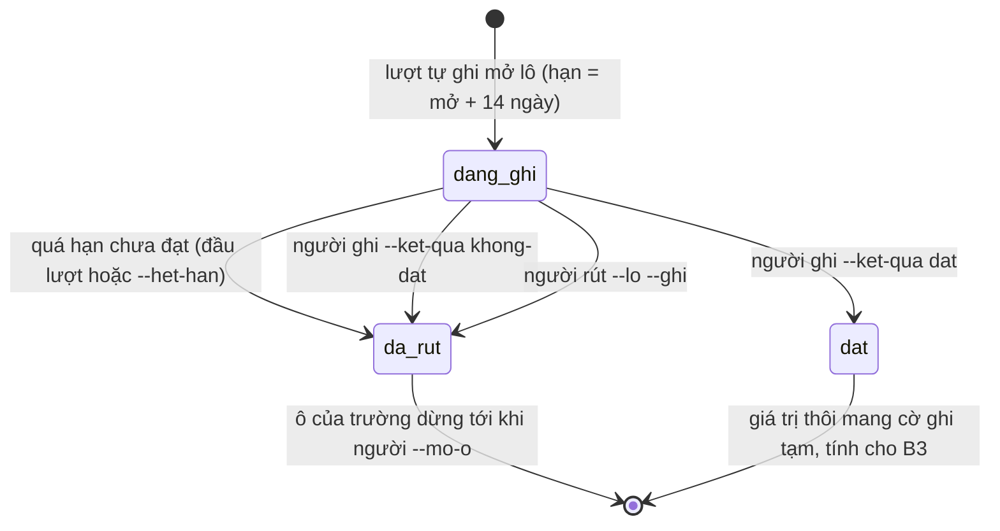

# NB10 · ghi-tam-do-sau-co-han — ghi tạm, đo sau, có hạn

Hàng NB10 (đợt `phe-duyet-may-2411`, ROADMAP §3 mục 63 quyết định 3, sửa mục 19 Q5). Hạng T3 (chạm `db/migrations/**`).
Dãy N1, đợt `dot0-cam-mau`. Trang tri thức: `wiki/dot/phe-duyet-may-2411.md` (kho `onehub-invest-tri-thuc`).

## 1. Vì sao

Bộ làm giàu đã tự ghi 2.290 giá trị khi luật (E1) và model (E2) cùng đáp án, ở ô chưa đo. Mạnh chốt (24/11, «Chốt cả ba»):
máy được tự ghi trước khi ô có số đo khi đủ bốn điều kiện — (1) hai phiếu độc lập trùng nhau; (2) mỗi đợt ghi có mã lô và
lệnh rút cả lô; (3) giá trị ghi tạm không tính là «đã đo», không làm căn lên bậc B3; (4) đo bù trong hai tuần, không đạt hay
quá hạn thì ô tự tụt và rút lô. Lượt hằng đêm đứng từ 23/11 và chờ hàng này («Chờ sửa xong», 03:35Z): lời nhắc của nó đưa
sẵn đáp án của luật nên phiếu model chưa độc lập. NB11 (#537) chặn tạm đường tự áp của lượt đêm; hàng này gỡ chốt chặn ấy
và thay bằng cổng ghi tạm.

## 2. Bảng phủ ca (đếm trên DB máy thu 26/11 ~20:30 VN, chỉ đọc)

Đơn vị: giá trị trong `enrichment_proposals` (status `applied`, route `corroborated`), trừ dòng ghi rõ khác.

| Chiều | Giá trị | Số trong ô | Ai đọc đầu ra này phía sau | Phủ bởi |
|---|---|---|---|---|
| Lượt ghi × trường | đọc toàn bộ × loại hình (Haiku 5.5, 03–05/11) | 1.993 | Hàng duyệt, B0–B2, lô đo bù loại hình | AC-4 |
| | hằng đêm × loại hình (qwen27b, 30/10–21/11) | 187 | như trên; lô «trước độc lập» | AC-4 |
| | hằng đêm × toà (`block_raw`) | 110 (108 căn cứ e1, 2 căn cứ danh bạ) | khoá căn, ghép toà, lô đo bù toà (chưa bài nhãn nào nối được → hết hạn thì tự rút) | AC-4, AC-6 |
| | đọc toàn bộ × toà | 0 | — | ngoài phạm vi: không có ca |
| Tin mang giá trị tự ghi | S03 / S05 | 2.231 / 16 tin (2.251 tin khác nhau, mọi tin đang chào) | trang tin, sync cloud | AC-5 (rút đưa về đúng như trước) |
| Trạng thái rút | đã rút | 0 | — | AC-5 (ca rút đầu tiên dựng bằng bản chép) |
| Bậc căn B3–B5 (`unit_data_level()`) | căn có tin mang giá trị tự ghi | 0 (hàm trả 0 dòng: chưa tin S03/S05/S06 nào gắn căn danh bạ) | thước bậc `/ops`, B3 | AC-8 dựng bằng ca cấy; số thật hôm nay là 0 |
| Đường gọi sau hàng này | lượt hằng đêm (`enrich-run`, Haiku 5.5 từ MH1) | 0 đề xuất từ 24/11 (đứng) | — | AC-1, AC-2, AC-9 |
| | lượt đọc toàn bộ (`doc-toan-bo`) | lượt cũ đã xong | — | AC-9 |
| Tồn của lượt đêm | tin S03 thiếu loại hình hoặc toà, chưa thử trong 30 ngày | 3.563 (thiếu loại hình 677, thiếu toà 4.479) | trần `ENRICH_LIMIT` 50 lời gọi/đêm; đo 14–21/11: 29–63 tin/đêm | Hỏi-1 |
| Lời nhắc đêm | dòng mang đáp án luật | 2 dòng: «Loại hình từ nhóm», «Mã tòa phát hiện» (`agent/src/agents/enrich-text.ts:60–61`) | model E2 | AC-1 |
| Direct E1 (luật một mình) | loại hình 37 · toà 11 | 48 | — | ngoài phạm vi: một phiếu, không phải đường «luật và model trùng nhau»; mục 63 không nói tới |
| Review người đã áp | 2 | 2 | — | ngoài phạm vi: người quyết, không phải tự ghi |

## 3. Thiết kế

### 3.1 Phiếu thứ hai độc lập (AC-1, AC-2)
- `buildEnrichInput` bỏ hai dòng đáp án của luật («Loại hình từ nhóm», «Mã tòa phát hiện»), giữ tên dự án, ứng viên dự án và
  khu vực. Căn cứ: `bat_khi` của hàng («lời nhắc của lượt hằng đêm không còn mang loại hình và mã toà của luật»).
- Một hàm thuần `phieuDocLap(input)` kiểm chuỗi lời nhắc thật sự gửi đi: có dấu đáp án của luật → không độc lập. Bên gọi model
  trả kèm lời nhắc đã gửi; bộ chạy ghi `evidence.doc_lap` và băm lời nhắc. Phiếu không độc lập thì đề xuất trùng luật đi thẻ
  (route `review`, căn cứ cũ ở `evidence.trung_luat` — giữ khuôn của NB11), không ghi.

### 3.2 Lô ghi tạm (AC-3, AC-4)
- Migration 129: bảng `ghi_tam_lo` (mã lô, trường, lượt nguồn, độc lập hay không, ai ghi, model, nấc, mở lúc, hạn đo bù, kết
  quả đo bù `chua-do|dat|khong-dat`, trạng thái `dang-ghi|dat|da-rut`, ai/khi nào đổi) và hai cột trên `enrichment_proposals`:
  `lo_id` (khoá ngoài) và `ghi_tam` (cờ «chưa đo»). Một lô cho mỗi (lượt × trường): toà rút riêng được như mục 63 đòi.
- Điền lùi trong cùng migration, chạy lại không đổi: `doc-toan-bo-loai-hinh` (1.993), `truoc-doc-lap-loai-hinh` (187),
  `truoc-doc-lap-toa` (110) — 297 giá trị của lượt đêm ở hai lô «trước độc lập». Hạn đo bù = ngày áp migration + 14 ngày
  (mục 63: «Hạn đo bù tính hai tuần từ ngày NB10 được áp lên máy thu»).
- Mỗi lượt ghi về sau: bộ chạy mở (hoặc dùng lại) lô `<run_id>:<trường>`, ghi `ai ghi` = `enrich-run:<run_id>`, model, nấc của ô
  (Hỏi-2), hạn = ngày mở + 14.

### 3.3 Cổng ghi tạm thay chốt chặn NB11 (AC-9)
- Gỡ `chanTuApCanCu` khỏi lượt đêm (`run.ts` ghi «Gỡ hàm này khi NB10 làm phiếu thứ hai độc lập»). Thay bằng: đề xuất
  `corroborated` chỉ được áp khi phiếu độc lập VÀ ô của trường đang mở; áp thì mang `lo_id` + `ghi_tam`. Mọi đường gọi
  `runEnrich` (đêm và đọc toàn bộ) đi qua cùng cổng — không đường nào áp corroborated mà thiếu lô.

### 3.4 Rút lô (AC-5)
- `pipeline/scripts/rut-lo-ghi-tam.mjs --lo <mã> [--ghi] --nguoi hitl:<tên> --ly-do <…>`: mặc định chạy thử, in số; `--ghi` gọi
  `revert_enrichment` trên mọi đề xuất `applied` của lô (giữ luật 066: ô về giá trị kế có căn cứ, mở lại đề xuất superseded,
  `ops_audit`), đặt lô `da-rut`. Chạy lại: 0 thay đổi.

### 3.5 Tự tụt (AC-6, AC-7)
- Đầu mỗi lượt, bộ chạy xét các lô `dang-ghi`: quá hạn mà chưa đạt, hoặc người đã ghi `khong-dat` → ô (trường) dừng ghi,
  lượt báo trong tổng kết, và lô bị rút bằng actor máy `may:ghi-tam:<lý do>`. `revert_enrichment` hiện chỉ nhận `hitl:`;
  migration 129 thêm một hàm bọc chỉ nhận actor `may:ghi-tam:` cho đề xuất thuộc lô ghi tạm (không nới cho đề xuất khác).
- Kết quả đo bù do người ghi (thước NB2 chưa dựng): `rut-lo-ghi-tam.mjs --ket-qua <lô> dat|khong-dat --nguoi hitl:<tên>`.
  `dat` → lô thôi ghi tạm (cờ `ghi_tam` về false cho giá trị của lô). Ô đã dừng chỉ mở lại bằng lệnh người `--mo-o <trường>`.

### 3.6 Không làm căn lên B3 (AC-8)
- Migration 129 thay `unit_data_level()`: tin có trường lõi (loại hình) đến từ đề xuất ghi tạm còn sống thì không tính là đủ
  trường lõi ở B3–B5. Bậc của tin (B0–B2) không đổi.

### 3.7 Áp lên máy thu (AC-10)
Năm thứ trong hồ sơ: lệnh áp (migration 129 từ `main`), số chạy thử trên bản chép DB máy thu (ba lô, 2.290 giá trị, hạn), sao
lưu trước (`pg_dump` hai bảng `enrichment_proposals`, `ghi_tam_lo` không tồn tại trước), cách lùi (khối lùi trong migration:
gỡ cột, bảng, trả hàm 066), lệnh kiểm sau.

## 4. Câu cho Mạnh (Cổng Phạm vi)
- **Hỏi-1 — trần lời gọi đêm** (tiền): giữ `ENRICH_LIMIT` 50/đêm (khuyên; tồn 3.563 tin, ~40 tin/đêm → khoảng ba tháng) hay
  nâng. Trần nằm ở script nạp hằng ngày của S03 — làn ZCode; nâng thì là việc giao riêng.
- **Hỏi-2 — nấc ghi trên dòng lô**: ghi nấc hiện có của ô (1, máy nháp người duyệt) kèm cờ ghi tạm (khuyên; mục 63 «ghi tạm
  không phải lên nấc») hay thêm một giá trị nấc riêng cho ghi tạm.
- **Hỏi-3 — bật lại tự ghi đêm** (khó đảo: giá trị chưa đo ra trang tin): ngay khi NB10 được áp (khuyên, mục 63 «cho tới khi
  NB10 được áp lên máy thu») hay chờ lô đo bù đầu tiên có kết quả.
- **Hỏi-4 — tự rút lô** (khó đảo: đổi giá trị ô trên tin đang chào, nới luật «chỉ người hoàn tác» cho một lối hẹp): máy tự rút
  bằng actor `may:ghi-tam:` chỉ cho đề xuất ghi tạm (khuyên, mục 63) hay máy dừng ô và báo, người gõ lệnh rút.
- **Hỏi-5 — đơn vị lô**: một lô mỗi (lượt × trường) (khuyên: mỗi lô một hạn, một kết quả, một lệnh rút) hay một lô mỗi lượt,
  mọi lệnh lọc theo trường.

§3.5 bổ sung: ngoài đầu mỗi lượt, lệnh `rut-lo-ghi-tam.mjs --het-han` xét hạn độc lập với lượt (lượt đêm từng đứng nhiều
ngày); nối nó vào lịch hằng ngày là việc giao làn ZCode sau gộp. §3.1 bổ sung: `phieuDocLap` cũng coi lời nhắc mang danh sách
toà hay mã toà là không độc lập ở trường toà; lời nhắc đêm chỉ giữ tên dự án, ứng viên dự án, khu vực.

## 5. Ngoài phạm vi
- Lô đo bù và thẻ cài (phiên gắn nhãn của Mạnh); lên nấc chính thức (chữ ký từng ô, mục 61).
- Thước đo bù tự động từ nhãn (cần lớp xuất xứ nhãn NB2).
- Direct E1 một phiếu (48 giá trị) và đường đọc gộp S03.
- Đổi trần `ENRICH_LIMIT` trong script của làn ZCode.

## Đặc tả UX
Bỏ — hàng không chạm giao diện (sổ quyết định: «bỏ đặc-tả-UX»).

## Hình — vòng đời lô ghi tạm (Hỏi-4)

