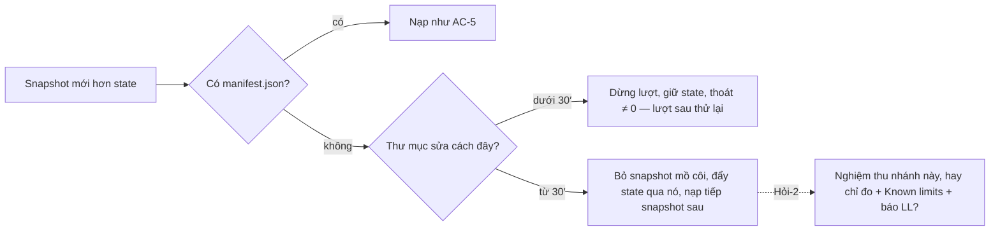

# audit-p1-resilience-do-tren-main — đưa thước ZC3 lượt nạp hằng ngày về đo được main

Hàng `audit-p1-resilience-do-tren-main` (dãy P2), cắt ngày 10/11: «zc3_import_daily khác gốc (đỏ từ 25/10)».
Hồ sơ dùng lại là `_acceptance/audit-p1-resilience` (ZC3, Mạnh ký 23/10, T3). Vòng này chỉ sửa thước
`scripts/audit-p1-resilience/acceptance.mjs` và vật hồ sơ. Nó KHÔNG sửa `scripts/zalo-import-daily.sh`, vì đó là tệp làn ZCode.

## 1. Đo trên main 1c3293fab (27/11, sandbox cô lập)

| Thước | Kết quả |
|---|---|
| l4b-scan, gateway, l4a-drop, l5b-db | PASS |
| import-daily | FAIL 13 mục |

Hai gốc, đều là thước lạc hậu; hành vi của script không hỏng:

1. **Cổng manifest (cb174db1b, 25/10, 2510-8, «snapshot nguyên tử»).**
   - Script coi snapshot thiếu `manifest.json` là chưa xong:
     - dưới 30′ thì giữ state, dừng chuỗi (`FAILED=1`);
     - từ 30′ trở lên thì bỏ snapshot mồ côi, đẩy state qua nó và đi tiếp.
   - Fixture của thước dựng thư mục rỗng, nên cả bốn ca dừng ở snapshot đầu. Đây là 9 trong 13 mục đỏ.
   - Thêm manifest vào fixture (đo tay trên bản chép) thì ca 2 và ca 4 xanh trọn.
2. **Chuỗi sau nạp lớn ra.**
   - Script nay source `scripts/lib/job-step.sh` (#471).
   - Sau nạp, script chạy thêm `phuong-tu-du-an`, `transform-media`, `xep-hang-gia`, `doc-gop-hang-ngay.sh` (`doc_gop_run`) và
     `enrich-run` (`cd agent && node --import tsx scripts/enrich-run.ts`).
   - Sandbox chỉ chép một tệp và giả lập đúng hai bước, nên gặp `job_run: command not found` (mã 127), rồi `JOB_RC: unbound
     variable`. Ca 1 và ca 3 vì thế đỏ.

Tiền lệ cùng ca: `au3-nap-bao-loi#d-20261031T030339Z-1` (lời người). Harness AU3 bắt kịp main bằng gói tsx rỗng và
`enrich-run.ts` giả ghi lời gọi, rồi thêm `manifest.json` cho fixture. Ngưỡng và ý nghĩa mọi ca giữ nguyên.

## 2. Cách sửa thước

- **Fixture:** mỗi snapshot có `manifest.json`. Ca cổng manifest dựng snapshot thiếu manifest và đặt mtime bằng `utimesSync`:
  - 5′ trước: «chưa xong»;
  - 45′ trước: «mồ côi».
- **Bước sau nạp đọc từ script lúc chạy, không chép tay tên.**
  - Thước quét văn bản `zalo-import-daily.sh`, lấy mọi đường `"$ROOT/<…>.(mjs|sh|ts)"` cùng ca `cd "$ROOT/agent" && … scripts/<…>.ts`.
  - Đường là thư viện được source (`. "$ROOT/scripts/lib/…"`) thì CHÉP bản thật vào sandbox.
  - Đường là bước thì sinh một bản giả. Bản giả chỉ ghi `<đường>` vào `calls.log`. `import-airbnb.mjs` vẫn theo kế hoạch ok, lỗi
    hay ECONNREFUSED như cũ.
  - Gói tsx rỗng ở `agent/node_modules/tsx` để `node --import tsx` chạy được bản giả `.ts`.
  - Script có đường `$ROOT/…` mà thước không xếp được vào «thư viện» hay «bước» thì thước dừng, thoát 3 và gọi tên đường ấy.
    Như vậy lần chuỗi lớn thêm, thước nói ra thay vì đỏ mù.
- **Cô lập:**
  - Mọi lượt chạy với HOME giả dưới `os.tmpdir()`. Trước khi spawn, thước ném lỗi (thoát 2, thông điệp ghim) nếu HOME của lượt bằng
    `os.homedir()` hoặc không nằm dưới thư mục tạm của lượt.
  - `launchctl`, `pkill`, `pgrep`, `osascript`, `curl`, `sleep` vẫn là stub thắng PATH (`assertStubsWin` có sẵn).
  - Không đọc `~/.openclaw`, không gọi gateway.
  - Lượt import-daily KHÔNG dùng spool nào: script không có spool. «Cô lập spool» ở đây là kiểm không có đường nào ngoài
    sandbox trong `calls.log` và trong đường giả `$ROOT`.
- **Đối chứng của chính thước (chiều đỏ), chạy trong cùng mode** (chi tiết ở §2b, §2c):
  - HOME thật → thước từ chối, đúng thông điệp ghim;
  - bản chép script có thêm một dòng `buoc … node "$ROOT/pipeline/buoc-la.mjs"` → thước vẫn sinh bản giả cho nó, và ca 1 thấy
    lời gọi `pipeline/buoc-la.mjs`, chứng danh sách đọc từ script;
  - bản chép thêm một đường `$ROOT/khong-xep-duoc.bin` → thoát 3, gọi tên;
  - bỏ manifest khỏi một snapshot của ca 1 → ca 1 đỏ.

## 2b. Ma trận dạng gọi (đếm trên `scripts/zalo-import-daily.sh` của main 1c3293fab, 27/11)

`grep -o '$ROOT…'` đếm được 16 lần. Mọi lần đều ở dạng `"$ROOT/<đường>"` liền một chuỗi. Không có dạng nháy tách, biến trung gian
gán từ `$ROOT`, hay `cd "$ROOT/<thư mục>" && node <tương đối>` nào khác ngoài `agent`.

| Lớp | Đường (số lần) | Thước xử lý |
|---|---|---|
| thư viện source | `scripts/lib/job-step.sh` (1) | chép bản thật |
| bước chạy (`node`/`bash` + đường) | `pipeline/import-airbnb.mjs` (1, theo kế hoạch ca), `transform-zalo.mjs`, `scripts/phuong-tu-du-an.mjs`, `transform-media.mjs`, `refresh-bait-gap.mjs`, `xep-hang-gia.mjs`, `doc-gop-hang-ngay.sh` (mỗi tệp 1) | bản giả ghi một dòng `calls.log` |
| thư mục `cd` rồi tệp tương đối | `agent` (1) + `scripts/enrich-run.ts` (bước `enrich_run`) | bản giả `agent/scripts/enrich-run.ts` + gói tsx rỗng |
| tệp dữ liệu, sổ | `pipeline/logs/*.state` (3), `.env` (2), `collector/snapshots` (2) | dựng trong sandbox, không giả lập |
| còn lại | 0 | thoát 3, gọi tên đường |

- Mỗi lớp được thước nhận ra bằng luật, không bằng tên: thư viện là đường đứng sau `. `; bước là đường đuôi
  `.mjs`/`.sh`/`.ts` đứng sau `node`/`bash`; thư mục `cd` là đường đứng sau `cd ` mà sau `&&` có một đường tương đối đuôi
  `.ts`/`.mjs`; dữ liệu là đường dưới `pipeline/logs/`, `collector/` hoặc `.env`.
- Thước còn kiểm thêm: tổng số lần `$ROOT` trong văn bản phải bằng tổng các lớp. Lệch thì thoát 3, in lần `$ROOT` không lớp nào
  nhận.
- Ca đường xanh assert số dòng bước trong `calls.log` bằng số bước sau nạp đếm từ script. Mỗi bước một lời gọi.
- Đối chứng đỏ, mỗi dạng thước không nhận ra một ca, đều phải thoát 3 gọi tên:
  - bước dạng `cd "$ROOT/pipeline" && node buoc.mjs`;
  - đường lạ `"$ROOT/khong-xep-duoc.bin"`.

## 2c. Cô lập (AC-8)

- Môi trường của lượt dựng từ đầu, không kế thừa: `HOME` và `TMPDIR` là thư mục con của sandbox; `PATH` gồm stub, node, `/usr/bin`,
  `/bin`; không có `DATABASE_URL`, `PG*`, `ANTHROPIC*`, `AI_GATEWAY*`. Script tự đặt `DATABASE_URL` mặc định, nhưng không bản giả
  nào kết nối. `psql` là stub ghi `calls.log`.
- Bản chép script được thêm đúng một dòng đầu: tạo tệp đánh dấu `spawned` trong sandbox. Dòng này dùng để chứng «không spawn».
- Hai đối chứng, mỗi đối chứng một chuỗi ghim riêng:
  - `HOME` = `os.homedir()` → «từ chối: HOME của lượt là HOME thật»;
  - `HOME` = `/var/empty` → «từ chối: HOME ngoài thư mục tạm của lượt».
  - Cả hai đều phải: tệp `spawned` vắng, thoát 2.
- Sau mỗi ca: không có tệp mới trong cây kho thật (`git status --porcelain` của kho trước và sau như nhau), và `calls.log` không có
  đường ngoài sandbox hay chuỗi `.openclaw`.

## 3. Bậc

Tệp đổi là `scripts/audit-p1-resilience/acceptance.mjs` và `_acceptance/audit-p1-resilience/**`. Không tệp nào trúng 16 mẫu
`risk_tiers.t3_paths`, nên máy xếp **T2**. Hồ sơ gốc Mạnh ký T3 ngày 23/10, vì vật khi ấy là `scripts/zalo-watchdog.sh`. Việc hạ bậc
trình thành câu hỏi có tên ở Cổng Phạm vi (GS 27/11). Mạnh muốn giữ T3 thì đổi lại và đi Cổng 1.5. Lúc làm mà phải chạm một tệp
trúng `t3_paths` → dừng, báo GS, bậc về T3.

## 4. Hành vi sai thật

Nếu khi đo lộ hành vi sai thật của script (ví dụ ca «chưa xong» thoát 0), vòng KHÔNG sửa script. Vòng ghi Known limits và báo GS
để chuyển LL (làn ZCode).

## 5. Hình: lượt nạp gặp snapshot thiếu manifest (Hỏi-2)

